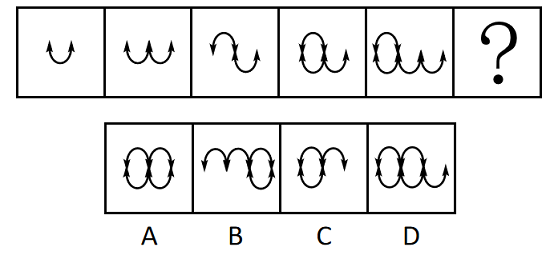

# 数量规律-元素换算（等价替换：图1+图3=2×图2）

考点：[[20-考点/判断推理/图形推理/数量规律-元素换算（等价替换：图1+图3=2×图2）|图形推理 / 数量规律-元素换算（等价替换：图1+图3=2×图2）]]

**问法模型**：‘选择最合适的一个填入问号处使之呈现规律性’且图形由两种小元素混杂构成、整体个数无直接规律 → 元素换算模型：先用‘图1+图3=2×图2’求两种元素等价比，统一当量后看等差，再逐项换算验证选项。

## 推理链
1. 第1步：题干五个图形均由两种小元素构成——带箭头的闭环‘○’与带箭头的开口弧‘∪’，直接数整体元素的种类和个数无规律（既有○又有∪，混杂出现）。
2. 第2步：元素组成不同且无明显属性规律，优先考虑数量规律；图形呈递变趋势且含两种元素，套用元素换算公式‘图1+图3=2×图2’。
3. 第3步：代入图形——图1（1个∪）+图3=2×图2（图2含2个∪），解得换算比：1个'○'=2个'∪'，即可把闭环统一折算为开口弧。
4. 第4步：统一当量后，题干五图折算值依次为1、2、3、4、5，构成公差为1的等差数列，故'？'处折算后应为6个当量。
5. 第5步：逐项换算对照：仅A项折算后当量为6，B、C、D三项折算后均不为6，排除。
6. 第6步：核验干扰解法——若只数箭头，题干为2、3、4、5、6，'？'应为7对应D；但箭头只是图形的部分元素（存在重合可能），整体元素换算规律优先于部分规律，故定答A。

**最快解法**：⚡ 元素换算口诀法：'图1+图3=2×图2'→解得1个○=2个∪→换算后数列为1、2、3、4、5→？=6→排除法唯一锁定A。

## 易错点
- ⚠ 只数箭头（部分元素）落入解法二陷阱：箭头2→7虽成等差并指向D，但属部分规律，整体换算规律优先，且箭头可看作重合，不能作为定位规律。
- ⚠ 不会建换算等式或把换算比搞反：应牢记常用公式'图1+图3=2×图2'，由该式解出两元素等价比，而非随意假设。
- ⚠ 得出换算比后不逐项验证选项：必须把四个选项统一折算成同一当量再比数值，不能凭'形状长得像'直接选。

## 母题抽象
> 🧩 当题干图形由两种小元素混杂构成、直接数个数无规律但整体呈递变趋势时，用'图1+图3=2×图2'求换算比，统一当量验证等差数列，再逐项折算选唯一符合项；同时警惕'只数某一种局部元素'形成的竞争规律（部分规律让位于整体规律）。

**同类特征**：图形由两种小元素（○闭环与∪开口弧）混杂构成、整体元素种类和数量无直接规律、图形呈连续递变趋势、含箭头元素形成部分规律干扰、元素组成不同且无属性规律、换算后呈等差数列1、2、3、4、5、6

## 相关题
- [[10-真题/判断推理/图形推理/10204622 图形推理-数量规律-笔画数（一笔画判定）|10204622]]（辽宁 2024，相关度1）
- [[10-真题/判断推理/图形推理/11367773 数量规律-一笔画（奇点数）+面的形状（三角形面个数）双规律|11367773]]（江苏 2025，相关度1）
- [[10-真题/判断推理/图形推理/12019817 数量规律-面的细化（面的形状：所有面均为四边形）|12019817]]（浙江 2026，相关度1）
- [[10-真题/判断推理/图形推理/13504266 数量规律-交点数（曲直交点数量+交点形态交替规律）|13504266]]（云南 2025，相关度1）
- [[10-真题/判断推理/图形推理/13504600 数量规律-多边形元素边数递减（等差数列）|13504600]]（辽宁 2025，相关度1）

---

### 题干

从所给四个选项中，选择最合适的一个填入问号处，使之呈现一定的规律性：

### 选项
- A. A
- B. B
- C. C
- D. D

### 官方解析

解法一：元素组成不同，且无明显属性规律，优先考虑数量规律。观察发现，题干图形均由和2种小元素构成，但整体小元素的种类和数量无规律，考虑元素换算。根据换算公式“图1+图3=2×图2”得出：1个=2个，换算后题干图形的数量分别为1、2、3、4、5，故“？”处图形应有6个，换算后只有A项符合。

解法二：元素组成不同，且无明显属性规律，优先考虑数量规律。观察发现，题干出现多个箭头，考虑箭头数量，题干图形箭头数量依次为2、3、4、5、6，故“？”处图形应有7个箭头，只有D项符合。

注：解法一的元素换算针对的是图形整体，解法二的箭头数量针对的是部分图形，在图形规律中整体规律优于部分规律，且解法二的部分箭头可看作箭头重合，故粉笔更倾向于解法一。

故正确答案为A。

### 给定材料
（无）

> [!note] 复核版本状态
> 原题不可计分（underdetermined；来源记录的答案键/竞争项：A、D）；仅当前明确标注的编辑版按答案A计分。
> 详细原题疑点、修订题面、解析和证据见下方独立复核记录。

<!-- CODEX-ANSWER-REVIEW:BEGIN -->
### 本次独立复核

**复核结论：** `resolved`（答案与解析已核定）

**原题计分状态：** 不计分（`underdetermined`：原题证据不足以唯一判定）。来源中记录的答案键/竞争项：A、D；这些记录不代表原题已核准答案。

**原题疑点与处理：**

甘肃 2023 〔20-考点/判断推理/图形推理/数量规律-元素换算（等价替换：图1+图3=2×图2）〕 — 官方解析自身列出两个结论冲突的解法（解法一→A，解法二→D），最终以‘整体规律优于部分规律’‘部分箭头可看作重合’作倾向性取舍，属命题争议点而非可更正的硬性错误…

**当前计分版本：** 明确标注的编辑版；未列出的题干、材料或选项沿用固定题源。答案不回填为原题答案。

**计分答案：** A（可计分）

**复核解析：**

【编辑修订版】按题干整体元素等价关系进行换算，比较图形总元素组成；不要只依据箭头数量单独归类。依此检查前三图和后续图形，只有A符合整体换算关系。原解析第二种只数箭头的规律会指向D，题面未指定规则时存在歧义；修订版明确本题采用的整体换算标准。

**修订题干：**

【编辑修订版】把每个闭环“○”折算为2个开口弧“∪”；按图形整体折算当量，题干序列依次为1、2、3、4、5。问号处应选择整体当量为6的图形，不单独按箭头数量判定。

**相关信息：**

图形推理—元素换算；同一组图形可存在局部规律，修订版指定整体等价关系作为判定标准。

**核对依据与来源边界：**

- 固定题源：[原题文件](https://github.com/Mentat-Uran/kaogongzhentizhengliu/blob/84ab93d4b64b61d897bece8a1c0a5bab06b4feb2/10-%E7%9C%9F%E9%A2%98/%E5%88%A4%E6%96%AD%E6%8E%A8%E7%90%86/%E5%9B%BE%E5%BD%A2%E6%8E%A8%E7%90%86/5509799%20%E6%95%B0%E9%87%8F%E8%A7%84%E5%BE%8B-%E5%85%83%E7%B4%A0%E6%8D%A2%E7%AE%97%EF%BC%88%E7%AD%89%E4%BB%B7%E6%9B%BF%E6%8D%A2%EF%BC%9A%E5%9B%BE1%2B%E5%9B%BE3%3D2%C3%97%E5%9B%BE2%EF%BC%89.md)；内容版本 `84ab93d4b64b61d897bece8a1c0a5bab06b4feb2`，源 Markdown blob `dda8b33a4af5fd0b5fa0b43ff665ef8434f48c49`.
- **核心依据：** 原解析列出整体等价规律和单独箭头计数两种规律，分别指向A与D；编辑版明确采用整体等价规律。
- 固定题图/公式图：`90-图片/题目图/18688c496859d64.png`, `90-图片/题目图/18688c8a12783d3.png`, `90-图片/题目图/18688c8c676d876.png`, `90-图片/题目图/18688c8f9e55d8d.png`, `90-图片/题目图/18688c91f263b26.png`, `90-图片/题目图/18688c949489598.png`, `90-图片/题目图/18688c9721cebfd.png`.

<!-- CODEX-ANSWER-REVIEW:END -->
