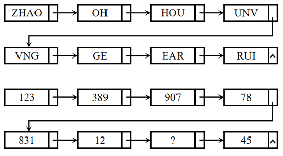

# 图形推理-规律类（字符-数字首尾衔接接龙规律）

考点：[[20-考点/判断推理/图形推理/图形推理-规律类（字符-数字首尾衔接接龙规律）|图形推理 / 图形推理-规律类（字符/数字首尾衔接接龙规律）]]

**问法模型**：箭头串联的方框序列填问号使之呈现规律性 → 验证相邻方框'前一框最右字符=后一框最左字符'的接龙规律，用问号两侧相邻框锁定答案

## 推理链
1. 第1步：题干分上下两组，第一组为字母方框链 ZHAO→OH→HOU→UNV→（跨行箭头）→VNG→GE→EAR→RUI，第二组为数字方框链 123→389→907→78→（跨行箭头）→831→12→？→45
2. 第2步：先在字母组验证规律——ZHAO 最右字母 O 是 OH 最左字母，OH 最右 H 是 HOU 最左，HOU 最右 U 是 UNV 最左，UNV 最右 V 恰是跨行后 VNG 最左，即'前框最右字符与后框最左字符重合'的接龙规律
3. 第3步：数字组套用同一规律——123 最右 3 是 389 最左，389 最右 9 是 907 最左，907 最右 7 是 78 最左，78 最右 8 是 831 最左（跨行箭头处同样成立）
4. 第4步：由 831 最右 1 = 12 最左可推，12 最右的数字 2 必为 ？处的最左数字
5. 第5步：再向后看，？的最右数字必等于 45 最左的 4，故 ？应形如'2_4'
6. 第6步：逐项对照——A.254 首位 2、末位 4 符合；B.235 末位 5 不符；C.432 首位 4 不符；D.215 末位 5 不符
7. 第7步：只有 A 同时满足首 2 尾 4，故选 A

**最快解法**：⚡ 接龙链定位法：不必逐框验证全链，直接看问号左右两框——左框'12'末位为 2 → 问号首位是 2；右框'45'首位为 4 → 问号末位是 4，锁定 2_4 即 A。

## 易错点
- ⚠ 只检查同一行内相邻框的衔接，忽略跨行箭头（UNV→VNG、78→831）同样遵循接龙规律，可能误判规律不成立
- ⚠ 把方框间的数字误当作加减运算关系（如 123→389 硬找和差），陷入数量运算陷阱
- ⚠ 只验证问号首位是 2 而不核对末位与 45 的衔接，遇到另一个 2 开头的干扰项会误选

## 母题抽象
> 🧩 当题干出现箭头串联的方框字符/数字链时，先在第一组验证'前框最右字符=后框最左字符'的接龙规律（含跨行箭头），再用问号两侧相邻框的首尾字符双向锁定答案，排除其余选项。

**同类特征**：箭头串联的方框序列、字母组与数字组上下两组对照、相邻方框首尾字符重合（接龙）、链中跨行换行箭头、问号位于数字链中段、选项为三位数

## 相关题
（暂无）

---

### 题干

从所给四个选项中，选择最合适的一个填入问号处，使之呈现一定的规律性：

### 选项
- A. 254　✅
- B. 235
- C. 432
- D. 215

### 官方解析
题干图形分为上下两组，观察发现，第一组图形均为字母，且沿箭头方向前一个图形中最右边的字母都在相邻的后一个图形的最左边。第二组图形均为数字，且沿箭头方向前一个图形中最右边的数字都在相邻的后一个图形的最左边，依此规律，？处所填数字最左边应为2，最右边应为4，只有A项符合。
故正确答案为A。

### 给定材料
（无）
