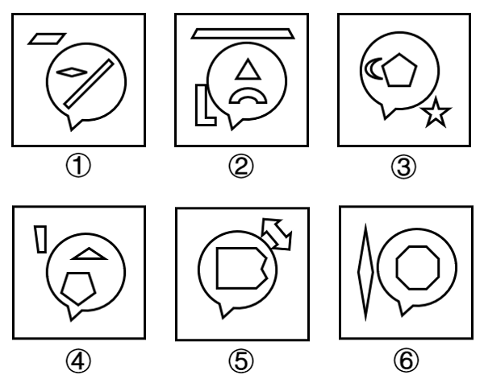

# 数量规律-元素个数（框内外分开数并做数量运算）

考点：[[20-考点/判断推理/图形推理/数量规律-元素个数（框内外分开数并做数量运算）|图形推理 / 数量规律-元素个数（框内外分开数并做数量运算）]]

**问法模型**：六个图形分两类且各有共同规律 → 优先整体属性/数量规律，本题每图均有外框，采用'内外分开数元素'再比较或作差的分类模型

## 推理链
1. 第1步：观察题干，元素组成不同且无明显属性（对称/曲直/开闭）规律，转入数量规律；每幅图都含一个'气泡'外框，框内外分布多个独立小元素
2. 第2步：每图恰有一个外框，采用'内外分开看'：分别数框外独立元素个数与框内独立元素个数，注意斜线、弧形、箭头等线状图形也各计为1个元素，外框自身不计
3. 第3步：逐图计数——图①框外1个（平行四边形）、框内2个（菱形+斜线）；图②框外2个（梯形长条+L形）、框内2个（三角形+弧形）；图③框外1个（五角星）、框内2个（月牙+五边形）
4. 第4步：继续计数——图④框外1个（小矩形）、框内2个（三角形+五边形）；图⑤框外1个（双向箭头）、框内1个（切角矩形）；图⑥框外1个（梭形）、框内1个（八边形）
5. 第5步：对两组数做运算比较：图①③④均为'框内数-框外数=1'（2-1=1），图②⑤⑥均为'框内数=框外数'（2=2、1=1）
6. 第6步：与选项对照，①③④一组、②⑤⑥一组，对应B项

**最快解法**：⚡ 内外分开数元素法：先数框外元素（依次为1、2、1、1、1、1），再数框内元素（依次为2、2、2、2、1、1），作差发现①③④'内-外=1'、②⑤⑥'内=外'，直接锁定B

## 易错点
- ⚠ 只数个数不做运算：单独看框外数（1、2、1、1、1、1）或框内数（2、2、2、2、1、1）均无分组规律，必须内外数量进行运算比较
- ⚠ 被局部规律带偏：框外直线数（①④⑥为4、②③⑤为10）也能分成两组对应D项，但该规律只关注局部，不及内外元素运算整体严谨，考场上若两条规律冲突，优先整体性规律
- ⚠ 漏数线状/异形元素：斜线、月牙、弧形、双向箭头等非封闭图形同样各算1个独立元素，漏数会导致内外计数错位

## 母题抽象
> 🧩 当题干每幅图都包含一个外框（如气泡框）且框内外散布独立小元素时，用'内外分开数元素个数→做差或比较相等'的方法分类，整体数量运算规律优先于只看局部的线段数等规律

**同类特征**：六个图形分两类、每图均有一个气泡状外框、框内外散布多个独立小元素、出现斜线、月牙、箭头等线状异形元素、单独数内外个数无规律、需内外数量运算分组

## 相关题
- [[10-真题/判断推理/图形推理/13504389 图形推理-笔画数（奇点数定一笔画-多笔画）|13504389]]（云南 2025，相关度1）
- [[10-真题/判断推理/图形推理/15137567 数量规律-线与面的数量做差运算（直线数-面数量）|15137567]]（湖北 2024，相关度1）
- [[10-真题/判断推理/图形推理/16593026 图形推理-对称性（轴对称判定，阴影斜线计入图形的干扰）|16593026]]（河北 2024，相关度1）
- [[10-真题/判断推理/图形推理/2423318 数量规律-面的位置关系（封闭面与外框是否相连）|2423318]]（甘肃 2019，相关度1）
- [[10-真题/判断推理/图形推理/2579760 图形推理-对称性（对称轴数量分组）|2579760]]（浙江 2020，相关度1）

---

### 题干

把下面的六个图形分为两类，使每一类图形都有各自的共同特征或规律，分类正确的一项是：

### 选项
- A. ①②④，③⑤⑥
- B. ①③④，②⑤⑥　✅
- C. ①③⑤，②④⑥
- D. ①④⑥，②③⑤

### 官方解析
思路一：元素组成不同，且无明显属性规律，考虑数量规律。观察发现，题干图形出现多个独立小元素，优先考虑元素的个数和种类，继续观察发现，题干每幅图形均出现一个外框，考虑内外分开看。其中，框外元素的数量依次为1、2、1、1、1、1，框内元素的数量依次为2、2、2、2、1、1，单独看数量无规律，但图①③④中，框内元素数-框外元素数=1，图②⑤⑥中，框内元素数=框外元素数。即图①③④一组，图②⑤⑥一组。
故正确答案为B。
思路二：元素组成不同，且无明显属性规律，考虑数量规律。观察发现，题干出现明显多边形，优先考虑直线数，继续观察发现，题干每幅图形均出现一个外框，考虑内外分开看。图①④⑥框外直线数为4，图②③⑤框外直线数为10。即图①④⑥一组，图②③⑤一组。
故正确答案为D。
注：观察图形规律时，应优先观察整体性规律，框外直线数只关注到图形中的局部，相比框外直线数的规律，考虑框内外元素数量间的运算更全面更严谨，故粉笔更倾向于思路一。

### 给定材料
（无）

<!-- CODEX-ANSWER-REVIEW:BEGIN -->
### 本次独立复核

**复核状态：** `resolved`（答案与解析已核定）

**计分答案：** B（可计分）

**复核解析：**

【编辑修订版】本题只比较每个图形框内与框外的元素数量关系，不按元素位置、方向或线条样式归类。按该数量分组，选项B对应的分类使各组内关系一致。

**修订题干：**

【编辑修订版】请只依据各图形框内与框外的元素数量关系进行分类，忽略元素位置和线条方向等其他特征。分类正确的一项是：

**相关信息：**

图形推理—元素数量；将框内和框外分别计数，排除位置等并行图形规律。

**题源依据：** [固定版本原题](https://github.com/Mentat-Uran/kaogongzhentizhengliu/blob/84ab93d4b64b61d897bece8a1c0a5bab06b4feb2/10-%E7%9C%9F%E9%A2%98/%E5%88%A4%E6%96%AD%E6%8E%A8%E7%90%86/%E5%9B%BE%E5%BD%A2%E6%8E%A8%E7%90%86/5509864%20%E6%95%B0%E9%87%8F%E8%A7%84%E5%BE%8B-%E5%85%83%E7%B4%A0%E4%B8%AA%E6%95%B0%EF%BC%88%E6%A1%86%E5%86%85%E5%A4%96%E5%88%86%E5%BC%80%E6%95%B0%E5%B9%B6%E5%81%9A%E6%95%B0%E9%87%8F%E8%BF%90%E7%AE%97%EF%BC%89.md)；固定内容 commit `84ab93d4b64b61d897bece8a1c0a5bab06b4feb2`，Markdown blob `01a10f2cc9b3a1cce37382bcede18782489cc43f`。
<!-- CODEX-ANSWER-REVIEW:END -->
