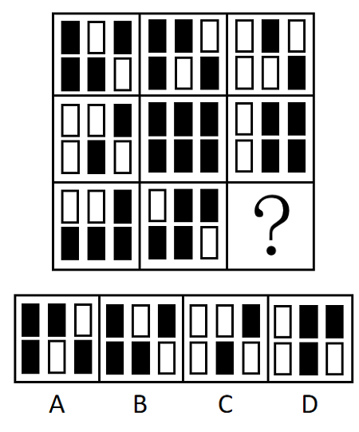
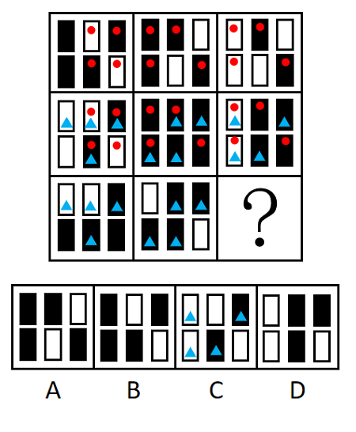

# 样式规律-相邻比较（黑白块逐位置比对的'四同两异'数量规律）

考点：[[20-考点/判断推理/图形推理/样式规律-相邻比较（黑白块逐位置比对的'四同两异'数量规律）|图形推理 / 样式规律-相邻比较（黑白块逐位置比对的'四同两异'数量规律）]]

**问法模型**：九宫格问'呈现一定规律性'且黑白块数量、位置均无规律 → 横行无规律转纵向，对同列相邻两图逐位置比较，统计相同/不同位置的个数

## 推理链
1. 第1步：提取图形信息——九宫格每格均为2×3骨架的黑白小块，黑块数量、白块数量及整体位置在横行上均无规律。
2. 第2步：转换视角——九宫格横行无规律时按官方思路'考虑纵向观察'，对每一列内相邻两图按6个位置逐一比对黑白。
3. 第3步：第一列验证——图1[黑,白,黑/黑,黑,白]与图2[白,白,黑/白,黑,白]仅第1、4两个位置黑白互换，其余4个位置相同，即'四同两异'；图2与图3[白,白,黑/黑,黑,黑]同样仅第4、6位置不同，仍为四同两异。
4. 第4步：第二列验证——图1[黑,黑,白/黑,白,黑]与图2全黑仅第3、5位置不同，图2全黑与图3[白,黑,黑/黑,黑,白]仅第1、6位置不同，均为四同两异，规律成立。
5. 第5步：应用规律——问号处应与第三列图2（第二行第三格：[白,黑,黑/白,黑,黑]）恰有4个位置相同、2个位置不同。
6. 第6步：逐项对照——A与之仅2同4异，B仅2同4异，D达5同1异，只有C[白,白,黑/白,黑,白]与之恰在第2、6两个位置不同（四同两异），故选C。

**最快解法**：⚡ 相邻比较法：九宫格纵向看，每列相邻两图恰有且仅有2个位置黑白互换（四同两异）；直接将第三列图2（第二行第三格）与四个选项逐位置比对，数出黑白不同的位置数，只有C恰好差2个位置。

## 易错点
- ⚠ 只统计黑白块数量或寻找位置平移/叠加规律，忽略'相邻两图逐位置比对'这一考点，导致横行、整体都找不到规律
- ⚠ 横行无规律后未及时切换为纵向视角，或比较对象找错——应与第三列图2（第二行第三格）比，而非与第三列图1比
- ⚠ 数错相同/不同位置的个数，把D的'五同一异'或A、B的'两同四异'误当作符合规律

## 母题抽象
> 🧩 当九宫格每格由黑白小元素按固定骨架排布，且数量、位置、叠加均无规律时，转为同列相邻两图逐位置比对，常考'恰有N个位置不同'（本题N=2，四同两异）的数量规律。

**同类特征**：九宫格、每格为2×3黑白小方块固定骨架、黑白块数量与位置无规律、横行看无规律、需纵向相邻比较、四同两异

## 相关题
- [[10-真题/判断推理/图形推理/10204610 样式规律-加减同异（去同存异），九宫格列规律|10204610]]（辽宁 2024，相关度1）
- [[10-真题/判断推理/图形推理/10297349 样式规律-黑白运算|10297349]]（浙江 2025，相关度1）
- [[10-真题/判断推理/图形推理/10297407 样式规律-黑白运算（定义叠加）|10297407]]（四川 2025，相关度1）
- [[10-真题/判断推理/图形推理/10975255 数量规律-元素个数与部分数（黑白球连通堆数）|10975255]]（江苏 2024，相关度1）
- [[10-真题/判断推理/图形推理/11367791 属性类-对称性（对称轴方向与条数、轴对称+中心对称）＋数量类-面数量（九宫格横行复合规律）|11367791]]（江苏 2025，相关度1）

---

### 题干

从所给的四个选项中，选择最合适的一个填入问号处，使之呈现一定的规律性：

### 选项
- A. A
- B. B
- C. C　✅
- D. D

### 官方解析

观察发现，题干图形均出现黑块与白块，但数量、位置等均无规律，九宫格横行看无规律时，考虑纵向观察。将第一列的图1和图2相邻比较发现，两幅图中含有四个相同的图形和两个不同的图形（如下图标红处所示），将第一列的图2和图3相邻比较发现，两幅图中也含有四个相同的图形和两个不同的图形（如下图标蓝处所示）。在第二列进行验证，符合此规律。故？处图形应与第三列的图2含有四个相同的图形和两个不同的图形，只有C项符合。

故正确答案为C。

### 给定材料
（无）
