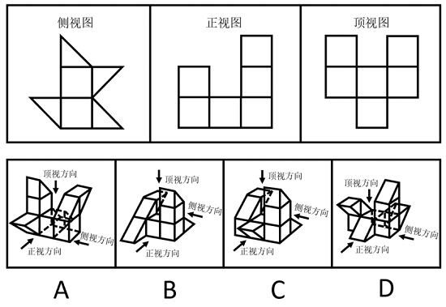
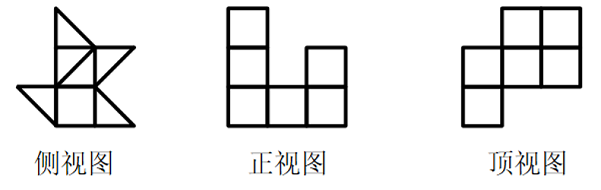
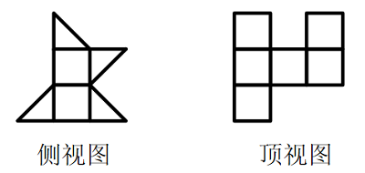

# 三视图匹配（立体图形与其侧视图-正视图-顶视图的对应还原）

考点：[[20-考点/判断推理/图形推理/三视图匹配（立体图形与其侧视图-正视图-顶视图的对应还原）|图形推理 / 三视图匹配（立体图形与其侧视图/正视图/顶视图的对应还原）]]

**问法模型**：题干给出某立体的侧视图、正视图、顶视图，要求从四个立体图形中选出相符项 → 按每个选项图中标注的'正视方向、侧视方向、顶视方向'箭头作三面投影，与题干三视图逐一比对排除

## 推理链
1. 第1步：从题干侧视图提取轮廓特征——中部为正方形，顶部接一个三角形，底部左右各伸出一个三角形（'上三角+中方+下双三角翼'结构）
2. 第2步：从题干正视图提取轮廓特征——三列矩形堆叠，中列最矮（1层）、左列居中（约2层）、右列最高，列内含分层横线，外轮廓无斜面
3. 第3步：从题干顶视图提取轮廓特征——俯视投影为6个正方形组成的对称十字/凸形轮廓（上排2格、中排3格、下排中间1格）
4. 第4步：解题方法——三视图逐一投影比对：对A、B、C、D分别按图中标注的视向箭头画出侧视、正视、顶视投影再对照题干
5. 第5步：验证A项——其侧视图、正视图与题干不符（三角翼位置朝向或列高分布对不上），排除
6. 第6步：验证B项——其侧视图、顶视图与题干不符，排除
7. 第7步：验证C项——侧视图、正视图和顶视图均与题干相符，当选
8. 第8步：验证D项——其侧视图、顶视图与题干不符，排除；综上正确答案为C

**最快解法**：⚡ 区分度排序法+排除法：题干侧视图轮廓最特殊（顶部三角+中部方+底部左右双三角翼），先用侧视图扫描四个选项，A、B、D的侧向投影均与该'双三角翼'轮廓对不上而快速排除，再用顶视图（6格对称轮廓）和正视图（三列左中右高度差）复核锁定C

## 易错点
- ⚠ 忽视选项立体图中标注的'正视/侧视/顶视方向'箭头，凭习惯视角投影，方向一错全盘皆错
- ⚠ 只比对投影外轮廓、忽略视图内部的分层横线与方格分界，把高度不一致误判为相符
- ⚠ 侧视图左右方向镜像混淆，把底部三角翼的左右位置看反，误选与正确项呈镜像关系的选项

## 母题抽象
> 🧩 当题干给出'侧视图+正视图+顶视图'求匹配立体图形时，先挑轮廓最复杂、区分度最高的视图作第一轮排除，再按选项标注的观察方向用其余视图复核，三个视图全部吻合才可当选

**同类特征**：侧视图/正视图/顶视图三图并列、立体图形还原匹配、选项标注'正视方向/侧视方向/顶视方向'箭头、立体由立方块与楔形（三棱柱）组合、需逐项投影排除

## 相关题
（暂无）

---

### 题干

下方为某一立体图形的侧视图、正视图和顶视图，请从下列选项中选出与之符合的一项：

### 选项
- A. A
- B. B
- C. C　✅
- D. D

### 官方解析

A项：选项的侧视图、正视图、顶视图如下图所示，与题干不符，排除；

B项：选项的侧视图、顶视图如下图所示，与题干不符，排除；

C项：选项的侧视图、正视图和顶视图，均与题干相符，当选；

D项：选项的侧视图、顶视图如下图所示，与题干不符，排除。

故正确答案为C。

### 给定材料
（无）
