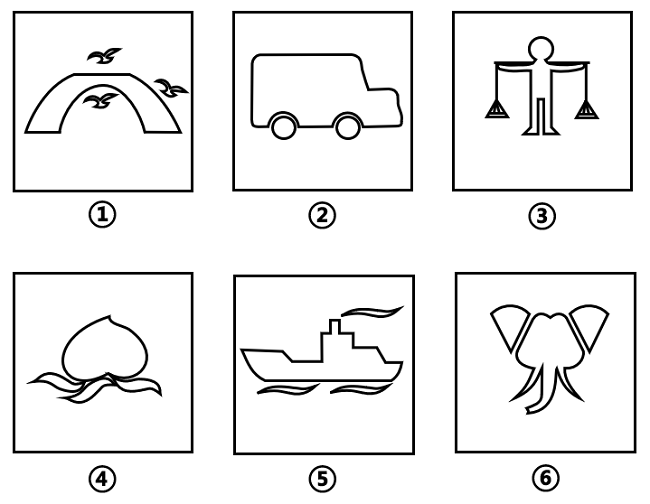

# 图形推理-数量规律（相同小元素的个数）

考点：[[20-考点/判断推理/图形推理/图形推理-数量规律（相同小元素的个数）|图形推理 / 图形推理-数量规律（相同小元素的个数）]]

**问法模型**：六个图形分为两类使每类有共同规律 → 分组分类题，元素组成不同且无属性规律时，转数量规律，多个相同小元素优先数相同元素的个数

## 推理链
1. 第1步：观察六图，每幅图均由一个主体轮廓加若干重复出现的小元素构成：图①主体为拱桥、重复小元素为飞鸟，图②主体为卡车、重复小元素为车轮，图③主体为人、重复小元素为扁担两端的秤盘，图④主体为桃子、重复小元素为叶瓣，图⑤主体为轮船、重复小元素为水波线，图⑥主体为象/章鱼形、重复小元素为扇形耳
2. 第2步：六图元素组成不同，对称、曲直、封闭等属性规律不明显，按'属性不通找数量'的思路，且题干每幅图都有多个相同小元素，优先考虑相同元素的个数
3. 第3步：逐图计数相同小元素：图①飞鸟3只、图④叶瓣3片、图⑤水波——注意图⑤实际为2条相同水波，重新核对：图①3只鸟、图②2个轮子、图③2个秤盘、图④3片叶、图⑤2条水波、图⑥2个扇形耳
4. 第4步：按相同元素个数分组：①④⑤均为3个，②③⑥均为2个，与选项C'①④⑤，②③⑥'完全吻合

**最快解法**：⚡ 元素计数法（数相同小元素个数）：快速扫视每幅图，圈出重复出现的小元素并计数——①鸟3、②轮子2、③秤盘2、④叶3、⑤波2、⑥耳2，得①④⑤一组（3个）、②③⑥一组（2个），直接选C

## 易错点
- ⚠ 被生活化主体轮廓（桥、卡车、人、桃、船）吸引，去找'实物类别'或主体形状规律，漏看真正考点是重复小元素
- ⚠ 把小元素的分布位置（如上/下、左/右对称）或笔画、封闭面个数误当作分类依据，偏离'相同元素个数'主线
- ⚠ 图③的秤盘、图⑥的扇形耳与主体相连，轮廓交织易漏数或多数一个

## 母题抽象
> 🧩 当分组分类题六图元素组成不同、属性规律不明显，且每幅图都含若干相同小元素时，用'数相同元素个数'分组验证（如3个一组、2个一组）

**同类特征**：分组分类（六图分两类）、元素组成不同、无明显属性规律、每图含一个生活化主体轮廓、每图有重复出现的相同小元素、相同元素个数为2或3、官方解析指向数量规律

## 相关题
- [[10-真题/判断推理/图形推理/2434290 数量规律-线数量（直线数与曲线数做差运算）|2434290]]（新疆 2019，相关度2）
- [[10-真题/判断推理/图形推理/11454021 数量规律-小元素个数与边数的等量关系（叠加白色同形区域验证）|11454021]]（选调 2024，相关度1）
- [[10-真题/判断推理/图形推理/1752676 数量规律-交点数（分组分类）|1752676]]（北京 2016，相关度1）
- [[10-真题/判断推理/图形推理/19283883 分组分类-特殊元素位置规律（正方形居中-居边）|19283883]]（国考 2025，相关度1）
- [[10-真题/判断推理/图形推理/19283956 数量规律-笔画数（一笔画与多笔画）|19283956]]（国考 2025，相关度1）

---

### 题干

把下面的六个图形分为两类，使每一类图形都有各自的共同特征或规律，分类正确的一项是：

### 选项
- A. ①②④，③⑤⑥
- B. ①③⑥，②④⑤
- C. ①④⑤，②③⑥　✅
- D. ①⑤⑥，②③④

### 官方解析
本题为分组分类题目。元素组成不同，且无明显属性规律，考虑数量规律。题干每幅图形都有多个相同小元素，优先考虑相同元素的个数。图①④⑤中相同元素的个数均为3，图②③⑥中相同元素的个数均为2，即图①④⑤为一组，图②③⑥为一组。
故正确答案为C。

### 给定材料
（无）
