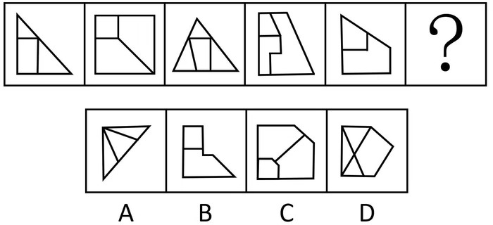

# 数量规律-面的细化（最小面形状与外框形状一致）

考点：[[20-考点/判断推理/图形推理/数量规律-面的细化（最小面形状与外框形状一致）|图形推理 / 数量规律-面的细化（最小面形状与外框形状一致）]]

**问法模型**：'选择最合适的一个填入问号处使之呈现规律性'+五幅连排图 → 优先数面，面数量无规律时转向面的细化，找最小面并与外框比对形状

## 推理链
1. 第1步：题干五幅图均为'外框+内部切割线'结构，封闭区域（面）特征明显，优先考虑面数量
2. 第2步：整体数各图面数量，无恒定常数或等差规律，需对'面'做细化考查
3. 第3步：细化方向锁定'最小面'：图2左上角最小面为小正方形，与外框正方形形状一致；图3上部最小面为小三角形，与外框三角形形状一致
4. 第4步：验证其余图形，图1、图4、图5的最小面同样与各自外框形状一致，归纳规律：'每幅图最小面的形状与外框形状一致'
5. 第5步：逐项对照：A项最小面与三角形外框形状不一致，B项外框为带台阶的凹多边形而最小面为小矩形，D项外框为五边形而内部最小面为三角形，均排除
6. 第6步：C项外框为切角五边形，其左下角最小面也是同形状的切角五边形，最小面与外框一致，符合规律，故选C

**最快解法**：⚡ 面的细化口诀（数面无规律→找最小面）：直接观察每幅图最小的封闭面，比对其与外框形状是否一致；C项左下角最小面与外框同为切角五边形，秒选C

## 易错点
- ⚠ 只停留在整体数面，发现面数量无规律后无从下手或误选面数量相近的选项
- ⚠ 细化时习惯看'最大面'或数面的形状种类，漏掉'最小面与外框形状'这一高频细化角度
- ⚠ C项外框是切掉一个角的五边形，易误看成普通四边形，从而误判最小面与外框不一致而排除C

## 母题抽象
> 🧩 当题干图形呈'外框+内部线分割、封闭面明显但面数量无规律'时，改用面的细化——找出每图最小面（或最大面），验证其与外框的形状/属性是否一致，据此匹配选项

**同类特征**：封闭面明显、外框+内部切割线、面数量无规律、存在最小面、最小面与外框形状一致

## 相关题
- [[10-真题/判断推理/图形推理/10297262 数量规律-面的形状种类（封闭面种类数分组）|10297262]]（浙江 2025，相关度1）
- [[10-真题/判断推理/图形推理/11367791 属性类-对称性（对称轴方向与条数、轴对称+中心对称）＋数量类-面数量（九宫格横行复合规律）|11367791]]（江苏 2025，相关度1）
- [[10-真题/判断推理/图形推理/12019817 数量规律-面的细化（面的形状：所有面均为四边形）|12019817]]（浙江 2026，相关度1）
- [[10-真题/判断推理/图形推理/13504389 图形推理-笔画数（奇点数定一笔画-多笔画）|13504389]]（云南 2025，相关度1）
- [[10-真题/判断推理/图形推理/16070143 图形间关系（面的分隔与相交）＋内部线条部分数-笔画数|16070143]]（贵州 2026，相关度1）

---

### 题干

从所给四个选项中，选择最合适的一个填入问号处，使之呈现一定的规律性：

### 选项
- A. A
- B. B
- C. C　✅
- D. D

### 官方解析
题干图形封闭面明显，考虑面数量，整体数面无规律，但面数量特征图形明显，考虑面的细化，观察发现，题干图形均有最小面，且最小面形状和外框形状一致，只有C项符合。
故正确答案为C。

### 给定材料
（无）
