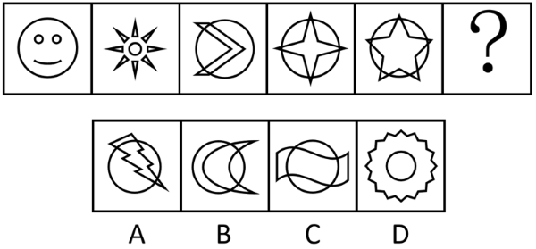

# 属性规律-对称性（轴对称与中心对称的奇偶交替）

考点：[[20-考点/判断推理/图形推理/属性规律-对称性（轴对称与中心对称的奇偶交替）|图形推理 / 属性规律-对称性（轴对称与中心对称的奇偶交替）]]

**问法模型**：“最符合所给图形规律的是”＋五幅图＋问号 → 奇偶位置分组找对称属性交替规律

## 推理链
1. 第1步：元素组成不同，题干五图依次为笑脸、八角太阳、箭头弧线、圆内四角星、圆内五角星，问号居第6位
2. 第2步：图形较规整且出现明显的等腰元素（星形、箭头、太阳），优先考虑对称性属性规律
3. 第3步：看奇数项——图一（笑脸，仅一条竖直对称轴）、图三、图五（五角星5重对称）均仅为轴对称图形，旋转180°不与自身重合
4. 第4步：看偶数项——图二（八角太阳，8重旋转对称）、图四（圆内四角星，4重旋转对称）既是轴对称又是中心对称图形
5. 第5步：归纳出奇偶交替规律：奇数位'仅轴对称'，偶数位'轴＋中心双对称'，问号在偶数位，应填双对称图形
6. 第6步：逐项验证——A圆内闪电无对称性；B双月牙组合、C波浪穿圆（S形波仅中心对称）均不具备'既轴又中心'双重属性
7. 第7步：D项锯齿圆环（齿轮状）＋内部圆，既有多条对称轴，旋转180°又与自身重合，符合双对称，当选

**最快解法**：⚡ 奇偶间隔看对称＋旋转180°验证法：奇数项全为'仅轴对称'→问号（偶数位）找'轴＋中心双对称'项，将选项图形在脑中旋转180°，只有D（齿轮外圈＋内圆）与原图重合，直接锁定D

## 易错点
- ⚠ 只验证'是否轴对称'而不加验中心对称，误选B等仅具单一对称属性的选项
- ⚠ 忽略奇偶交替规律，试图给五幅图找统一对称属性，因图二、图四与图一、三、五属性不同而卡壳
- ⚠ 把C的波浪/S形误判为轴对称——S形曲线是中心对称而非轴对称；五角星（图五）也仅轴对称、非中心对称

## 母题抽象
> 🧩 当题干图形规整、元素组成不同且出现星形/太阳/齿轮等强对称元素时，按奇偶位置分组比较'轴对称'与'中心对称'属性，问号处填与同奇偶位置图形一致的对称类型（用旋转180°是否重合快速验证）

**同类特征**：元素组成不同、图形规整、等腰/星形元素明显、奇偶位对称属性交替、问号位于第6位（偶数位）、需区分轴对称与中心对称双重属性

## 相关题
- [[10-真题/判断推理/图形推理/11367775 属性规律-对称性（对称轴数量等差递减）|11367775]]（江苏 2025，相关度2）
- [[10-真题/判断推理/图形推理/15833781 属性规律-对称性（轴对称与中心对称组合分组）|15833781]]（内蒙古 2026，相关度2）
- [[10-真题/判断推理/图形推理/2295537 图形推理-对称性（对称轴数量规律）|2295537]]（上海 2019，相关度2）
- [[10-真题/判断推理/图形推理/2448498 属性规律-对称性（对称轴与图形要素的关系：穿线 vs 穿点）|2448498]]（国考 2020，相关度2）
- [[10-真题/判断推理/图形推理/2670590 属性规律-对称性（轴对称+对称轴方向为竖直）|2670590]]（选调 2019，相关度2）

---

### 题干

下列选项最符合所给图形规律的是：

### 选项
- A. A
- B. B
- C. C
- D. D　✅

### 官方解析
元素组成不同，优先考虑属性规律。题干图形较规整，且出现明显的等腰元素，优先考虑对称性。观察发现，图一、图三、图五均仅为轴对称图形；图二、图四既是轴对称又是中心对称图形，故“？”处应该填入一个既是轴对称又是中心对称的图形，只有D项符合。
故正确答案为D。

### 给定材料
（无）
