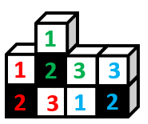
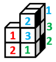

# 立体拼合-小方块组合（基本块切分验证）

考点：[[20-考点/判断推理/图形推理/立体拼合-小方块组合（基本块切分验证）|图形推理 / 立体拼合-小方块组合（基本块切分验证）]]

**问法模型**：‘最不可能由三个左侧图形构成’的选非问法 → 将各选项整体切分为3个与题干全等的L形三连块（黑面方位可随旋转变换），切不出3块的即为答案

## 推理链
1. 第1步：题干立体图形由3个小方块构成'L'形（底层2块+上层拐角1块），且仅一个正方形面为黑色（位于底层拐角块正面）
2. 第2步：问法为选非题，各选项均由9个小方块组成，需验证能否恰好切分为3个与题干全等的L形三连块，黑面位置可通过整体位置变换对齐
3. 第3步：A项：左下角与中部两块可直接切出2个题干块，右下角块经位置变换后黑面与题干一致，可得第3个，排除
4. 第4步：B项：右侧两块经位置变换切出2个题干块；第一层标2的小方块黑面朝内不可见，其内侧再补1块（标3）构成第3个题干块，排除
5. 第5步：C项：上方块切出1个题干块，右侧块经变换得1个；标2的小方块黑面朝内，其内侧补1块（标3）构成第3个题干块，排除
6. 第6步：D项：左下角块可切出1个题干块，右侧块经变换得1个；但由题干黑面位置限定，拼法唯一，第三层（从下往上数）的2个小方块无法与内部方块再拼成L形三连块，切不出第3个题干块
7. 第7步：故只有D不能由三个题干图形构成，当选

**最快解法**：⚡ 切分验证法（黑面定位口诀）：以黑色面为锚点，把每个选项的9块切成3个'L三连块'；注意黑面可'朝内隐藏'（B、C即靠隐藏黑面拼成），而D项按黑面唯一拼法只能切出2块、顶层剩余2块孤立不成L形，直接锁定D

## 易错点
- ⚠ 忽视黑色面方位对拼法的约束，误以为任意朝向的L三连块都能拼入（实际黑面使拼法唯一）
- ⚠ 漏掉'黑面朝内、不可见'的隐藏拼法，误判B或C不能拼成
- ⚠ 被外轮廓迷惑：D项外观规整看似可拼，必须实际切分验证而非凭直观轮廓判断

## 母题抽象
> 🧩 当题干给出'由n个小方块组成且含特征面（黑色面）的基本块，问最不能/能拼成哪个整体'时，用切分验证法：以特征面方位为锚把整体切成若干全等基本块（含黑面朝内的隐藏拼法），切不出基本块的那个整体即为答案

**同类特征**：立体拼合、L形三连块（3方块基本单元）、单个黑色特征面、选非问法（最不可能构成）、整体由9个小方块组成、黑面朝内的隐藏拼法

## 相关题
- [[10-真题/判断推理/图形推理/2776149 图形推理-立体拼合（小方块计数守恒+分层形状咬合）|2776149]]（浙江 2021，相关度1）
- [[10-真题/判断推理/图形推理/10204640 立体拼合（多面体组合：数量守恒+凹凸互补+旋转）|10204640]]（河南 2024，相关度1）
- [[10-真题/判断推理/图形推理/12019797 立体拼合-由两视图及全等小块反推小立体（数小立方体+旋转试装）|12019797]]（浙江 2026，相关度1）
- [[10-真题/判断推理/图形推理/12536475 图形推理-立体拼合（正方体堆叠多面体组合）|12536475]]（四川 2024，相关度1）
- [[10-真题/判断推理/图形推理/12881949 立体拼合-多块拼合正方体（凹凸互补+旋转）|12881949]]（广东 2025，相关度1）

---

### 题干

左侧立体图形仅有图中所示的一个正方形面为黑色，则下列选项最不可能由三个左侧图形构成的是（    ）。

### 选项
- A. A
- B. B
- C. C
- D. D　✅

### 官方解析

本题考查立体拼合。题干立体图形由3个小方块组成，分别标1、2、3，如下图所示。

A项：如下图所示，左下角和中间的立体图形（分别标记为红色、绿色）可以拼成2个题干中的立体图形，右下角的立体图形（标记为蓝色）可通过位置变换得到题干中的立体图形，排除；

B项：如下图所示，右侧的立体图形（分别标记为蓝色、绿色）可以通过位置变换拼成2个题干中的立体图形，在第一层（从下往上数）标2（标记为红色，此时黑面朝内，无法看到）的小方块的内侧可以有另外一个小方块（标记应为3），组合拼成题干中的立体图形，排除；

C项：如下图所示，上方的立体图形（标记为绿色）可以拼成1个题干中的立体图形，右侧的立体图形（标记为蓝色）可通过位置变换得到题干中的立体图形，在第一层（从下往上数）标2（标记为红色，此时黑面朝内，无法看到）的小方块的内侧可以有另外一个小方块（标记应为3），组合拼成题干中的立体图形，排除；

D项：如下图所示，左下角的立体图形（标记为绿色）可以拼成1个题干中的立体图形，右面的立体图形（标记为蓝色）可通过位置变换得到题干中的立体图形，但根据题干图形的特征及黑面的位置，只存在图示中唯一的拼法。此时第三层（从下往上数）的2个小方块无法和内部的其他方块拼成题干中的立体图形，当选。

本题为选非题，故正确答案为D。

### 给定材料
（无）
