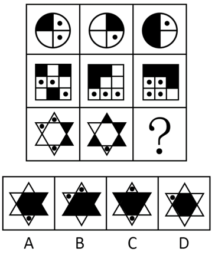

# 样式规律-黑白运算（黑-白-点三色叠加）

考点：[[20-考点/判断推理/图形推理/样式规律-黑白运算（黑-白-点三色叠加）|图形推理 / 样式规律-黑白运算（黑/白/点三色叠加）]]

**问法模型**：“下列选项最符合所给图形规律的是”+九宫格求问号 → 横向逐行做黑白（点）叠加运算，用前两行归纳规则、第三行应用对照选项。

## 推理链
1. 第1步：观察九宫格，每行三个图形外轮廓完全相同（第一行为四分圆、第二行为3×3方格、第三行为六角星），内部为黑白填充且夹带小圆点，元素组成相似→优先考虑样式规律。
2. 第2步：轮廓相同而填色不同→考虑黑白运算；九宫格优先横向观察，将每行三个图形同一位置的颜色进行叠加。
3. 第3步：用第一行归纳叠加规则：左上角黑+白=黑，右上角点+黑=点，右下角点+点=白，再验证得黑+黑=黑、白+黑=黑。
4. 第4步：第二行验证规则成立：左上白+黑=黑，带点位置与黑叠加仍为点，无点位置白+白=黑、白+黑=黑，两行规则一致。
5. 第5步：汇总规则口诀：凡无“点”参与的组合一律得黑（黑+黑=黑、黑+白=黑、白+黑=黑、白+白=黑）；点+点=白；点+黑=点、点+白=点、黑+点=点、白+点=点。
6. 第6步：第三行六角星逐区域应用：中心区域黑+白=黑（变黑），角部无点区域按规则得黑，带点区域与黑/白叠加保留为点，点+点区域变白。
7. 第7步：逐项对照A/B/C/D，只有B项各区域的黑、白、点分布与运算结果完全一致，故选B。

**最快解法**：⚡ 黑白运算口诀法：先抓特殊规则“点+点=白”（由第一行右下角直接看出），再记“无点组合全得黑、点+黑/白=点”；第三行中心黑+白=黑、带点处保留点，直接锁定B。

## 易错点
- ⚠ 按常规黑白运算惯性把“白+白”当作白，本题须由前两行自归纳出白+白=黑
- ⚠ 忽略小圆点是独立于黑白的第三种元素，误将点并入黑色运算，得出点+黑=黑、点+点=黑的错误结果
- ⚠ 第三行六角星分区细碎（中心六边形+六个角部小三角形），漏看藏在角部的点导致逐位对照出错；或误用竖列观察方向

## 母题抽象
> 🧩 当九宫格每行图形轮廓相同、内部黑白（或含点）填充互异时，横向做黑白点叠加运算：先从前两行归纳每种“颜色组合→结果”的规则，再用规则算出第三行并与选项逐一对照。

**同类特征**：九宫格、每行轮廓相同、黑白填充+小圆点、样式规律、黑白运算、问号在第三行

## 相关题
- [[10-真题/判断推理/图形推理/5660586 图形推理-样式规律（黑白运算-定义叠加，含'点'三种元素）|5660586]]（上海 2020，相关度3）
- [[10-真题/判断推理/图形推理/10297349 样式规律-黑白运算|10297349]]（浙江 2025，相关度2）
- [[10-真题/判断推理/图形推理/2776062 样式规律-图形叠加（直接覆盖叠加）|2776062]]（浙江 2021，相关度2）
- [[10-真题/判断推理/图形推理/3523645 样式规律-求同存异（线条去同存异-叠加运算）|3523645]]（四川 2021，相关度2）
- [[10-真题/判断推理/图形推理/5509732 图形推理-样式规律-去同存异（求异）|5509732]]（吉林 2023，相关度2）

---

### 题干

下列选项最符合所给图形规律的是：

### 选项
- A. A
- B. B　✅
- C. C
- D. D

### 官方解析
元素组成相似，优先考虑样式规律。题干每行图形的轮廓相同，考虑黑白运算。九宫格优先横向观察，前两行黑白运算的规律为：黑+黑=黑，黑+白=黑，白+黑=黑，白+白=黑，点+黑=点，黑+点=点，点+点=白，点+白=点，白+点=点。第三行应用此规律，只有B项符合。
故正确答案为B。

### 给定材料
（无）
