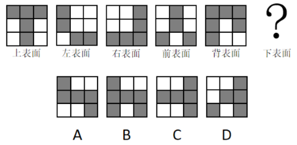
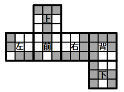

# 空间重构-相邻面公共边（下表面外圈拼接）

考点：[[20-考点/判断推理/图形推理/空间重构-相邻面公共边（下表面外圈拼接）|图形推理 / 空间重构-相邻面公共边（下表面外圈拼接）]]

**问法模型**：已知立方体五个表面的黑白分布、求下表面 → 用相邻面公共边拼接：把左、前、右、背四个侧面最底行按环绕顺序围成下表面外圈，再与选项比对

## 推理链
1. 第1步：题干给出同一立方体的上、左、右、前、背五个3×3黑白表面，其中左、前、右、背四个面的最底一行恰好与下表面的外圈相重合
2. 第2步：下表面外圈共8个小方块，四个角块分别被相邻两个侧面共用，故按'左→前→右→背'的环绕顺序取各面最底行并去掉重复角块
3. 第3步：读取各面最底行——左表面'白黑黑'、前表面'黑白黑'、右表面'黑黑黑'、背表面'黑白白'；角块颜色两两吻合（左底右=前底左=黑、前底右=右底左=黑、右底右=背底左=黑、背底右=左底左=白），验证拼接方向正确
4. 第4步：12格中白4黑8，扣除4个重复角块（3黑1白）后，外圈依次为白、黑、黑、白、黑、黑、黑、白，即5个黑块、3个白块
5. 第5步：逐项对照——A、C、D的外圈黑白数量及排列均与该序列不符，B项外圈黑白分布与推导完全一致
6. 第6步：故该立体图形的下表面为B

**最快解法**：⚡ 外圈拼接法（公共边法）：把左、前、右、背四个表面最底行按'左→前→右→背'围成一圈，角块共用去重，数出外圈为'白黑黑白黑黑黑白'即5黑3白，直接锁定B

## 易错点
- ⚠ 忽略四个角块被相邻两个侧面共用，直接按12个方块数黑白（4白8黑），与去重后的8格外圈（3白5黑）不符
- ⚠ 侧面最底行的左右顺序与围绕下表面的实际环绕方向（左→前→右→背）对应错位，导致黑白排列错误
- ⚠ 只比较黑白总数量而忽略外圈的排列顺序；下表面中心块无法由五个已知面推出，判断只能依据外圈8块信息

## 母题抽象
> 🧩 当题干给出立方体若干已知表面的黑白（或图案）分布并求某个未见面时，用相邻面公共边拼接：把与目标面相邻的各面朝向目标面的那一行（列）按环绕顺序取出、角块共用去重，得到目标面外圈后再与选项比对

**同类特征**：立方体六面体、3×3黑白方格表面、已知上/左/右/前/背五个面求下表面、相邻面公共边重合、外圈方块围成一圈、角块共用去重

## 相关题
（暂无）

---

### 题干

如图所示为某立体图形的表面形状，则该立体图形的下表面是下列选项中的：

### 选项
- A. A
- B. B　✅
- C. C
- D. D

### 官方解析

把题干中左表面、前表面、右表面、背表面最底层的方块围成一圈即为下表面的外圈。如下图所示，从左表面开始，依次将题干的各个表面排列到六面体展开图中，按照左表面、前表面、右表面、背表面的顺序，可确定下底面的外圈依次为白、黑、黑、白、黑、黑、黑、白，外圈共有5个黑块、3个白块，对应B项。

故正确答案为B。

### 给定材料
（无）
