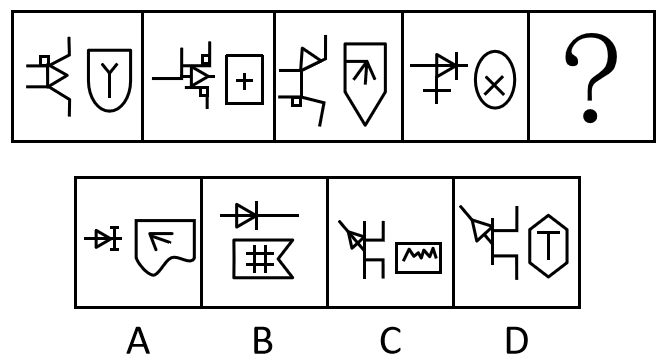

# 结构拆分规律（左右结构+内外拆分：外框轴对称+内部交点数）

考点：[[20-考点/判断推理/图形推理/结构拆分规律（左右结构+内外拆分：外框轴对称+内部交点数）|图形推理 / 结构拆分规律（左右结构+内外拆分：外框轴对称+内部交点数）]]

**问法模型**：'最符合所给图形规律的是'→元素组成不同时，先看整体结构特征（左右两部分），再对主体图形做内外拆分，分别验证属性（对称性）与数量（交点数）规律

## 推理链
1. 第1步：题干四幅图元素组成不同，但结构一致——每幅图均由左右两部分构成：左侧为类电路元件符号，右侧为带内嵌小元素的封闭外框，B项不是左右结构，先排除B
2. 第2步：对右侧图形做'内外拆分'，分别找规律：外框看属性（对称性），内部小元素看数量（交点数）
3. 第3步：外框规律——盾形、矩形、五边形屋形、椭圆，外框均为轴对称图形
4. 第4步：内部规律——'Y'、'+'、'↑箭头'、'×'，内部线条的交点数均只有1个（三线共点或十字交叉点）
5. 第5步：逐项验证——A项外框为不规则波浪形，非轴对称，排除；C项内部为折线（波浪线），交点数不止1个，排除；D项外框为正六边形（轴对称），内部'T'仅1个T字交点，双条件均符合
6. 第6步：只有D项同时满足'外框轴对称+内部交点数为1'，故选D

**最快解法**：⚡ 结构拆分法+排除法：第一步按'左右两部分结构'排除B；第二步对右侧图形内外拆分，外框验对称（排除A），内部数交点=1（排除C），锁定D

## 易错点
- ⚠ 只盯着左侧电路符号或整体轮廓找规律，忽略'每幅图均为左右两部分'这一结构特征，漏排B项
- ⚠ 只验证单一条件：A项内部箭头交点也是1个，若不查外框对称性易误选A；C项外框是矩形对称，若不数内部交点易误选C
- ⚠ 交点计数偏差：漏数'T'字接点为1个交点，或对波浪/折线的拐角点计数错误导致C项误判

## 母题抽象
> 🧩 当题干各图元素组成不同但均呈'左右两部分'结构时，先按结构排除位置不符项，再将主体图形做'内外拆分'，分别验证外框的属性规律（如轴对称）与内部元素的数量规律（如交点数），双条件同时满足者即为答案

**同类特征**：元素组成不同、左右两部分结构、外框均为轴对称、内部元素交点数均为1、内嵌小元素、内外拆分找规律

## 相关题
- [[10-真题/判断推理/图形推理/10204454 数量规律-部分数（黑白球连通区域数做和）|10204454]]（甘肃 2024，相关度1）
- [[10-真题/判断推理/图形推理/10204604 数量规律-线数量（汉字横线数）|10204604]]（辽宁 2024，相关度1）
- [[10-真题/判断推理/图形推理/10297050 数量规律-特殊计数（线条穿过小白球的数量）|10297050]]（天津 2025，相关度1）
- [[10-真题/判断推理/图形推理/10297127 图形间关系-相交图形中不相交边数量（黑白图形相交）|10297127]]（天津 2025，相关度1）
- [[10-真题/判断推理/图形推理/10297148 数量规律-线的细化（端点连线穿过线条数；备选：平行线组数）|10297148]]（天津 2025，相关度1）

---

### 题干

下列选项最符合所给图形规律的是：

### 选项
- A. A
- B. B
- C. C
- D. D　✅

### 官方解析
题干元素组成不同，观察发现，题干图形均为左右两部分，排除B项；左右分开观察发现，题干右侧图形可以分为内外两部分，考虑内外分开看，右侧图形的外框均为对称图形，且内部均只有1个交点，排除A、C两项，只有D项符合。
故正确答案为D。

### 给定材料
（无）
