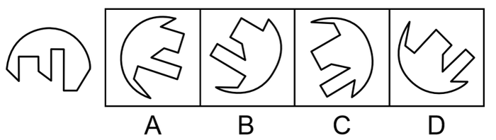

# 图形推理-平面拼合（互补拼图、拼合复原圆形）

考点：[[20-考点/判断推理/图形推理/图形推理-平面拼合（互补拼图、拼合复原圆形）|图形推理 / 图形推理-平面拼合（互补拼图、拼合复原圆形）]]

**问法模型**：'能与左侧图形组成一个完整圆形的是'→平面拼合模型：将题干缺口的凹凸折线边与选项折齿逐边做'凸对凹、角对角'咬合验证，且外轮廓须复原为整圆。

## 推理链
1. 第1步：观察题干图形——大半圆轮廓，底部缺口处边缘呈'竖直凹槽+矩形凸齿'的阶梯状折线，缺失一段圆弧，待补块的对应边必须与该折线严格互补。
2. 第2步：应用平面拼合规则：两块图形公共边凹凸互补（凸齿嵌凹槽、直角对直角），允许平移旋转拼合，拼后无缝隙、不重叠，外轮廓拼成完整圆。
3. 第3步：验证A项——其圆弧段恰好补齐题干缺失的那段圆弧，矩形凹口与凸齿的朝向、张角与题干阶梯折线一一咬合，可无缝拼出完整圆。
4. 第4步：排除干扰项——B、C、D虽圆弧形状与A相近，但其折齿的凹凸方向或角度与题干缺口不吻合，拼合会出现缝隙或重叠，无法复原整圆。
5. 第5步：对照得出结论：仅A能与左侧图形组成完整圆形，故正确答案为A。

**最快解法**：⚡ 凹凸互补排除法：先锁定题干缺口处最独特的'矩形阶梯齿'特征边，再逐项核对选项折齿与其是否方向相对、角度相等；仅A能严丝合缝咬合并补足缺口圆弧，B/C/D齿形不匹配，直接锁定A。

## 易错点
- ⚠ 只对比圆弧大小、忽略缺口折齿的凹凸互补，被B/C/D相似圆弧干扰而误选。
- ⚠ 忽视拼合允许平移加旋转，误认为选项须与缺口原始朝向一致而错排正确项。
- ⚠ 把镜像翻转当成允许操作，误选与缺口互为镜像的干扰块。

## 母题抽象
> 🧩 当题干出现'残缺圆形（或规则外框）+多个带折齿候选块'的拼合问法时，用凹凸互补匹配法，验证缺口边缘齿形的角度与凹凸方向能否与选项一一咬合、外轮廓能否复原。

**同类特征**：问法：能与左侧图形组成完整圆形、题干为带缺口的残缺圆形、缺口边缘呈矩形阶梯折线齿、选项均为圆弧+折齿的不规则块、考查平面拼合（平移/旋转拼接）

## 相关题
（暂无）

---

### 题干

以下选项能与左侧图形组成一个完整圆形的是：

### 选项
- A. A　✅
- B. B
- C. C
- D. D

### 官方解析

本题考查平面拼合。观察选项所给图形的线条分布形状，应与题干图形拼合成一个完整的圆。具体拼合方式如下图所示：

故正确答案为A。

### 给定材料
（无）
