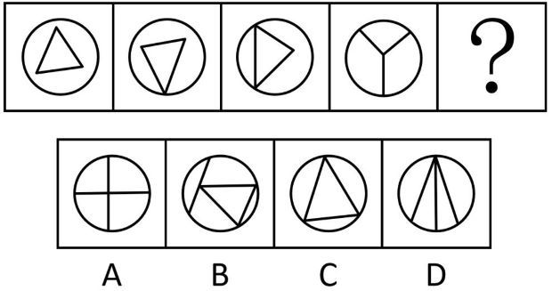

# 数量规律-框上交点数（递增数列）+直线数二次验证

考点：[[20-考点/判断推理/图形推理/数量规律-框上交点数（递增数列）+直线数二次验证|图形推理 / 数量规律-框上交点数（递增数列）+直线数二次验证]]

**问法模型**：问'最符合所给图形规律的是'且题干为线框组合图形 → 先数外框上的交点数找数量规律，再用第二重数量特征（线条数）验证锁定唯一答案

## 推理链
1. 第1步：元素组成不同、无明显属性规律，观察发现题干四图均由'圆形外框+内部直线'构成，且内部直线与外框存在明显交叉关系
2. 第2步：采用数量规律之'框上交点数'：图1三角形完全在圆内、不触框，交点为0；图2三角形一个顶点落在圆上，交点为1；图3三角形两个顶点在圆上，交点为2；图4为Y形，三条线段端点落在圆上，交点为3
3. 第3步：框上交点数依次为0、1、2、3，构成等差递增数列，故？处图形框上交点数应为4——A项十字与圆交4点，B项交点情况不符，C项三角形与圆的交点数不为4，排除C
4. 第4步：单一规律无法唯一锁定（A也满足4个交点），引入第二重数量验证：题干各图内部直线数均为3（三角形三边、Y形三段），？处也需3条直线
5. 第5步：逐项数直线数：A项仅2条（一横一竖），B项直线数多于3条，D项为3条且框上交点为4
6. 第6步：只有D同时满足'框上交点数=4、直线数=3'两重规律，故选D

**最快解法**：⚡ 双重数量规律排除法：先数框上交点0→1→2→3知？处需4个（排除C），再数内部直线数须为3条（排除A的2条、B的多条），秒选D

## 易错点
- ⚠ 只验证框上交点数=4这一重规律而误选A，忽略A项直线仅2条，必须用'直线数=3'二次验证
- ⚠ 框上交点漏数或错数：仅内部直线与圆框的实际交点/触点才计数，图1三角形在圆内不触框应记0而非3
- ⚠ 误把规律当作'三角形'形状规律，看到图4是Y形而怀疑规律中断；实际贯穿全程的是数量规律（交点数递增、直线数均为3）

## 母题抽象
> 🧩 当题干图形呈现'外框+内部线条且线条与外框交叉'的特征时，优先数框上交点数找递增/常数规律；若多选项同时满足，再用内部线条数（或面数、部分数）做第二重验证锁定答案

**同类特征**：圆形外框、内部直线与外框交叉、框上交点数0/1/2/3递增、前三幅图含三角形、内部直线数均为3、元素组成不同、无属性规律

## 相关题
- [[10-真题/判断推理/图形推理/12561867 数量规律-相同元素的位置关系（对角相对-边邻相邻）分组分类|12561867]]（浙江 2024，相关度1）
- [[10-真题/判断推理/图形推理/14993424 数量规律-元素个数（黑-灰矩形数量等差递增）|14993424]]（选调 2024，相关度1）
- [[10-真题/判断推理/图形推理/15419022 数量规律-图形间关系（面相贴-被完全隔开，内部线条部分数）|15419022]]（湖北 2025，相关度1）
- [[10-真题/判断推理/图形推理/16069776 数量规律-面数量（总面数恒定+全直线面数量递减二级规律）|16069776]]（广西 2026，相关度1）
- [[10-真题/判断推理/图形推理/1789602 数量规律-波峰波谷个数差+位置规律（最高波峰与竖轴左右关系）|1789602]]（江苏 2016，相关度1）

---

### 题干

下列选项最符合所给图形规律的是：

### 选项
- A. A
- B. B
- C. C
- D. D　✅

### 官方解析
元素组成不同，无明显属性规律，考虑数量规律。观察发现，题干图形均由圆形外框和内部直线构成，且内部直线与外框有明显交叉，考虑框上交点数，题干图形的框上交点数依次为0、1、2、3，故？处应选择框上交点数为4的图形，排除C项；继续观察发现，题干前三幅图形中均出现三角形，考虑直线数，题干图形的直线数均为3，故？处应选择直线数为3的图形，只有D项符合。
故正确答案为D。

### 给定材料
（无）
