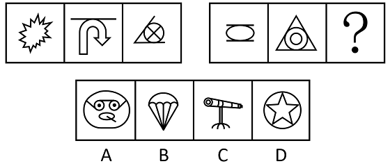

# 数量规律-切点数

考点：[[20-考点/判断推理/图形推理/数量规律-切点数|图形推理 / 数量规律-切点数]]

**问法模型**：两组图依序类推填问号 → 先排属性规律，再按'交叉明显、有相切'特征数切点找等差规律

## 推理链
1. 第1步：第一组图形为爆炸形、带横线的箭头、圆与三角形组合，元素组成不同且无对称/曲直等明显属性规律，转向数量规律
2. 第2步：题干图形'交叉明显，且有明显切点'（如图2横线与箭头弧线相切、图3圆与三角形两线相切），确定计数对象为切点数
3. 第3步：第一组切点数依次为0、1、2，呈公差为1的递增等差；第二组前两图（椭圆与双线、三角内圆）切点数为2、3
4. 第4步：延续等差规律，问号处图形切点数应为4
5. 第5步：逐项验证：A项（眼镜/人脸组合图形）圆与圆、圆与外框相切共4个切点，B（降落伞）、C（望远镜）、D（圆内五角星）切点数均不为4
6. 第6步：只有A项切点数为4，符合规律，故选A

**最快解法**：⚡ 切点计数法：见'交叉+相切'特征直接数切点，第一组0/1/2确定等差，第二组2/3推出？=4，快速点数选项切点排除B、C、D得A

## 易错点
- ⚠ 把切点混同于一般交点：只有线与线相切接触的才算切点，相交穿过处不计入，误数会得出其他规律
- ⚠ A项为生活化表意图形（人脸/眼镜），易因图形'不像几何图'而跳过不数
- ⚠ 只看第一组或只数线条数、交点数等常规数量，忽略'切点'这一细化考点

## 母题抽象
> 🧩 当图形'元素组成不同+属性无规律+出现明显相切/交叉结构'时，数切点数找等差（或常数）规律，并逐项计数对照选项

**同类特征**：元素组成不同、无明显属性规律、图形交叉明显、存在明显切点、两组图类推填问号、切点数呈0/1/2、2/3/?递增

## 相关题
- [[10-真题/判断推理/图形推理/10204454 数量规律-部分数（黑白球连通区域数做和）|10204454]]（甘肃 2024，相关度2）
- [[10-真题/判断推理/图形推理/10297050 数量规律-特殊计数（线条穿过小白球的数量）|10297050]]（天津 2025，相关度2）
- [[10-真题/判断推理/图形推理/10297262 数量规律-面的形状种类（封闭面种类数分组）|10297262]]（浙江 2025，相关度2）
- [[10-真题/判断推理/图形推理/10297314 数量规律-交点数（曲直交点）|10297314]]（浙江 2025，相关度2）
- [[10-真题/判断推理/图形推理/11454020 数量规律-小元素按行排布（每行个数自上而下递增1）|11454020]]（选调 2024，相关度2）

---

### 题干

从所给四个选项中，选择最合适的一个填入问号处，使之呈现一定规律性。

### 选项
- A. A　✅
- B. B
- C. C
- D. D

### 官方解析
元素组成不同，且无明显属性规律，考虑数量规律。观察发现，题干图形交叉明显，且有明显切点，考虑切点数。第一组图形切点数依次为：0、1、2，第二组图形切点数依次为：2、3、？，故？处图形切点数应为4，只有A项符合。
故正确答案为A。

### 给定材料
（无）
