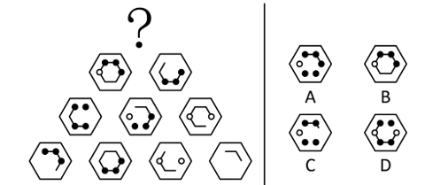

# 样式规律-加减同异（金字塔型：外框不变+内部求异+黑白球叠加规则）

考点：[[20-考点/判断推理/图形推理/样式规律-加减同异（金字塔型：外框不变+内部求异+黑白球叠加规则）|图形推理 / 样式规律-加减同异（金字塔型：外框不变+内部求异+黑白球叠加规则）]]

**问法模型**：题干为金字塔分层排列且'问符合变化规律的图形' → 采用金字塔自下而上逐层叠加模型：下层相邻两图外框不变、内部线条去同存异，并对黑白小球单独套用求异规则，验证后推向'？'处。

## 推理链
1. 第1步：题干为四层金字塔，底层4图、第三层3图、第二层2图、顶层'？'，各图外框均为六边形，内部由线条段与黑球/白球构成，元素组成相似且相同线条重复出现，优先考虑样式规律中的加减同异。
2. 第2步：金字塔类题自下向上找规律，即下层相邻两图运算得到上层图；对比第四行到第三行可知：外框六边形保持不变，内部图案求异（去同存异），且黑球与白球求异后得到黑球（黑+白=黑）。
3. 第3步：用第三行到第二行验证该规律：相邻两图叠加后外框不变、相同线条抵消、不同线条保留、黑白球按'求异得黑'合并，结果与第二行图形一致，规律成立。
4. 第4步：将规律应用于'？'正下方第二行的左右两图：外框仍为六边形，内部线条逐位求异；其中最右侧位置两图均为黑球，两个黑球求异按规则应为空白、一定不是黑球。
5. 第5步：四个选项中均不存在最右侧为空白的情况，先由线条求异结果排除不符的B、D，再在A、C中择优：两个黑球求异不可能是黑球，故排除最右侧为黑球的A，锁定最右侧为白球的C。
6. 第6步：C项上方两黑球与内部线条求异结果均与逐位运算一致，故'？'处选C。

**最快解法**：⚡ 金字塔自下而上'外框不变+内部去同存异+黑白球求异得黑'口诀；考场只抓'？'正下方两图差异最明显的最右侧位置：两图均为黑球→结果必非黑球，直接排除最右侧含黑球的选项，在A、C中锁定最右侧为白球的C，无需逐位画完。

## 易错点
- ⚠ 金字塔方向看反：必须自下向上运算（下层相邻两图得上层），自上向下推会误判无规律
- ⚠ 黑白球规则记错：本题规则是黑球与白球求异后得到黑球，易误当作黑+白抵消为空白
- ⚠ 忽略官方注明的妥协点：最右侧两个黑球求异本应为空白，但四个选项均无空白，若误认'非黑即白无规律'而乱选，会错选最右侧为黑球的A

## 母题抽象
> 🧩 当图形呈金字塔/阶梯分层排列且同位置小元素、线条反复出现时，用'自下而上逐层运算'法：外框不变、内部线条去同存异、小元素（如黑白球）单独设定叠加规则，先用已有上层数行验证规律，再运算到'？'处对照选项。

**同类特征**：金字塔分层排列（1-2-3-4）、外框完全相同（六边形）、内部相同线条重复出现、含黑球/白球小元素、问'符合图形变化规律'、加减同异（去同存异）

## 相关题
- [[10-真题/判断推理/图形推理/4651744 样式规律-旋转+求异（去同存异复合规律）|4651744]]（江苏 2022，相关度1）

---

### 题干

下列选项中，符合所给图形的变化规律的是：<u>        </u>。

### 选项
- A. A
- B. B
- C. C　✅
- D. D

### 官方解析

元素组成相似，且相同线条重复出现，优先考虑样式规律中的加减同异。本题为金字塔类题目，要自下向上找规律，即下层相邻的两幅图之间进行运算得到上面的一幅图，如下图箭头指向所示：

通过第四行到第三行的运算可知：外框保持不变，内部图案求异，且黑球和白球求异后得到黑球；经验证，第三行到第二行满足此规律；？处应用此规律，只有C项符合。

故正确答案为C。

注：第二行最右侧的两个黑球求异后根据之前的规则应为空白，但四个选项中均不存在最右侧为空白的情况，由于两个黑球求异一定不是黑球，故在A、C两项中择优选择最右侧是白球的C项。

### 给定材料
（无）

> [!warning] 疑点（官方解析可能有误，待人工复核）
> 官方解析自认规则存在死角：按'黑+黑求异'本应为空白，？处最右侧应为空白，但四个选项中均无该情况，官方以'两个黑球求异一定不是黑球'为由在A、C中择优选最右侧为白球的C，属于选项设置不严谨的妥协；C为官方唯一给定答案，不改判。

<!-- CODEX-ANSWER-REVIEW:BEGIN -->
### 本次独立复核

**复核状态：** `resolved`（答案与解析已核定）

**计分答案：** C（可计分）

**复核解析：**

【编辑修订版】金字塔图形自下向上计算：外框不变，内部线条求异；黑球与黑球相消后，该位置应为空白。题源原图中A、C均把最右侧画成有球，原选项因此没有满足完整规则的图形。本编辑版保留原题图全部内容，只在C选项最右侧删除空心球，其他线条、图形和选项均不改；修订后C的该位置留白，且其余可见结构符合已由下层图形验证的规则。原始题图仍作为原题保存，校订图单独存放。

**修订题干：**

下列选项中，符合所给图形的变化规律的是：____。

**相关信息：**

图形推理—求异运算；黑球与黑球求异结果为空白。本记录以单独的C项校订图恢复可计分版本，固定原始题图不覆盖。

**题源依据：** [固定版本原题](https://github.com/Mentat-Uran/kaogongzhentizhengliu/blob/84ab93d4b64b61d897bece8a1c0a5bab06b4feb2/10-%E7%9C%9F%E9%A2%98/%E5%88%A4%E6%96%AD%E6%8E%A8%E7%90%86/%E5%9B%BE%E5%BD%A2%E6%8E%A8%E7%90%86/5660582%20%E6%A0%B7%E5%BC%8F%E8%A7%84%E5%BE%8B-%E5%8A%A0%E5%87%8F%E5%90%8C%E5%BC%82%EF%BC%88%E9%87%91%E5%AD%97%E5%A1%94%E5%9E%8B%EF%BC%9A%E5%A4%96%E6%A1%86%E4%B8%8D%E5%8F%98%2B%E5%86%85%E9%83%A8%E6%B1%82%E5%BC%82%2B%E9%BB%91%E7%99%BD%E7%90%83%E5%8F%A0%E5%8A%A0%E8%A7%84%E5%88%99%EF%BC%89.md)；固定内容 commit `84ab93d4b64b61d897bece8a1c0a5bab06b4feb2`，Markdown blob `b297cda072db58a18b9de2bff30ce04468a7bf79`。
<!-- CODEX-ANSWER-REVIEW:END -->
