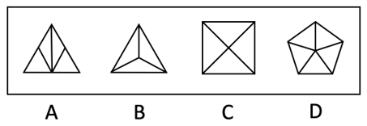

# 数量规律-面细化（面的形状种类）；求异型选非题

考点：[[20-考点/判断推理/图形推理/数量规律-面细化（面的形状种类）；求异型选非题|图形推理 / 数量规律-面细化（面的形状种类）；求异型选非题]]

**问法模型**：问'与其他三个图形规律不同的是'→求异（选非）模型：找出能让三个图形共有、一个图形例外的规律；当多条规律均能'三同一异'时，择优采信图形特征最明显的一组规律

## 推理链
1. 第1步：题干为'与其他三个不同'的求异选非题，四个图形均为多边形外框（A、B为三角形、C为正方形、D为五边形）被内部直线分割的封闭图形，元素组成不同→考虑数量规律
2. 第2步：封闭区域多，先数面：A为4个面、B为3个面、C为4个面、D为5个面，面数量无统一规律，按'数面后细化'原则转看每个面的形状
3. 第3步：逐项看面形状：B的3个面为同一种三角形，C的4个面为同一种直角三角形，D的5个面为同一种等腰三角形，即B、C、D的面形状均只有1种
4. 第4步：A内部各面虽也都是三角形，但出现了两种不同形状（大小、形态不同）的三角形，面形状种类为2，与B、C、D不一致
5. 第5步：辅助验证：B、C、D的内部交点数均为1，A为0（A的内部分割线交点落在外框边上）；且B、C、D均满足'对称轴数=面数'（3=3、4=4、5=5），A不满足（轴1≠面4）
6. 第6步：以'面的形状种类'为规律，B、C、D一致而A例外；本题为选非题，故正确答案为A

**最快解法**：⚡ 面的形状种类法（数面细化）：看到'多边形被内线分割、封闭区域多'，数完面数量无规律就逐图看面的形状——B、C、D每个图的所有面都是同一种三角形，只有A的面出现两种三角形，直接锁定A

## 易错点
- ⚠ 只数面数量、不细化到面的形状：面数量4、3、4、5本身无规律，不转'面的形状种类'就会卡壳乱选
- ⚠ 被其他'三同一异'规律带偏：对称性指向C（既轴又中心对称）、直线数6/6/6/10与笔画数2/2/2/3指向D，本题属官方自认的争议题，考场应优先采信图形特征最明显的面规律
- ⚠ 选非题审题反了：按'找相同规律'思路去选一致项，而本题要求选的是例外项

## 母题抽象
> 🧩 当题干出现'多边形被内部线条分割成多个封闭区域'且问'与其他三个图形不同的是'时，先数面数量，无规律则细化看'每个面是否同一种形状'（可辅以内部交点数验证），锁定三同一异中的例外项

**同类特征**：求异（选非）问法、多边形外框被内部直线分割、封闭区域多、面特征明显、各面均为三角形但形状种类不同、内部交点数、对称轴数=面数等多重验证、多个规律均能三同一异的争议题

## 相关题
（暂无）

---

### 题干

下列选项中，与其他三个图形规律不同的是：

### 选项
- A. A　✅
- B. B
- C. C
- D. D

### 官方解析
解法一：图形元素组成不同，可考虑数量规律。题干图形的封闭区域多，优先考虑数面，但无规律。观察发现，B、C、D三项的面均只有一种形状，只有A项的面有两种三角形的形状。
本题为选非题，故正确答案为A。
解法二：图形元素组成不同，优先考虑属性规律。观察发现，题干图形均为对称图形，并且A、B、D三项为轴对称图形，只有C项为既轴对称又中心对称图形。
本题为选非题，故正确答案为C。
解法三：图形元素组成不同，可考虑数量规律。题干图形中出现多边形，考虑数直线。观察发现，A、B、C三项均为6条直线，只有D项为10条直线。
本题为选非题，故正确答案为D。
解法四：图形元素组成不同，可考虑数量规律。题干图形中出现“田”字变形，考虑笔画数。观察发现，A、B、C三项的笔画数均为2，只有D项笔画数为3。
本题为选非题，故正确答案为D。
解法五：图形元素组成不同，可考虑数量规律。观察发现，题干图形中存在较多的直线交叉，考虑交点数量。整体考虑交点数没有规律，考虑点的细化。B、C、D三项内部交点数均为1，只有A项内部交点数为0。
本题为选非题，故正确答案为A。
解法六：图形元素组成不同，可考虑数量规律。观察发现，A、B、D三项中框内的直线数量跟外框线数量一样，只有C项不一样。
本题为选非题，故正确答案为C。
解法七：图形元素组成不同，可考虑数量规律。观察发现，B、C、D三项中的对称轴数量和面数量一样，只有A项不一样。
本题为选非题，故正确答案为A。
注：本题有争议，七个规律都有道理，但根据多边形被分割，面的数量和形状明显，粉笔更倾向根据面形状的种类择优选择A项，争议题大家了解基本解题思路即可，无需作为备考重点。

### 给定材料
（无）

> [!note] 复核版本状态
> 原题不可计分（genuine_multi_answer；来源记录的答案键/竞争项：A、C、D）；仅当前明确标注的编辑版按答案A计分。
> 详细原题疑点、修订题面、解析和证据见下方独立复核记录。

<!-- CODEX-ANSWER-REVIEW:BEGIN -->
### 本次独立复核

**复核结论：** `resolved`（答案与解析已核定）

**原题计分状态：** 不计分（`genuine_multi_answer`：多个答案均成立）。来源中记录的答案键/竞争项：A、C、D；这些记录不代表原题已核准答案。

**原题疑点与处理：**

上海 2020 〔20-考点/判断推理/图形推理/数量规律-面细化（面的形状种类）；求异型选非题〕 — 官方解析自认本题有争议：解法二（C为既轴对称又中心对称，指向C）、解法三与解法四（直线数6/6/6/10、笔画数2/2/2/3，指向D）与解法一、五、七（指向A…

**当前计分版本：** 明确标注的编辑版；未列出的题干、材料或选项沿用固定题源。答案不回填为原题答案。

**计分答案：** A（可计分）

**复核解析：**

【编辑修订版】只比较各图形所包含的封闭面形状种类，不使用对称性、线条数、笔画数或其他同时存在的规律。按封闭面的形状类别核对，A与B、C、D其余三图不同，故选A。

**修订题干：**

【编辑修订版】下列选项中，与其他三个图形在“封闭面的形状种类”这一属性上规律不同的是（忽略对称性、直线数和笔画数）：

**相关信息：**

图形推理—封闭面的形状种类；不同属性规律须明确当前唯一判定维度。

**核对依据与来源边界：**

- 固定题源：[原题文件](https://github.com/Mentat-Uran/kaogongzhentizhengliu/blob/84ab93d4b64b61d897bece8a1c0a5bab06b4feb2/10-%E7%9C%9F%E9%A2%98/%E5%88%A4%E6%96%AD%E6%8E%A8%E7%90%86/%E5%9B%BE%E5%BD%A2%E6%8E%A8%E7%90%86/5660597%20%E6%95%B0%E9%87%8F%E8%A7%84%E5%BE%8B-%E9%9D%A2%E7%BB%86%E5%8C%96%EF%BC%88%E9%9D%A2%E7%9A%84%E5%BD%A2%E7%8A%B6%E7%A7%8D%E7%B1%BB%EF%BC%89%EF%BC%9B%E6%B1%82%E5%BC%82%E5%9E%8B%E9%80%89%E9%9D%9E%E9%A2%98.md)；内容版本 `84ab93d4b64b61d897bece8a1c0a5bab06b4feb2`，源 Markdown blob `7ab8f32e56d6c1770ffad7d5be942a600aea4749`.
- **核心依据：** 原题至少有面形状、对称性、直线数、笔画数多套规律，分别指向A/C/D；编辑限定仅按面的形状种类。
- 固定题图/公式图：`90-图片/题目图/188bd9fc058139d.png`.

<!-- CODEX-ANSWER-REVIEW:END -->
