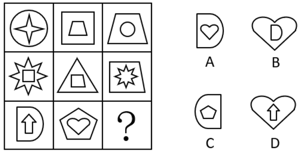

# 样式规律-遍历（内外图形互换重组）

考点：[[20-考点/判断推理/图形推理/样式规律-遍历（内外图形互换重组）|图形推理 / 样式规律-遍历（内外图形互换重组）]]

**问法模型**：『符合所给图形规律的是』→ 九宫格优先横行观察，每格为外框+内部双层结构，找前两图与第三图之间的内外元素重组（遍历）关系

## 推理链
1. 第1步：九宫格中元素组成相似，圆、梯形、星形、D形、心形、五边形等相同元素跨格重复出现，优先考虑样式规律中的遍历；每格图形均为'外部图形+内部图形'两层结构
2. 第2步：九宫格优先看横行，观察第一行：图1外框为圆、内部为四角星，图2外框为正方形、内部为梯形，而图3恰为'外梯形内圆'
3. 第3步：归纳规律——图3的外部图形=图2的内部图形，图3的内部图形=图1的外部图形（即前两图的内外元素互换重组）；验证第二行：图1外八角星、图2内正方形，图3为外正方形内八角星，规律成立
4. 第4步：第三行应用规律：图1外框为D形（内为上箭头），图2内部为心形（外为五边形），故问号处应为'外心形、内D形'
5. 第5步：对照选项：A为外D形内心形（内外位置颠倒），C为外D形内五边形（内部误用图2外框），D为外心形内上箭头（内部误用图1内部图形），仅B'外心形内D形'完全符合

**最快解法**：⚡ 口诀法'第三图=前两图内外互换'：横行看，第3图外框取第2图内部、内部取第1图外框；第三行图2内心形→外框为心形，图1外为D形→内部为D形，直接锁定B

## 易错点
- ⚠ 内外位置看反：误以为规律是'图1外框继续作外框'而错选A（外D内心）
- ⚠ 误用未参与互换的图形：把图2的外框五边形或图1的内部上箭头带入问号处，错选C或D
- ⚠ 只做整行元素种类的简单遍历计数（D形、心形、五边形各出现几次），忽略'外框与内部两层位置关系'这一核心维度

## 母题抽象
> 🧩 当九宫格每格均由'外框+内部'两层图形构成且相同元素跨格重复出现时，按行找'图3外部=图2内部、图3内部=图1外部'的互换遍历规律，排除内外颠倒与错配元素项

**同类特征**：九宫格、每图为内外两层嵌套结构、相同元素跨格重复（D形/心形/五边形）、元素组成相似、问号位于第三行行末、选项设置内外互换干扰项

## 相关题
- [[10-真题/判断推理/图形推理/4673223 样式规律-黑白运算（灰白叠加）|4673223]]（广东 2022，相关度3）
- [[10-真题/判断推理/图形推理/10204610 样式规律-加减同异（去同存异），九宫格列规律|10204610]]（辽宁 2024，相关度2）
- [[10-真题/判断推理/图形推理/10297349 样式规律-黑白运算|10297349]]（浙江 2025，相关度2）
- [[10-真题/判断推理/图形推理/10297407 样式规律-黑白运算（定义叠加）|10297407]]（四川 2025，相关度2）
- [[10-真题/判断推理/图形推理/12019768 样式规律-加减同异（求同）与位置旋转的复合规律|12019768]]（浙江 2026，相关度2）

---

### 题干

符合所给图形规律的是<u>        </u>。

### 选项
- A. A
- B. B　✅
- C. C
- D. D

### 官方解析
元素组成相似，且相同元素重复出现，优先考虑样式规律中的遍历。九宫格优先看横行，观察发现，第一行图形中，图1的外部图形出现在图3内部，图2的内部图形出现在图3外部；经验证，第二行符合此规律；第三行应用此规律，只有B项符合。
故正确答案为B。

### 给定材料
（无）
