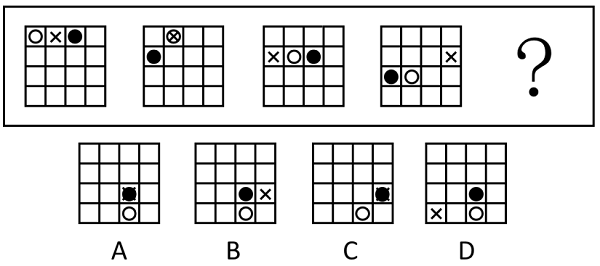
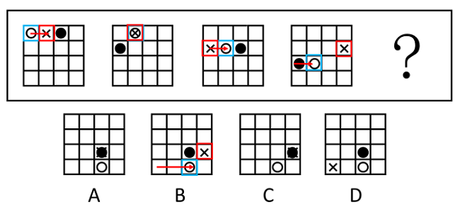

# 位置规律-平移（黑球定步长平移+白球与叉号相对距离等差递增）

考点：[[20-考点/判断推理/图形推理/位置规律-平移（黑球定步长平移+白球与叉号相对距离等差递增）|图形推理 / 位置规律-平移（黑球定步长平移+白球与叉号相对距离等差递增）]]

**问法模型**：“符合所给图形规律的一项”且各图元素组成相同 → 优先位置规律：先用单一元素的定步长平移排除，再用多元素相对距离定量验证。

## 推理链
1. 第1步：题干四图与选项均为4×4方格，元素组成相同（黑球、白球、叉号各一个，图2中白球与叉号重合为⊗），仅位置变化，优先考虑位置规律。
2. 第2步：黑球沿从左向右、逐行往下的16格轨迹每次平移2格：第1图第1行第3格→第2图第2行第1格→第3图第2行第3格→第4图第3行第1格，故？处黑球应在第3行第3格，排除C项（C黑球在第3行第4格）。
3. 第3步：将16格沿从左向右轨迹编号1~16，用“白球格号－叉号格号”度量两者相隔距离：图1白1叉2得-1，图2重合于第6格得0，图3白6叉5得1，图4白10叉8得2。
4. 第4步：距离依次为-1、0、1、2，构成公差为1的等差递增数列，故？处白球与叉号相隔距离应为3。
5. 第5步：逐项验证距离：A项叉号与黑球重合于第11格，白球15-叉11=4；D项白球15-叉13=2；B项白球15-叉12=3。
6. 第6步：黑球位置与距离双重验证后仅B项同时满足，故正确答案为B。

**最快解法**：⚡ 双指标定位法：先用黑球“每次右移2格、到底换行”锁定？处黑球在第3行第3格排除C；再给格子沿阅读方向编号，算白球与叉号距离-1、0、1、2→3，唯B符合。

## 易错点
- ⚠ 只盯黑球平移、忽略白球与叉号的相对距离规律，误选黑球位置正确但距离不符的A或D
- ⚠ 距离的正负号理解错：负值表示沿从左向右轨迹白球在叉号之后（叉号在前），若取绝对值成1、0、1、2就看不出等差规律
- ⚠ 图2中白球与叉号重合易被误认为出现新元素（⊗）或缺元素，漏掉“距离为0”这一关键环节

## 母题抽象
> 🧩 当一组方格图中相同小元素仅位置变化时，先给格子沿阅读方向编号，锁定某一元素“定步长平移（到底换行/循环走）”排除部分选项，再对剩余元素用“相对距离成等差/循环”定量验证唯一答案。

**同类特征**：4×4方格+黑白球与叉号小元素、元素组成相同仅位置改变、黑球定步长平移且到底换行、白球与叉号距离等差递增(-1,0,1,2,3)、元素重合对应距离为0、问“符合规律的一项”

## 相关题
- [[10-真题/判断推理/图形推理/2444696 位置规律-旋转与平移（圆点阵黑点分组移动）|2444696]]（四川 2019，相关度1）

---

### 题干

符合所给图形规律的一项是<u>        </u>。

### 选项
- A. A
- B. B　✅
- C. C
- D. D

### 官方解析

图形元素组成相同，优先考虑位置规律。观察发现，题干图形中的黑球依次从左向右平移2格（到底后移至下一行），故？处图形中的黑球应位于第三行第三格，排除C项。继续观察发现，从左向右的运动轨迹看，白球和叉号相隔的距离依次为-1、0、1、2（如下图所示），故？处图形中的白球和叉号相隔的距离应为3，只有B项符合。

故正确答案为B。

### 给定材料
（无）
