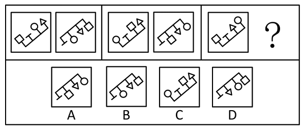
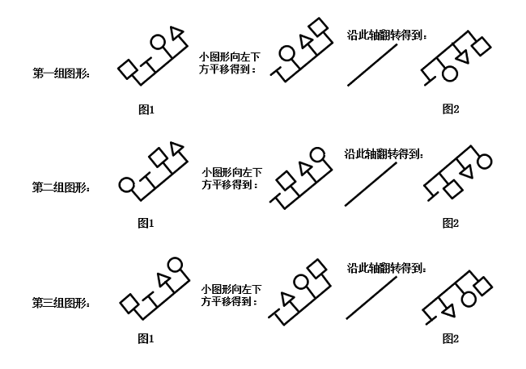

# 位置规律（平移+翻转复合变化）

考点：[[20-考点/判断推理/图形推理/位置规律（平移+翻转复合变化）|图形推理 / 位置规律（平移+翻转复合变化）]]

**问法模型**：三组图前两组完整、第三组缺图2的'符合变化规律'问法 → 先归纳第一组图1→图2的位置变化（平移+翻转），第二组验证后套用到第三组选答案

## 推理链
1. 第1步：三组图形元素组成相同（均由同一线框及圆、三角形、方块等小图形构成），优先考虑位置规律
2. 第2步：观察第一组，图1中的小图形分别向左下方平移一步，最下方的小图形直接平移到右上方，平移后的图形再沿图示方向翻转得到图2
3. 第3步：用第二组验证：图1→图2同样满足'小图形左下平移一步+最下方小图形移至右上+沿图示方向翻转'，规律成立
4. 第4步：将规律应用到第三组：先把第三组图1的小图形整体向左下方平移一步，最下方的小图形平移到右上方
5. 第5步：再沿图示方向翻转，逐项对照A、B、C、D，只有D项与翻转后的图形一致

**最快解法**：⚡ 位置规律口诀'元素相同看位置、先平移后翻转'：小图形整体左下移一步、最下方小图形循环跳到右上方，再沿图示方向翻转一步到位，直接锁定D；若只做平移不做翻转就会误选C

## 易错点
- ⚠ 只做平移漏掉最后一步翻转，误选平移后未翻转的选项（如C）
- ⚠ 忽略'最下方小图形直接平移到右上方'的循环移位细节，误以为所有小图形同步平移
- ⚠ 把'沿图示方向翻转'误当作旋转，翻转方向看错导致误选A或B

## 母题抽象
> 🧩 当图形元素组成相同且以'三组式（两组完整+一图问号）'呈现时，用'先平移（注意端点循环移位）再翻转'的复合位置规律：先归纳第一组变化，第二组验证后套用到第三组

**同类特征**：元素组成相同、三组式布局（两组完整+第三组缺图2）、小图形挂靠在主线框上、位置变化包含平移与翻转、最下方小图形循环移至右上方

## 相关题
- [[10-真题/判断推理/图形推理/2172768 位置规律（旋转-翻转）|2172768]]（海南 2021，相关度1）
- [[10-真题/判断推理/图形推理/10204458 位置规律-平移（特征交点沿内圈循环平移）|10204458]]（甘肃 2024，相关度1）
- [[10-真题/判断推理/图形推理/10204614 图形推理-位置规律（旋转+翻转交替循环）|10204614]]（黑龙江 2024，相关度1）
- [[10-真题/判断推理/图形推理/10297399 位置规律—平移（多黑块分组循环平移）|10297399]]（四川 2025，相关度1）
- [[10-真题/判断推理/图形推理/11226892 位置规律-九宫格小元素沿固定循环链移动|11226892]]（上海 2025，相关度1）

---

### 题干

下列选项中，符合所给图形的变化规律的是<u>        </u>。

### 选项
- A. A
- B. B
- C. C
- D. D　✅

### 官方解析

元素组成相同，优先考虑位置规律。第一组图形中，图1中的小图形分别向左下方平移一步，最下方的小图形直接平移到右上方，平移后得到的图形沿图示方向进行翻转得到图2；经验证第二组图形符合此规律，第三组图形应用此规律，只有D项符合。

故正确答案为D。

### 给定材料
（无）
