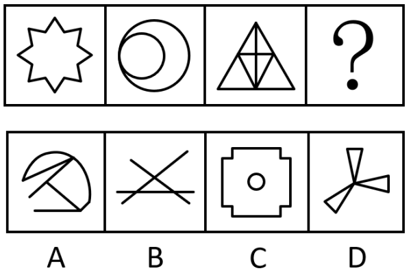

# 数量规律-笔画数（一笔画判定）

考点：[[20-考点/判断推理/图形推理/数量规律-笔画数（一笔画判定）|图形推理 / 数量规律-笔画数（一笔画判定）]]

**问法模型**：问法为'符合所给图形的变化规律'，且元素组成不同、属性无统一规律 → 优先考虑数量规律，本题锁定笔画数（连通图且奇点数为0或2即一笔画）

## 推理链
1. 第1步：题干三图元素组成不同——八角星、两圆相切、内部加线的三角形，对称/曲直/封闭等属性无明显统一规律，转向数量规律
2. 第2步：图2为'圆相切'，是笔画数考点的高频特征图，锁定一笔画判定标准：图形连通且奇点数（度数为奇数的点）为0或2
3. 第3步：逐一验证题干：八角星为单一封闭轮廓，奇点0个；两圆相切切点处度数为4（偶），奇点0个；三角形分割图仅顶点与底边中点两个奇点——三图均为一笔画图形
4. 第4步：规律确定为'？'处应填一笔画图形
5. 第5步：排除干扰项：A项内部多条线段交叉且端点众多，奇点超过2个为多笔画；B项多条直线相交，线的端点即奇点，明显多笔画；C项外部图形与中间小圆不连通，两个独立部分至少两笔画
6. 第6步：D项三个小三角形交汇于中心一点，中心点度数为偶数、其余顶点度数均为2，奇点数为0且整体连通，为一笔画，当选D

**最快解法**：⚡ 特征图定位法+数奇点：见'圆相切'立即想到一笔画；题干三图数奇点均≤2个，故在选项中找唯一一笔画——C项'不连通至少两笔'秒排，A、B数端点（端点即奇点）超2个排除，D项奇点0个入选

## 易错点
- ⚠ C项误判为一笔画：外部图形与内部小圆是两个不连通部分，即使各自奇点为0，整体也至少两笔画
- ⚠ 数奇点时漏数线段端点：端点度数为1也是奇点，B项多条直线的端点众多，必然多笔画
- ⚠ 凭'图形看起来简单'直接断定一笔画，忽略一笔画须同时满足'连通'与'奇点数为0或2'两个条件

## 母题抽象
> 🧩 当图形元素组成不同、对称/曲直/封闭等属性规律失效，且出现圆相切、多圆相交、多角星、多端点交叉线等特征图时，用一笔画判定法：连通+奇点数≤2，逐项数奇点排除作答

**同类特征**：圆相切、多角星轮廓、三角形内部加线、元素组成不同且属性无规律、一笔画、奇点数

## 相关题
- [[10-真题/判断推理/图形推理/2742162 数量规律-笔画数（一笔画判定）|2742162]]（江苏 2021，相关度4）
- [[10-真题/判断推理/图形推理/2050436 数量规律-一笔画（奇点数判定笔画数）|2050436]]（浙江 2017，相关度3）
- [[10-真题/判断推理/图形推理/2136974 数量规律-笔画数（一笔画判定）|2136974]]（北京 2018，相关度2）
- [[10-真题/判断推理/图形推理/2280971 图形推理-数量规律-笔画数（一笔画与奇点数）|2280971]]（四川 2018，相关度2）
- [[10-真题/判断推理/图形推理/2423322 数量规律-一笔画（奇点数）|2423322]]（甘肃 2019，相关度2）

---

### 题干

下列选项中，符合所给图形的变化规律的是<u>        </u>。

### 选项
- A. A
- B. B
- C. C
- D. D　✅

### 官方解析
元素组成不同，且无明显属性规律，优先考虑数量规律。观察发现，图2为“圆相切”，优先考虑笔画数。题干图形均为一笔画图形，故“？”处图形也应为一笔画图形，只有D项符合。
故正确答案为D。

### 给定材料
（无）
