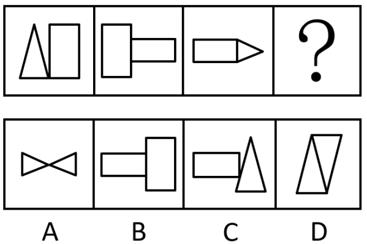

# 样式规律-遍历（相邻图形元素左右位置传递）

考点：[[20-考点/判断推理/图形推理/样式规律-遍历（相邻图形元素左右位置传递）|图形推理 / 样式规律-遍历（相邻图形元素左右位置传递）]]

**问法模型**：'符合所给图形的变化规律'的序列填空问法 → 相邻图形两两对比找元素位置传递规律，用'前图右元素=后图左元素'链式规则锁定问号处图形

## 推理链
1. 第1步：图1由'三角形+竖长矩形'左右拼接，图2由'竖长矩形+横长矩形'拼接，图3由'横长矩形+尖朝右三角形'拼接，元素组成相似且矩形、三角形重复出现，优先考虑样式规律中的遍历
2. 第2步：比较相邻图形提取传递规则——图1右侧的竖长矩形出现在图2的左侧，图2右侧的横长矩形出现在图3的左侧，即'前图右半元素→后图左半元素'的链式传递
3. 第3步：按此规则，图3右侧的'尖朝右三角形'必须出现在'？'处图形的左侧
4. 第4步：逐项核对左半元素——B项左半为横长矩形、C项左半为横长矩形，均与尖朝右三角形不符，排除
5. 第5步：D项左半三角形尖朝上，与图3右侧尖朝右三角形方向不符，排除；A项左半为尖朝右三角形（与右侧尖朝左三角形拼成双三角/蝴蝶结状），符合传递规律，故选A

**最快解法**：⚡ 相邻传递法：只看拼接位置——'前图右半=后图左半'，锁定问号处左半必为图3右半的尖朝右三角形，一步排除B、C、D，直接选A

## 易错点
- ⚠ 误把规律看成图形整体形状递变或线段/面数量规律，忽略'元素左右位置逐图传递'这一核心
- ⚠ 忽略三角形的方向细节：图3右侧三角形尖朝右，D项左半三角形虽也是三角形但尖朝上，方向不符易误选D
- ⚠ 过度追问A项右半新元素（尖朝左三角形）的来源而误排A，实际本规律只约束左半元素

## 母题抽象
> 🧩 当题干图形为'两个小图形左右拼接且元素在相邻图间重复出现'时，用相邻传递法：验证'前图右元素=后图左元素'，据问号处应有的左半元素排除选项

**同类特征**：元素组成相似且重复出现、每个图形由两小图左右拼接、相邻图形元素位置传递、问号求第四幅图、样式规律-遍历、矩形与三角形交替出现

## 相关题
- [[10-真题/判断推理/图形推理/16070180 样式规律-相同元素遍历之位置关系（圆位于主体图形内部-外部）|16070180]]（湖北 2026，相关度1）
- [[10-真题/判断推理/图形推理/2295533 样式规律-元素遍历（图形分层拆解后按行遍历补缺）|2295533]]（上海 2019，相关度1）
- [[10-真题/判断推理/图形推理/2731208 位置规律-小元素移动（五位置标号追踪移动路径）|2731208]]（上海 2021，相关度1）
- [[10-真题/判断推理/图形推理/5833602 样式规律-遍历（共性元素：四边形）|5833602]]（选调 2020，相关度1）

---

### 题干

下列选项中，符合所给图形的变化规律的是<u>        </u>。

### 选项
- A. A　✅
- B. B
- C. C
- D. D

### 官方解析
元素组成相似，且某些元素重复出现，优先考虑样式规律中的遍历。比较相邻图形发现，图1右侧的图形出现在图2的左侧，图2右侧的图形出现在图3的左侧，因此图3右侧的图形应出现在“？”处图形的左侧，只有A项符合。
故正确答案为A。

### 给定材料
（无）
