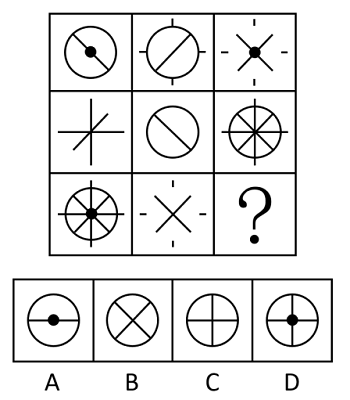

# 样式规律-去同存异（求异）

考点：[[20-考点/判断推理/图形推理/样式规律-去同存异（求异）|图形推理 / 样式规律-去同存异（求异）]]

> [!note] 独立复核结论
> 原题和编辑版均可计分，答案D。同题第三方试卷解析按前两行验证“求异”并判第三行为D。第三行左图十字线穿出圆周的四向外伸段，与右图四向短刻线长度和连接方式不同；本题采用元素级抽象，将同方位外围标记视为同类元素消去。若按像素长度/连通性严格匹配会留下残线，但这不是同题解析采用的抽象层级。

**问法模型**：“符合所给图形的变化规律”且九宫格元素组成相似 → 横向逐行找样式叠加规律（去同存异），验证后应用于问号处

## 推理链
1. 第1步：九宫格各图均由线条、小黑点、外围短线等相似元素构成，优先考虑样式规律，且九宫格优先横向看行
2. 第2步：观察第一行：图一为“圆+\斜线+黑点”，图二为“圆+/斜线+外围短线”，两图相同元素（圆、斜线）消去、不同元素保留，恰好得到图三“X交叉线+黑点+外围短线”，即求异规律
3. 第3步：验证第二行：图一为“竖线+横线+\斜线”，图二为“圆+/斜线”，求异后保留圆、竖、横及两条斜线，得到图三“圆+米字八向线”，规律成立
4. 第4步：第三行应用求异：图一“圆+米字八向线+中心黑点”与图二“X双斜线+外围短线”叠加，共同的两条斜线（/与\）相互消去
5. 第5步：保留图一独有的圆、竖线、横线和中心黑点，即“圆+十字+中心黑点”
6. 第6步：对照选项：A为圆+横线+点（缺竖线）、B为圆+X（斜线未消去）、C为圆+十字（缺黑点）、D为圆+十字+中心黑点，只有D符合

**最快解法**：⚡ 去同存异口诀法：第三行两图叠加，相同斜线相消，保圆、竖、横线及黑点，秒选D（用黑点即可排除C，用斜线消去排除B）

## 易错点
- ⚠ 只看线条消去、忽略中心黑点也参与求异，误选无点的C
- ⚠ 未先横行验证、误当旋转或整体叠加规律，方向判断出错
- ⚠ 第三行图一为米字八向线，漏数与图二共有的两条斜线，误以为斜线应全部保留

## 母题抽象
> 🧩 当九宫格各图由相似的线条、小黑点等元素重复构成时，横向做“去同存异”——两图相同元素消去、不同元素保留，用前两行验证规律后再套用到第三行选答案

**同类特征**：九宫格、元素组成相似、线条+小黑点+短线组合、横行规律、去同存异/求异、问号位于第三行右下角

## 相关题
- [[10-真题/判断推理/图形推理/15833719 样式规律（图形相加-叠加）+位置规律（上下翻转）复合规律|15833719]]（黑龙江 2026，相关度3）
- [[10-真题/判断推理/图形推理/19526396 样式规律-加减同异（求异）+位置规律（逆时针旋转90°）复合考点|19526396]]（国考 2026，相关度3）
- [[10-真题/判断推理/图形推理/2264343 样式规律-加减同异（求异）+位置旋转复合|2264343]]（国考 2019，相关度3）
- [[10-真题/判断推理/图形推理/4630437 样式规律-元素求同（遍历）+位置对应（公共元素固定于左上角）|4630437]]（新疆 2021，相关度3）
- [[10-真题/判断推理/图形推理/10204610 样式规律-加减同异（去同存异），九宫格列规律|10204610]]（辽宁 2024，相关度2）

---

### 题干

下列选项中，符合所给图形的变化规律的是<u>        </u>。

### 选项
- A. A
- B. B
- C. C
- D. D　✅

### 官方解析
元素组成相似，优先考虑样式规律。九宫格中优先横向看，第一行中，图一和图二求异得到图三；经验证，第二行也满足此规律；第三行应用此规律，图一和图二求异，只有D项符合。
故正确答案为D。

### 给定材料
（无）

> [!note] 复核版本状态
> 原题可计分（resolved，答案D）；编辑版将外围标记的元素级匹配规则写明，答案同为D。
> 详细原题疑点、修订题面、解析和证据见下方独立复核记录。

<!-- CODEX-ANSWER-REVIEW:BEGIN -->
### 本次独立复核

**复核结论：** `resolved`，原题答案D

**原题计分状态：** 可计分（`resolved`，D）。固定题源题图及答案键记D；独立逐格复核和同题试卷解析支持该答案。

**原题疑点与处理：**

第三行第一格的竖、横直径穿出圆周，形成上、下、左、右四段外伸线；第二格有同方位的四条短刻线。它们长度和连接方式略异，若按像素/连通性严格匹配会有残线；但前两行验证的是图形元素级“去同存异”，同题第三方试卷解析也按这一层级计算并给出D。第三行两条斜线及四向外围标记消去，剩下圆、竖线、横线和中心黑点，唯一对应D。这里明确采用题目所验证的元素抽象，不声称两组外围线像素完全重合。

**当前计分版本：** 编辑版将图形逐格转写为文字，并显式写明外围标记按方位/类型匹配、忽略长度差；原图版本与编辑版均为D。

**计分答案：** D

**修订题干：**

【编辑重构版；原题图形改为逐格文字描述】本题在每行中将前两格作“去同存异”：相同的元素消去，不同元素保留。编辑版明确规定：圆、直径、斜线、黑点及圆外四个方位标记按种类和方向/位置识别；同方向同位置的圆外标记视为同一元素，忽略图中线段长短差。求第三行问号处应为哪一项。

第一行：①圆、反斜线“\”、中心黑点；②圆、斜线“/”、圆外上/下/左/右四个短标记；③两条对角线组成X、中心黑点、圆外四向短标记。
第二行：①竖线、横线、斜线“/”；②圆、反斜线“\”；③圆、竖线、横线和两条对角线。
第三行：①圆、竖线、横线、两条对角线、中心黑点，且十字线向圆外四向延伸；②两条对角线组成X、圆外上/下/左/右四个短标记；③？

**修订/采用选项：**

A. 圆内只有一条水平直径，中心有黑点。
B. 圆内有两条对角线交成X。
C. 圆内有水平、竖直两条直径交成十字。
D. 圆内有水平、竖直两条直径交成十字，中心有黑点。

**复核解析：**

第一行：两圆相消，方向不同的两条斜线保留成X，黑点和四向标记各只出现于一格，均保留，得到第三格。第二行：方向不同的两条斜线保留成X，圆、横线、竖线也各只在一格出现，得到第三格。第三行：共有的两条斜线组成X后消去；四方位外侧标记按已验证的元素类别和方位消去；圆、十字、黑点保留，对应D。

**相关信息：**

图形推理按样式要素识别，不以外伸线长度作独立计数属性；前两行支持本题采用该抽象。严格像素匹配会留下长度/连通性差异，作为题图精度限制予以说明。

**核对依据与来源边界：**

- 固定题源：[原题文件](https://github.com/Mentat-Uran/kaogongzhentizhengliu/blob/84ab93d4b64b61d897bece8a1c0a5bab06b4feb2/10-%E7%9C%9F%E9%A2%98/%E5%88%A4%E6%96%AD%E6%8E%A8%E7%90%86/%E5%9B%BE%E5%BD%A2%E6%8E%A8%E7%90%86/5690260%20%E6%A0%B7%E5%BC%8F%E8%A7%84%E5%BE%8B-%E5%8E%BB%E5%90%8C%E5%AD%98%E5%BC%82%EF%BC%88%E6%B1%82%E5%BC%82%EF%BC%89.md)；commit `84ab93d4b64b61d897bece8a1c0a5bab06b4feb2`。题图为 `90-图片/题目图/189202a26a0d972.png`。
- 同题第三方试卷解析：[2017上海行政执法类行测题卷页](https://www.lasee.net/gongwuyuan/169162621515485.html)提供第18题答案D及解析文档；该站为第三方汇编，非命题机关发布。对应解析按行“求异”并得D。

<!-- CODEX-ANSWER-REVIEW:END -->
