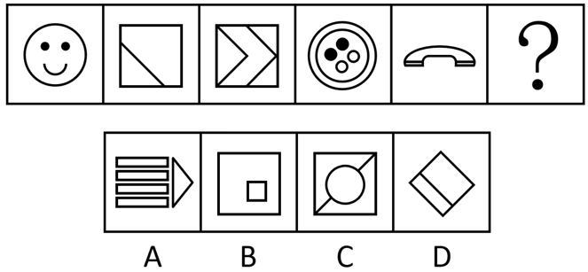

# 属性规律-对称性（对称轴条数+对称轴方向顺时针旋转）

考点：[[20-考点/判断推理/图形推理/属性规律-对称性（对称轴条数+对称轴方向顺时针旋转）|图形推理 / 属性规律-对称性（对称轴条数+对称轴方向顺时针旋转）]]

**问法模型**：‘填入问号处使图形呈现规律性’→ 元素组成不同优先看属性规律，先数每图对称轴条数，再追踪对称轴方向的旋转步进

## 推理链
1. 第1步：题干五图元素组成不同（笑脸、对角线正方形、双箭头方形、圆环纽扣、横放听筒），且均含明显等腰结构，优先考虑对称性
2. 第2步：逐一数对称轴条数——图1笑脸仅1条竖直轴，图2沿对角线仅1条斜轴，图3双箭头仅1条水平轴，图4纽扣仅1条斜轴，图5听筒仅1条竖直轴，规律为‘每图有且仅有1条对称轴’
3. 第3步：追踪对称轴方向——竖→斜→横→斜→竖，对称轴每次顺时针旋转45°，故？处应为仅1条撇方向（/）斜轴的图形
4. 第4步：对照选项排除——A项横条纹加右箭头仅1条水平轴，方向不符；B项大正方形内小正方形的斜轴为捺（\）方向，不符；C项正方形内圆加对角线关于两条对角线均对称（2条轴），条数不符
5. 第5步：D项旋转45°的正方形内加一条平行于左下边的线段，图形只剩1条撇（/）方向对称轴，同时满足‘仅1条轴+方向顺时针延续’，当选

**最快解法**：⚡ 对称轴‘数量+方向’双描点法：先排除条数不符的C（2条轴），再描方向箭头（竖→斜→横→斜→竖→?，顺时针每次45°），锁定撇方向斜轴的D，排除A（横轴）、B（捺向斜轴）

## 易错点
- ⚠ 只判断‘是否轴对称’而不数对称轴条数，误选看似斜轴对称实则2条轴的C项
- ⚠ 只盯‘斜轴’却忽略旋转方向，把捺（\）方向斜轴的B项当成正确答案
- ⚠ 图2、图4斜轴的具体对角线方向看错，导致45°旋转链断裂、规律难以延续到问号处

## 母题抽象
> 🧩 当题干图形元素组成不同且每图都明显轴对称时，先用‘每图对称轴条数恒定’（如均为1条）做第一层筛选，再用‘对称轴方向按顺/逆时针45°（或90°）旋转’做第二层筛选，选项必须同时过两关

**同类特征**：元素组成不同、等腰/轴对称特征明显、每图仅1条对称轴、对称轴方向依次旋转45°、竖→斜→横→斜→竖交替出现、问号处延续旋转规律

## 相关题
- [[10-真题/判断推理/图形推理/10204454 数量规律-部分数（黑白球连通区域数做和）|10204454]]（甘肃 2024，相关度1）
- [[10-真题/判断推理/图形推理/10204604 数量规律-线数量（汉字横线数）|10204604]]（辽宁 2024，相关度1）
- [[10-真题/判断推理/图形推理/10297050 数量规律-特殊计数（线条穿过小白球的数量）|10297050]]（天津 2025，相关度1）
- [[10-真题/判断推理/图形推理/10297127 图形间关系-相交图形中不相交边数量（黑白图形相交）|10297127]]（天津 2025，相关度1）
- [[10-真题/判断推理/图形推理/10297148 数量规律-线的细化（端点连线穿过线条数；备选：平行线组数）|10297148]]（天津 2025，相关度1）

---

### 题干

请从四个选项中选出最恰当的一项填入问号处，使题干图形呈现一定的规律性。

### 选项
- A. A
- B. B
- C. C
- D. D　✅

### 官方解析

元素组成不同，优先考虑属性规律。观察发现，题干图形出现明显的等腰元素，优先考虑对称性。题干图形均只有1条对称轴，且对称轴方向依次顺时针旋转，？处应用规律，只有D项符合规律。

故正确答案为D。

### 给定材料
（无）
