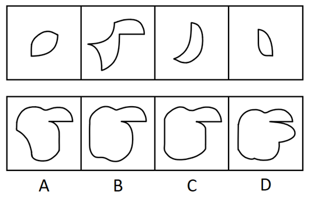

# 图形推理-平面拼合（消去公共边）

考点：[[20-考点/判断推理/图形推理/图形推理-平面拼合（消去公共边）|图形推理 / 图形推理-平面拼合（消去公共边）]]

**问法模型**：四个图形只通过上、下、左、右平移拼合成一个 → 采用消去公共边拼合模型：找最大件作基准，消去弯曲程度一致且等长的公共边，对照外轮廓选答案

## 推理链
1. 第1步：提取各件特征——图1为左下带平直边的小半圆片，图2为波浪左缘、下端带尖角的'帽形'最大件，图3为月牙形，图4为小月牙形
2. 第2步：所用规则——拼合只允许平移（不旋转不翻转），两块贴合后弯曲程度一致且等长的公共曲线边相互抵消（消线）
3. 第3步：以最大件图2为基准，将图1、图3、图4分别平移至凹凸弧等长处贴合，逐一消去公共曲线边
4. 第4步：消边拼合后的整体外轮廓应为：上部帽檐状凸起+左侧波浪过渡+底部平滑圆弧，且无任何多余凸出
5. 第5步：逐项对照——A左下保留尖角（图2尖角未消去、拼合位错）、D右侧多出一个帽檐状凸起（重复拼合痕迹）、C底部轮廓与消线结果不符
6. 第6步：仅B的外轮廓与消去公共边后的拼合轮廓完全一致，故正确答案为B

**最快解法**：⚡ 主体基准法+消去公共边法：先锁定最大件图2为基准，把其余三块沿等长同弯的曲线'贴边消线'，再对照外轮廓排除——A左下多尖角、D右侧多帽檐凸起、C底部圆弧不符，只剩B

## 易错点
- ⚠ 忽略'只能平移'的条件而自行旋转拼块，导致方向错位误选C
- ⚠ 消去公共边时未核查'弯曲程度一致且等长'，把不等长或弯向不合的曲线强行拼合
- ⚠ 底部细节辨析不足：A左下尖角与B底部圆弧差异是排除A的关键；D右侧多余帽檐状凸起是重复拼合痕迹，勿误选

## 母题抽象
> 🧩 当题干出现'几个图形只通过平移拼合成一个'的特征时，先找最大件作基准，沿弯曲程度一致且等长的公共边消线拼合，再对照外轮廓排除细节不符项

**同类特征**：平面拼合、只能上、下、左、右平移、消去弯曲程度一致且等长的线条、含月牙形/帽形曲线件、以最大图形为拼合基准、对照外轮廓选答案

## 相关题
- [[10-真题/判断推理/图形推理/10975247 图形推理-平面拼合（平行且等长相消法）|10975247]]（江苏 2024，相关度2）
- [[10-真题/判断推理/图形推理/16095258 图形推理-平面拼合（平行且等长相消）|16095258]]（江苏 2024，相关度2）
- [[10-真题/判断推理/图形推理/16095267 图形推理-平面拼合（平移拼合·平行且等长相消）|16095267]]（江苏 2024，相关度2）
- [[10-真题/判断推理/图形推理/2043628 图形拼合-平面拼合（平行等长相消）|2043628]]（江苏 2017，相关度2）
- [[10-真题/判断推理/图形推理/2172313 平面拼合-平行且等长相消（三角形拼合轮廓）|2172313]]（江苏 2018，相关度2）

---

### 题干

下边四个图形中，只有一个是由上边的四个图形拼合（只能通过上、下、左、右平移）而成的，请把它找出来。

### 选项
- A. A
- B. B　✅
- C. C
- D. D

### 官方解析

本题考查平面拼合，消去弯曲程度一致且等长的线条后进行拼合，即可得到轮廓图，即为B项。具体拼合方式如下图所示：

故正确答案为B。

### 给定材料
（无）
