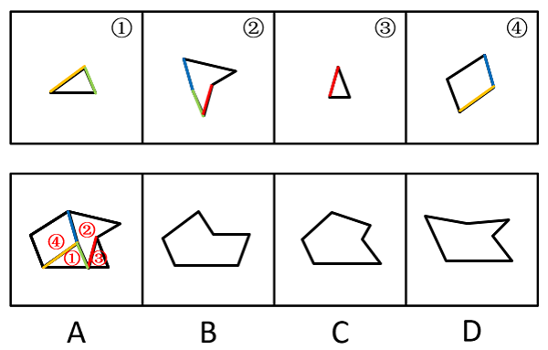

# 图形推理-平面拼合（平移组合+平行且等长线段相消）

考点：[[20-考点/判断推理/图形推理/图形推理-平面拼合（平移组合+平行且等长线段相消）|图形推理 / 图形推理-平面拼合（平移组合+平行且等长线段相消）]]

**问法模型**：四个小图形只能上下左右平移拼成一个整体 → 用'平行且等长相消法'：平行且等长的边两两贴合消去，剩余外缘即为轮廓，与选项比对。

## 推理链
1. 第1步：提取图形要素——①为扁矮三角形，②为带内凹口的箭头形凹多边形，③为细高小三角形，④为斜置四边形（近似平行四边形）；规则限定只能上、下、左、右平移，不能旋转或翻转。
2. 第2步：确定方法——不能旋转意味着每个图形每条边的方向固定不变，只有方向相同（平行）且长度相等的边才能互相贴合，贴合线段内部相消，外缘保留为整体轮廓。
3. 第3步：在①②③④之间逐对寻找平行且等长的边（斜边对斜边、水平边对水平边），如②的凹口斜边与④的斜边、④与①的斜边、③与①的相应边等，作为贴合线依次消去。
4. 第4步：将四个小图形沿相消边拼合，剩余外缘围成的轮廓是一个带内凹缺口的凹多边形，缺口的开口方向与外缘斜边走向固定。
5. 第5步：与选项对照——A项轮廓与相消拼合结果完全一致；B、C、D的缺口位置、朝向或外缘斜边方向与之不符，排除。

**最快解法**：⚡ 平行且等长相消法：给四个小图形的每条边标出方向和长短，两两寻找平行且等长的边作为贴合线直接消去，快速拼出外轮廓后与选项比对，锁定A。

## 易错点
- ⚠ 忽略'只能平移、不能旋转/翻转'的硬约束，擅自旋转某个小图形（如把④摆正）后拼合，误选B/C/D
- ⚠ 相消时只验证平行不验证等长（或反之），错误消去不该消的边，导致轮廓凹口位置判断失误
- ⚠ A、C等选项轮廓相近，仅凭'大致像'选定，未逐一比对凹口朝向与外缘斜边方向导致误判

## 母题抽象
> 🧩 当题干出现'多个小图形拼合、只能平移'特征时，用平行且等长相消法：标出各边方向与长度，将平行且等长的边两两贴合消去，验证剩余外轮廓与选项一致即得答案。

**同类特征**：四个小图形拼合为一个整体、只能上下左右平移（不可旋转）、含三角形、斜四边形与带凹口箭头形、斜边方向各异、选项为带内凹缺口的凹多边形轮廓

## 相关题
- [[10-真题/判断推理/图形推理/1791818 图形推理-平面拼合（平行且等长相消）|1791818]]（江苏 2016，相关度1）

---

### 题干

下边四个图形中，只有一个是由上边的四个图形拼合（只能通过上、下、左、右平移）而成的，请把它找出来。

### 选项
- A. A　✅
- B. B
- C. C
- D. D

### 官方解析

本题考查平面拼合，可采用平行且等长相消的方式解题。消去平行且等长的线段后进行组合即可得到轮廓图，即为A项。平行且等长相消的方式如下图所示：

故正确答案为A。

### 给定材料
（无）
