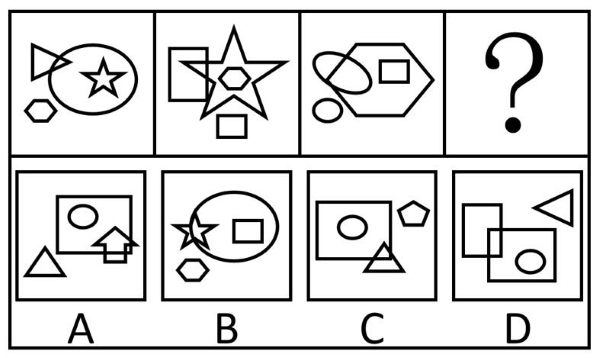

# 样式规律-元素遍历与位置关系传递（内含-相交-相离）

考点：[[20-考点/判断推理/图形推理/样式规律-元素遍历与位置关系传递（内含-相交-相离）|图形推理 / 样式规律-元素遍历与位置关系传递（内含/相交/相离）]]

**问法模型**：问'不符合所给图形的变化规律'的选非题 → 先归纳序列的静态位置关系+动态传递规律，再逐项验证找出违背传递链的选项

## 推理链
1. 第1步：题干前三图每幅均由4个不同元素组成，且相同元素反复出现，优先考虑样式遍历；各图存在唯一面积最大元素：图1圆形、图2五角星、图3六边形
2. 第2步：验证最大元素与其余三元素的位置关系：图1中五角星内含于圆、三角形与圆相交、小六边形与圆相离；图2、图3同样构成'内含、相交、相离'各一个的遍历结构
3. 第3步：发现动态传递规律——前一幅图中被最大元素'内含'的小元素变成下一幅图中面积最大的元素：图1内含的五角星→图2最大，图2内含的六边形→图3最大
4. 第4步：沿传递链推出图4（问号处）的面积最大元素应为图3内含的矩形，且该矩形与其余元素仍应呈内含、相交、相离三种关系
5. 第5步：逐项对照：A项矩形最大（圆内含、箭头相交、三角形相离）符合；C项矩形最大（圆内含、三角形相交、五边形相离）符合；D项大矩形最大（圆内含、小矩形相交、三角形相离）符合
6. 第6步：B项面积最大元素是圆形而非矩形（矩形反而内含于圆中），破坏了'前图内含元素→后图最大元素'的传递链，不符合规律

**最快解法**：⚡ 排除法+传递链口诀'内含变小、小变最大'：只需追踪每图最大元素和其内含元素——五角星→六边形→矩形，锁定问号处最大元素应为矩形；快速扫选项，仅B项最大元素为圆形，直接选B

## 易错点
- ⚠ 只验证'内含/相交/相离三种关系各出现一次'的静态遍历，B项三种关系也齐全，漏看动态传递规律而误选
- ⚠ 传递方向搞反，误以为'前图最大元素缩小为后图内含元素'，会错把A、C、D当异常项
- ⚠ 忽略面积大小比较基准，把与最大元素相交的较大元素误认成最大元素

## 母题抽象
> 🧩 当一组图形'元素组成相似且相同元素反复出现、每图有唯一最大元素'时，先用'内含/相交/相离'三关系做静态遍历验证，再追踪'前图内含元素→后图最大元素'的传递链，选非题找破坏链条的那一项

**同类特征**：选非题（问'不符合'）、元素组成相似、相同元素重复出现、每幅图4个不同元素、存在唯一面积最大元素、内含/相交/相离三种位置关系遍历、最大元素逐幅传递

## 相关题
- [[10-真题/判断推理/定义判断/2137084 单定义-选非题-要件比对|2137084]]（北京 2018，相关度1）
- [[10-真题/判断推理/定义判断/2376786 单定义-选非题（关键词要素对应）|2376786]]（江西 2019，相关度1）
- [[10-真题/判断推理/定义判断/4808788 单定义-要素对应（主体要件限定）|4808788]]（湖北 2022，相关度1）

---

### 题干

下列选项中，不符合所给图形的变化规律的是<u>        </u>。

### 选项
- A. A
- B. B　✅
- C. C
- D. D

### 官方解析
元素组成相似，优先考虑样式规律，题干图形中相同元素重复出现，考虑遍历。观察发现，每幅图均存在4个不同的元素，对于图中面积最大的元素来说，和其他三个元素的位置关系分别为内含、相交和相离。继续观察发现，前一幅图中面积最大的元素内含的小元素将变成后一幅图中面积最大的元素，只有B项不符合此规律。
本题为选非题，故正确答案为B。

### 给定材料
（无）
