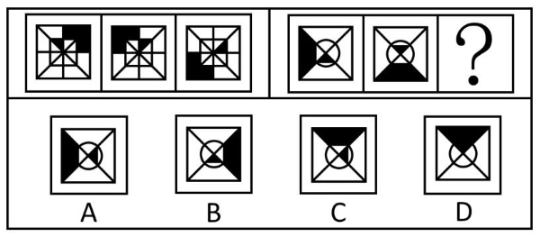

# 图形推理-位置规律（平移-顺-逆时针移动格数）

考点：[[20-考点/判断推理/图形推理/图形推理-位置规律（平移-顺-逆时针移动格数）|图形推理 / 图形推理-位置规律（平移-顺/逆时针移动格数）]]

**问法模型**：“符合所给图形的变化规律”的两组图类比问法 → 第一组找各黑块平移的方向与步数规律，第二组套用同一规律推问号处图形

## 推理链
1. 第1步：两组图元素组成相同，仅黑色色块位置改变，优先考虑位置规律而非样式规律
2. 第2步：第一组图中分别标记'L'形黑块与三角形黑块两个移动主体，沿对角线分割出的八方格逐图追踪其位置
3. 第3步：对比第一组图1→图2→图3，'L'形黑块沿逆时针每次移动1格，三角形黑块沿顺时针每次移动1格，规律成立
4. 第4步：第二组图同样含两个黑块（梯形黑块、三角形黑块），将第一组'一个逆时针一个顺时针'的双主体平移模式迁移过来
5. 第5步：第二组图1→图2验证：梯形黑块沿逆时针每次移动1格，三角形黑块每次移动2格
6. 第6步：从第二组图2出发，梯形黑块再逆时针移1格、三角形黑块再移2格，逐项对照A/B/C/D，只有B项两个黑块落位均吻合

**最快解法**：⚡ 标记追踪法：分别盯住两个黑块各自走——先在第一组数出'L'形块逆时针1格、三角块顺时针1格，再到第二组套用'一逆一顺、步数核对'，从图2各推一步直接锁定B

## 易错点
- ⚠ 只追踪一个黑块忽略另一黑块，两个块移动方向相反（一逆一顺），漏看一个即可能误选A
- ⚠ 将第一组'每次移动1格'惯性套用到第二组三角形黑块，其实第二组三角形黑块每次移动2格，步数核对缺位
- ⚠ 梯形黑块与三角形黑块形状相近，图2中位置重叠区域易看混，需先分清主体再数格

## 母题抽象
> 🧩 当两组图元素组成相同、仅色块位置变化时，按'分主体追踪方向+步数'法：第一组定规律（谁顺时针、谁逆时针、各走几格），第二组套规律，从末图再推一步对照选项

**同类特征**：两组图各三幅、元素组成相同、黑白块/色块位置变化、顺时针与逆时针移动、移动格数递推、对角线/圆内十字分割区域

## 相关题
- [[10-真题/判断推理/图形推理/4651895 图形推理-位置规律（左右翻转-镜像）|4651895]]（深圳市考 2022，相关度2）
- [[10-真题/判断推理/图形推理/2172768 位置规律（旋转-翻转）|2172768]]（海南 2021，相关度1）
- [[10-真题/判断推理/图形推理/10204458 位置规律-平移（特征交点沿内圈循环平移）|10204458]]（甘肃 2024，相关度1）
- [[10-真题/判断推理/图形推理/10204614 图形推理-位置规律（旋转+翻转交替循环）|10204614]]（黑龙江 2024，相关度1）
- [[10-真题/判断推理/图形推理/10297399 位置规律—平移（多黑块分组循环平移）|10297399]]（四川 2025，相关度1）

---

### 题干

下列选项中，符合所给图形的变化规律的是<u>        </u>。

### 选项
- A. A
- B. B　✅
- C. C
- D. D

### 官方解析
元素组成相同，考虑位置规律。第一组图中，图1到图3“L”形黑块沿逆时针方向每次移动1格，三角形黑块沿顺时针方向每次移动1格。第二组图运用此规律，图1到图3梯形黑块沿逆时针方向每次移动1格，三角形黑块沿顺/逆时针方向每次移动2格，只有B项符合。
故正确答案为B。

### 给定材料
（无）

> [!warning] 疑点（官方解析可能有误，待人工复核）
> 官方解析对第二组三角形黑块的方向表述为'顺/逆时针'（双向均可），方向不够唯一；但结合步数2格与梯形块逆时针1格仍能唯一锁定B项，不影响正确答案
