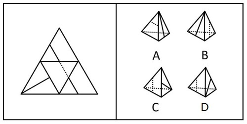

# 空间重构-四面体折叠（公共边交点-中点定位法）

考点：[[20-考点/判断推理/图形推理/空间重构-四面体折叠（公共边交点-中点定位法）|图形推理 / 空间重构-四面体折叠（公共边交点/中点定位法）]]

**问法模型**：'左边展开图、右边哪个能折叠而成'的四面体折纸盒问法 → 给展开图各面标号，用公共边上线条落点（中点/端点）检验法逐项排除

## 推理链
1. 第1步：题干为一个大三角形内部分割出四个小三角形的四面体展开图，按官方解析标号，可见选项均由面f与面g两个面构成
2. 第2步：明确展开图中的关键特征——面f内所画直线的一端恰好落在面f与面g的公共边的中点上
3. 第3步：折叠规律为'面上的线与公共边的相对位置在折叠前后不变'，故立体图中面f的直线必须仍与两可见面（f、g）的公共边交于中点
4. 第4步：逐项对照：A项中面f的直线与公共边的交点不在中点，排除
5. 第5步：B项中面f的直线与公共边的交点不在中点，排除
6. 第6步：C项中面f的直线恰好经过f、g两公共边的中点，与展开图一致
7. 第7步：D项中面f的直线与公共边的交点不在中点，排除；故只有C可由展开图折叠而成

**最快解法**：⚡ 中点定位法（公共边交点检验）：先在展开图中锁定'面f的直线落在公共边中点'这一特征，再逐项看立体图中该直线与两可见面公共边的交点位置，凡交点偏离中点者（A、B、D）一步排除，仅C吻合

## 易错点
- ⚠ 只比较线条的大致方向/角度，忽略线与公共边交点是否为中点这一精细特征，在A、C、D等形似选项间误判
- ⚠ 把立体图中表示不可见棱的虚线误当作面内图案，干扰对面f、面g的识别
- ⚠ 四面体折叠方向（向内/向外翻折）判断错误，导致公共边对应关系找错

## 母题抽象
> 🧩 当四面体展开图中某面内画有线段且线段端点落在棱上（尤其在中点）时，折叠题用'公共边交点定位法'：立体图中该线与两可见面公共边的交点位置必须与展开图中完全一致（中点/端点不可移位）

**同类特征**：四面体展开图（大三角形分为四个小三角形）、面内含直线且一端落在公共边上、直线经过公共边的中点、选项为四个立体四面体三视图、各选项均由相同的两个面（f和g）构成、立体图中虚线为不可见棱

## 相关题
（暂无）

---

### 题干

左边给定的是纸盒外表面的展开图，右边选项中能由它折叠而成的是<u>        </u>。

### 选项
- A. A
- B. B
- C. C　✅
- D. D

### 官方解析

本题考查四面体，将题干展开图标上序号，如下图所示，逐一分析选项。

A项：选项由面f和面g构成，题干展开图中面f中的直线经过两个面公共边的中点，而选项中面f中的直线没有经过两个面公共边的中点，选项与题干展开图不一致，排除； 

B项：选项由面f和面g构成，题干展开图中面f中的直线经过两个面公共边的中点，而选项中面f中的直线没有经过两个面公共边的中点，选项与题干展开图不一致，排除；

C项：选项由面f和面g构成，选项与题干展开图一致，当选；

D项：选项由面f和面g构成，题干展开图中面f中的直线经过两个面公共边的中点，而选项中面f中的直线没有经过两个面公共边的中点，选项与题干展开图不一致，排除。

故正确答案为C。

### 给定材料
（无）
