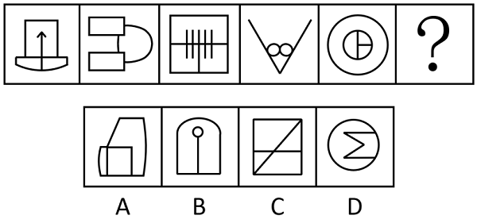

# 属性规律-对称性（轴对称+对称轴与图形线条的重合关系）

考点：[[20-考点/判断推理/图形推理/属性规律-对称性（轴对称+对称轴与图形线条的重合关系）|图形推理 / 属性规律-对称性（轴对称+对称轴与图形线条的重合关系）]]

**问法模型**：『选择最合适的一个填入问号处，使之呈现一定的规律性』→ 元素组成不同优先看属性规律，在确认『均为轴对称』后进一步细化对称轴与图形自身线条是否重合

## 推理链
1. 第1步：题干五幅图元素组成不同（箭头底座、双矩形连半圆、竖线方格、V形加双圆、同心圆加T形），无位置或样式叠加规律，优先考虑属性规律，观察发现①~⑤均为轴对称图形
2. 第2步：仅凭『轴对称』无法唯一锁定答案，按对称考点细化——逐图画出对称轴，比较对称轴与图形中已有线条的位置关系
3. 第3步：图①竖直对称轴与箭身竖线重合、图③对称轴与方格中间竖线重合、图⑤对称轴与内部T形竖线重合，即①③⑤的对称轴均与图形中的一条线重合
4. 第4步：图②水平对称轴从上下两矩形之间穿过、图④竖直对称轴从两个小圆之间穿过（虽过V字顶点但未压任何线段），即②④的对称轴均不与图形中的线条重合，规律为『压线与不压线』奇偶交替
5. 第5步：问号处为第6幅图（偶数位），应选择『轴对称且对称轴不与图形中任何线条重合』的图形
6. 第6步：逐项对照：A外框不对称、C含对角线破坏轴对称，均非轴对称图形排除；B虽为轴对称但对称轴与内部竖线重合排除；D为轴对称且对称轴不与任何线条重合，符合，故选D

**最快解法**：⚡ 排除法＋对称轴压线口诀：先排非轴对称的A、C；再画B、D的对称轴——B的竖直对称轴恰好压在内部竖线上，D的对称轴从折线图形的空白处穿过、不压任何线，直接锁定D

## 易错点
- ⚠ 只做第一层『是否轴对称』辨析就误选B，漏掉『对称轴是否与图形线条重合』的二级辨析
- ⚠ 对称轴压线判断失误：图④竖直对称轴虽穿过V形顶点，但未与任何一条线段重合，误将其归入『压线』组导致规律看反
- ⚠ 忽略①③⑤与②④的交替（奇偶分组）规律，错去硬套对称轴数量、封闭区域数等其他规律

## 母题抽象
> 🧩 当题干图形元素组成不同且全部为轴对称图形时，升级比较『对称轴与图形线条的重合关系』（压线/不压线、重合线数、对称轴方向），常呈奇偶交替或分组规律，据此确定问号处图形

**同类特征**：元素组成不同、全部为轴对称图形、对称轴与线条重合与否、奇偶交替分组、对称轴位置二级辨析、问号处延续交替规律

## 相关题
- [[10-真题/判断推理/图形推理/2434278 属性规律-对称性（对称轴数量周期交替）|2434278]]（新疆 2019，相关度2）
- [[10-真题/判断推理/图形推理/10204454 数量规律-部分数（黑白球连通区域数做和）|10204454]]（甘肃 2024，相关度1）
- [[10-真题/判断推理/图形推理/10204604 数量规律-线数量（汉字横线数）|10204604]]（辽宁 2024，相关度1）
- [[10-真题/判断推理/图形推理/10297050 数量规律-特殊计数（线条穿过小白球的数量）|10297050]]（天津 2025，相关度1）
- [[10-真题/判断推理/图形推理/10297127 图形间关系-相交图形中不相交边数量（黑白图形相交）|10297127]]（天津 2025，相关度1）

---

### 题干

从所给的四个选项中，选择最合适的一个填入问号处，使之呈现一定的规律性：

### 选项
- A. A
- B. B
- C. C
- D. D　✅

### 官方解析
元素组成不同，优先考虑属性规律。观察发现，题干图形均为轴对称图形，排除A、C两项；继续观察发现，图①、图③、图⑤的对称轴均与图形中的一条线重合，图②、图④的对称轴均不与图形中的线条重合，故？处应选择一个对称轴不与图形中的线条重合的图形，只有D项符合。
故正确答案为D。

### 给定材料
（无）
