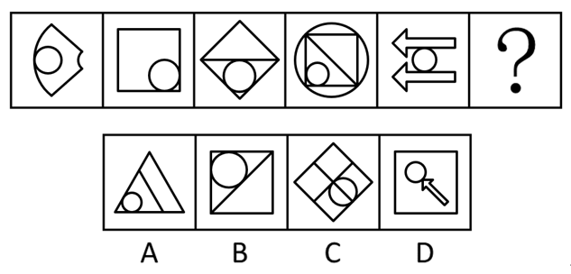

# 属性规律-对称性（对称轴方向顺时针旋转）+数量规律-一笔画（双规律叠加）

考点：[[20-考点/判断推理/图形推理/属性规律-对称性（对称轴方向顺时针旋转）+数量规律-一笔画（双规律叠加）|图形推理 / 属性规律-对称性（对称轴方向顺时针旋转）+数量规律-一笔画（双规律叠加）]]

**问法模型**：一组组成不同的图形填？处→先属性规律（数对称轴数量与方向旋转）第一轮排除，再数量规律（一笔画奇点计数）第二轮锁定

## 推理链
1. 第1步：题干五幅图元素组成不同，且出现等腰三角形、双向箭头等明显等腰对称元素→优先考虑属性规律中的对称性
2. 第2步：数对称轴：题干每幅图均只有1条对称轴，且对称轴方向逐幅顺时针旋转（图1竖直方向延续旋转至图5水平方向），？处须延续'仅1条对称轴+方向顺时针旋转'的规律
3. 第3步：第一轮对照选项：A项（三角形+内部斜线+小圆）的对称轴方向不符合题干顺时针旋转规律，排除A项
4. 第4步：对称性无法在B/C/D中唯一锁定→启动第二规律：题干多幅图出现圆与外框相切的组合，数切点无规律→转向笔画数
5. 第5步：数奇点：题干各图整体连通且奇点数为0或2个，均为一笔画图形，？处也须为一笔画图形
6. 第6步：第二轮逐项验证：B项（方框+对角线+相切圆）仅2个奇点且连通，为一笔画；C、D项含独立圆/箭头部分，为多笔画→只有B项同时满足两轮规律

**最快解法**：⚡ 两步排除法：第一步数对称轴——题干均1条对称轴且方向依次顺时针旋转，？处延续该方向，排除A；第二步数奇点——题干均为一笔画，B项对角线两端共2个奇点且连通为一件画，C、D多笔画，秒锁B

## 易错点
- ⚠ 只验证'有对称轴'而忽略对称轴'方向依次顺时针旋转'的动态规律，误把方向不符的图形当候选
- ⚠ 看到多幅图出现相切圆就死磕切点数/交点数，未及时切换到笔画数规律
- ⚠ 判断一笔画时忘记先确认图形连通（相切即连通），或忘记'奇点数为0或2才是一笔画'的判定标准

## 母题抽象
> 🧩 当题干图形组成不同且出现等腰三角形、箭头等对称特征时，先数对称轴的数量与方向旋转规律做第一轮排除；若仍不能唯一确定，再结合相切、一笔画等数量规律做第二轮筛选

**同类特征**：元素组成不同、等腰三角形与箭头等腰元素、对称轴仅1条且方向顺时针旋转、多个圆与外框相切、切点数无规律转考笔画数、题干均一笔画

## 相关题
- [[10-真题/判断推理/图形推理/10204454 数量规律-部分数（黑白球连通区域数做和）|10204454]]（甘肃 2024，相关度1）
- [[10-真题/判断推理/图形推理/10204604 数量规律-线数量（汉字横线数）|10204604]]（辽宁 2024，相关度1）
- [[10-真题/判断推理/图形推理/10297050 数量规律-特殊计数（线条穿过小白球的数量）|10297050]]（天津 2025，相关度1）
- [[10-真题/判断推理/图形推理/10297127 图形间关系-相交图形中不相交边数量（黑白图形相交）|10297127]]（天津 2025，相关度1）
- [[10-真题/判断推理/图形推理/10297148 数量规律-线的细化（端点连线穿过线条数；备选：平行线组数）|10297148]]（天津 2025，相关度1）

---

### 题干

从所给的四个选项中，选择最合适的一个填入问号处，使之呈现一定的规律性：

### 选项
- A. A
- B. B　✅
- C. C
- D. D

### 官方解析

元素组成不同，优先考虑属性规律。观察发现，题干中出现了等腰三角形、箭头等腰元素，优先考虑对称性。题干图形均只有1条对称轴，且对称轴的方向依次顺时针旋转，？处应用此规律，排除A项；继续观察发现，题干出现多个相切图形，切点数无规律，考虑笔画数。题干图形均为一笔画图形，？处应用此规律，只有B项符合。

故正确答案为B。

### 给定材料
（无）
