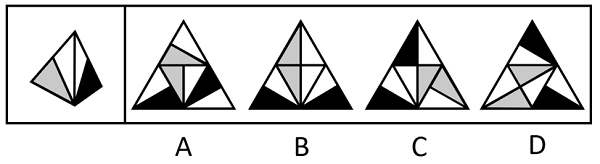

# 空间重构-四面体展开图（唯点标边法+相邻面公共边验证）

考点：[[20-考点/判断推理/图形推理/空间重构-四面体展开图（唯点标边法+相邻面公共边验证）|图形推理 / 空间重构-四面体展开图（唯点标边法+相邻面公共边验证）]]

**问法模型**：给出四面体立体图问哪个展开图可折成原图 → 采用'唯点+顺时针标边法'逐面比对边序所邻图案，并验证相邻面公共边特征

## 推理链
1. 第1步：将题干立体图的两个可见面标记为面e（含灰色三角形与白色三角形的面）和面f（含黑色三角形与白色三角形的面），每个面各有一个'唯一点'：面e的唯一点是灰色与白色相交的点，面f的唯一点是黑色与白色相交的点。
2. 第2步：使用唯点标边法——以唯一点为起点顺时针给该面三条边编号，题干特征为：面e的边1挨着灰色三角形，面f的边1挨着白色三角形。
3. 第3步：锁定相邻面公共边特征：面e与面f的公共边是面内白色三角形的斜边，展开图中该公共边关系必须保持。
4. 第4步：A项——以右下角面的唯一点为起点顺时针画边，边1挨着黑色三角形，与面e（边1挨灰）、面f（边1挨白）均不符，为无中生有面；且无论哪个面作面e，它与面f的公共边都不都是白色三角形斜边，排除。
5. 第5步：B项——各面以唯点顺时针画边后，边1所邻三角形颜色及面e、面f公共边（白色三角形斜边）均与题干一致，当选。
6. 第6步：C项——以灰色面的唯一点为起点顺时针画边，边1挨着白色三角形，两个灰色面均与题干面的边序特征不符，为无中生有面，排除。
7. 第7步：D项——同C，以灰色面唯一点顺时针画边，边1都挨着白色三角形，两个灰色面均为无中生有面，排除。

**最快解法**：⚡ 唯点标边法+排除法：先给题干两个可见面定唯一点并顺时针编号（面e边1邻灰三角、面f边1邻白三角），再逐项以选项各面唯点顺时针画边比对边1所邻颜色，凡边1邻色不符者即'无中生有面'直接排除（A、C、D），唯一吻合的B当选，最后用公共边（白色三角形斜边）复核。

## 易错点
- ⚠ 展开图中面经旋转后图案方向改变，若只凭图案相似而不做唯点标边比对，会误选C或D中'看起来像'的灰色面
- ⚠ 只验证单个面图案、忽略两相邻面公共边须为白色三角形斜边这一特征，可能错留A项
- ⚠ 唯一点找错或画边方向画反（须与题干同为顺时针且起点为唯一点），导致边1所邻颜色判断颠倒

## 母题抽象
> 🧩 当四面体立体图与展开图对照且面内图案不对称时，用'唯一点+顺时针标边法'给每个面的边定序，比对边1所邻图案并验证相邻面公共边特征，即可快速排除无中生有面。

**同类特征**：四面体外表面展开图、面内含灰色/白色/黑色三角形图案、每面存在唯一点（两色相交点）、相邻面公共边特征（白色三角形斜边）、无中生有面排除、折叠方向一致性

## 相关题
- [[10-真题/判断推理/图形推理/2042114 空间重构-四面体折叠（画箭头法-相邻面相对位置）|2042114]]（江苏 2017，相关度1）
- [[10-真题/判断推理/图形推理/2042116 空间重构-四面体折叠（相邻面公共边+箭头法）|2042116]]（江苏 2017，相关度1）
- [[10-真题/判断推理/图形推理/2172562 空间重构-四面体折叠（相邻面线条位置关系）|2172562]]（江苏 2018，相关度1）
- [[10-真题/判断推理/图形推理/2367943 空间重构-四面体折纸盒（相邻面公共边法）|2367943]]（江苏 2019，相关度1）
- [[10-真题/判断推理/图形推理/2742179 空间重构-四面体折叠（画边法：相邻面时针方向与压线顺序判定）|2742179]]（江苏 2021，相关度1）

---

### 题干

左边给定的是一个四面体，右边哪一项可能是它的外表面展开图？

### 选项
- A. A
- B. B　✅
- C. C
- D. D

### 官方解析

将题干立体图形的两个面标记为e、f，以题干中面e的唯一点（灰色与白色相交的点）为起点顺时针画边，边1挨着面e中的灰色三角形；以题干中面f的唯一点（黑色与白色相交的点）为起点顺时针画边，边1挨着面f中的白色三角形。且面e和面f的公共边为面内白色三角形的斜边，如下图所示，逐一进行分析。

A项：以选项右下角图形的唯一点为起点顺时针画边，边1挨着面内的黑色三角形，故该面为无中生有面。不管哪个面为面e，它和面f的公共边并不都是白色三角形的斜边，选项与题干不一致，排除；

B项：如上图所示，选项与题干一致，当选；

C项：以选项灰色面中的唯一点为起点顺时针画边，边1都挨着面内的白色三角形，故选项中的2个灰色面均为无中生有面，选项与题干不一致，排除；

D项：以选项灰色面中的唯一点为起点顺时针画边，边1都挨着面内的白色三角形，故选项中的2个灰色面均为无中生有面，选项与题干不一致，排除。

故正确答案为B。

### 给定材料
（无）
