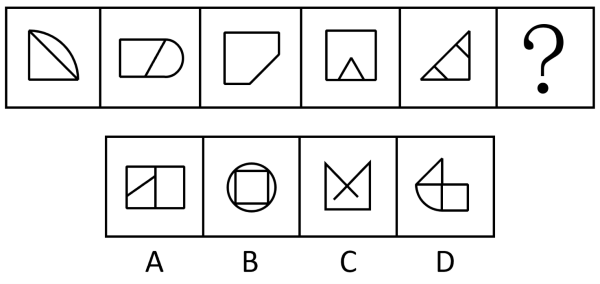

# 数量规律-角的数量（直角个数等差递增）

考点：[[20-考点/判断推理/图形推理/数量规律-角的数量（直角个数等差递增）|图形推理 / 数量规律-角的数量（直角个数等差递增）]]

**问法模型**：『选最合适的一个填入问号处使之呈现规律性』且元素组成不同、属性无规律 → 采用『属性不通转数量』模型，本题锁定清点直角个数

## 推理链
1. 第1步：题干五图元素组成不同（扇形直角三角/矩形+半圆/切角矩形/矩形内嵌三角/直角三角形加内线），对称、曲直、封闭等属性均无统一规律
2. 第2步：观察到各图均含明显直角（直角边、矩形角、切角后残留角），按『有直角优先数直角』的数量规律逐图清点
3. 第3步：清点题干直角数依次为1、2、3、4、5，构成公差为1的等差数列，故？处图形应含6个直角
4. 第4步：逐项清点选项直角数：A项8个、B项4个、C项6个、D项7个
5. 第5步：只有C项直角数为6，恰好延续等差规律，故选C

**最快解法**：⚡ 直角计数法+等差规律：快速扫五图各数直角得1→2→3→4→5，锁定？=6个直角，再数选项（A=8、B=4、D=7）排除法直选C

## 易错点
- ⚠ 数成图形总角数（锐角+钝角+直角一起数）或只数外轮廓角，导致找不到规律
- ⚠ 数直角时漏数内部线段与边相交、交叉形成的直角（如图5内部斜线、C项交叉线、D项分割处），从而误判C或D
- ⚠ 被扇形、半圆、圆等曲线元素带偏，转去数曲线数、面数量或交点数，忽略『曲直杂糅图形中隐藏的直角递增』主线

## 母题抽象
> 🧩 当题干为一组元素组成不同、且多图含矩形边或直角边的杂糅图形、属性规律不通时，优先逐图数直角个数；若呈等差数列，则按公差确定问号处直角数，再逐一清点选项直角数匹配唯一答案

**同类特征**：元素组成不同且无明显属性规律、多图含直角边/矩形/切角结构、直角个数依次为1、2、3、4、5的等差递增、曲直共存的杂糅图形组合、选项直角数互不相同（8/4/6/7）可唯一匹配

## 相关题
- [[10-真题/判断推理/图形推理/14403697 图形推理-数量规律（外框边数与内部元素个数作差恒定分组）|14403697]]（山东 2025，相关度1）
- [[10-真题/判断推理/图形推理/16070043 数量规律-灰色多边形边数与白色面数量的差值运算分组|16070043]]（贵州 2026，相关度1）
- [[10-真题/判断推理/图形推理/16070177 数量规律-部分数（黑白块分堆-同色连通区域数）|16070177]]（重庆 2026，相关度1）
- [[10-真题/判断推理/图形推理/2423328 图形推理-数量规律（内部线条与外框角端点相接个数）|2423328]]（甘肃 2019，相关度1）
- [[10-真题/判断推理/图形推理/2448487 数量规律-曲直交点数与曲线数的倍数运算关系|2448487]]（国考 2020，相关度1）

---

### 题干

从所给的四个选项中，选择最合适的一个填入问号处，使之呈现一定的规律性：

### 选项
- A. A
- B. B
- C. C　✅
- D. D

### 官方解析
元素组成不同，且无明显属性规律，优先考虑数量规律。观察发现，题干图形出现多个直角，优先考虑直角数，题干图形直角数依次为：1、2、3、4、5、？，故？处图形的直角数应为6。A项的直角数为8，B项的直角数为4，C项的直角数为6，D项的直角数为7，只有C项符合。
故正确答案为C。

### 给定材料
（无）
