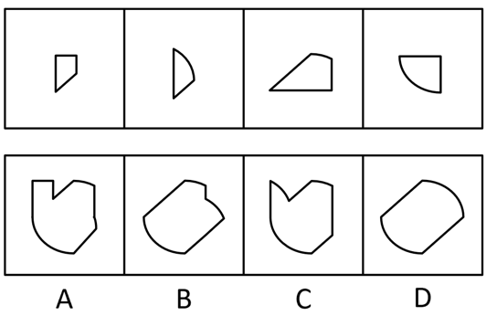

# 平面拼合（平行且等长相消）

考点：[[20-考点/判断推理/图形推理/平面拼合（平行且等长相消）|图形推理 / 平面拼合（平行且等长相消）]]

**问法模型**：四个图形只能上、下、左、右平移拼合成哪一项 → 按“平行且等长”两两配对相消公共边，再用消剩的外轮廓比对选项

## 推理链
1. 第1步：题干限定四个图形“只能通过上、下、左、右平移”拼合，故能对接的边必须平行且等长，对接后公共边从轮廓中消失（平行且等长相消）。
2. 第2步：清点四个原图的边线特征：①为左长右短两竖边＋顶横边＋右下斜边的直角梯形；②为左竖直边＋右凸弧的半月形；③为水平底边＋右侧短竖边＋左上长斜边（顶部略平）；④为上横边＋右竖边＋左下凸弧的四分之一圆。
3. 第3步：按“平行且等长”两两配对相消：①的右下斜边与③的长斜边平行等长，可整段对接相消；②的竖直边与④的右竖边平行等长，可对接相消；弧线只能与弧线拼合，②与④的弧相接后在拼合体左下方连成一条连续大弧。
4. 第4步：消去内部公共边后平移组合，外轮廓应为：左下方一条连续大弧＋上方斜边与右侧直边转折，整体光滑、无凹陷缺口。
5. 第5步：逐项对照：A、C顶部均出现“V”形凹陷，平移拼合（只能相消、不能翻转）无法产生此类缺口，排除；B整体由直边构成、不含弧线，与拼合体必含大弧不符，排除。
6. 第6步：D项轮廓（左下连续大弧＋上部斜边＋右侧直边）与相消后的组合轮廓完全一致，故选D。

**最快解法**：⚡ 平行且等长相消法＋排除法：斜边配斜边（①与③）、竖边配竖边（②与④）、弧配弧（②与④的弧连成左下大弧），消去公共边后锁定“含一条连续大弧且无凹陷”的外轮廓，直接排除A、C（顶部缺口）、B（无弧），秒选D。

## 易错点
- ⚠ 误将图形旋转后再拼合：本题只允许平移，斜边朝向与弧的凸向均不可改变，一旦在脑中旋转图形就会对不上轮廓
- ⚠ 把不平行或不等长的边强行对接（如①的斜边只与③的斜边部分重合），拼出带缺口或台阶的轮廓而误选A、C
- ⚠ 忽视“弧线只能与弧线拼合”，把弧与直边相接，从而误选不含弧线的B

## 母题抽象
> 🧩 当题干出现“四个图形拼合、只能平移”的特征时，用平行且等长相消法：斜对斜、直对直、弧对弧两两配对相消，消剩的外轮廓与选项比对即为答案。

**同类特征**：平面拼合、只能上、下、左、右平移、平行且等长相消、含弧线图形的对接、斜边整段相消、外轮廓比对选项

## 相关题
- [[10-真题/判断推理/图形推理/17058547 平面拼合（平行且等长相消）|17058547]]（选调 2023，相关度4）
- [[10-真题/判断推理/图形推理/17900828 平面拼合（平行且等长相消）|17900828]]（江苏 2024，相关度4）
- [[10-真题/判断推理/图形推理/1791636 平面拼合（平行且等长相消）|1791636]]（江苏 2016，相关度4）
- [[10-真题/判断推理/图形推理/1791816 平面拼合（平行且等长相消）|1791816]]（江苏 2016，相关度4）
- [[10-真题/判断推理/图形推理/4651713 平面拼合（平行且等长相消）|4651713]]（江苏 2022，相关度4）

---

### 题干

下边四个图形中，只有一个是由上边的四个图形拼合（只能通过上、下、左、右平移）而成的，请把它找出来。

### 选项
- A. A
- B. B
- C. C
- D. D　✅

### 官方解析

本题考查平面拼合，可采用平行且等长相消的方式解题。消去平行且等长的线段后进行组合可得到轮廓图，即为D项。平行且等长相消的方式如下图所示：

故正确答案为D。

### 给定材料
（无）
