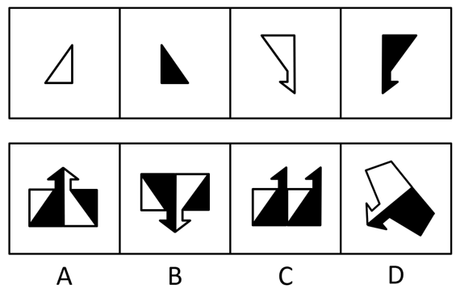

# 平面拼合（双面黑白纸片，翻转变色验证）

考点：[[20-考点/判断推理/图形推理/平面拼合（双面黑白纸片，翻转变色验证）|图形推理 / 平面拼合（双面黑白纸片，翻转变色验证）]]

**问法模型**：“右边哪项不能由其拼合而成”（选非）→ 平面拼合＋翻转变色验证模型：先按轮廓将选项分割为四块拼形状，再逐块核对“该朝向下翻/不翻”所呈现的黑白颜色是否与目标一致。

## 推理链
1. 第1步：题干左侧四片纸为①白色直角三角形、②黑色直角三角形、③白色箭头形、④黑色箭头形，条件是“一面为白色，一面为黑色”，允许平移、旋转、翻转。
2. 第2步：提取核心规则——翻面会使形状变成镜像、同时黑白互换；因此某片在目标朝向下“是否必须翻转”由形状唯一确定，其呈现的颜色也随之唯一确定，颜色不是可随意涂改的。
3. 第3步：A项：按官方拼合图安排四片的位置与翻/不翻状态，轮廓与黑白区域同时吻合，可拼成，排除。
4. 第4步：B项：轮廓虽可由这四片拼出，但四个黑白区域的颜色全部对不上——直接平移（不翻面）时四片颜色均错误，翻面后拼合四片颜色仍均错误。
5. 第5步：C、D项：均存在使形状与颜色同时匹配的拼合方式（官方拼合图），排除。
6. 第6步：本题为选非题（问“哪项不能”），四项中仅B颜色无法匹配，故选B。

**最快解法**：⚡ 翻转变色排除法：把每个选项按轮廓分成对应四片的小块，逐块判断该块形状需不需要镜像（翻面），再核对翻/不翻后应显示的颜色；A、C、D均能形状、颜色同时对上，B四块颜色全不符，直接锁定B。

## 易错点
- ⚠ 误以为“每片可白可黑”颜色就不构成限制——忽略翻面在变色的同时把形状变成镜像，形状朝向锁死了翻不翻，从而锁死了颜色
- ⚠ 只拼形状不验颜色：B的轮廓其实能由这四片拼出，错在黑白区域对不上，只看形状会误判B可选
- ⚠ 选非题惯性失误：问“不能拼合”，易顺手错选成“能拼合”的A、C、D

## 母题抽象
> 🧩 当题干出现“一面白一面黑的纸片、允许平移旋转翻转、问能/不能拼成哪个图形”时，先按轮廓做平面拼合，再用“翻面＝镜像＋黑白互换”规则逐片验证颜色，形状能拼但颜色全不符的即为答案（选非题）。

**同类特征**：一面为白色，一面为黑色、允许平移、旋转和翻转、左边四张纸片拼合、右边哪项不能（选非问法）、黑白三角形与箭头形纸片、颜色随翻转互换

## 相关题
（暂无）

---

### 题干

左边四张纸片，都是一面为白色，一面为黑色，在允许平移、旋转和翻转的条件下，可以拼合成多种图形。右边哪项不能由其拼合而成？

### 选项
- A. A
- B. B　✅
- C. C
- D. D

### 官方解析

本题考查平面拼合，可以平移、旋转、翻转，且每张纸片一面是黑色，另一面是白色，需要考虑翻转后的颜色变化。将题干图形标上序号如下图所示，逐一进行分析。

A项：可以由题干图形拼合而成，拼合方式如图所示，排除；

B项：存在多个错误，如果考虑直接平移拼合成选项图形，则四个题干图形颜色均错误；如果考虑翻转后拼合成选项图形，则四个题干图形颜色也均错误，当选；

C项：可以由题干图形拼合而成，拼合方式如图所示，排除；

D项：可以由题干图形拼合而成，拼合方式如图所示，排除。

本题为选非题，故正确答案为B。

### 给定材料
（无）
