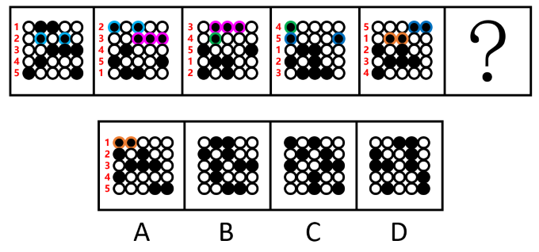

# 图形推理-位置规律（循环平移）

考点：[[20-考点/判断推理/图形推理/图形推理-位置规律（循环平移）|图形推理 / 图形推理-位置规律（循环平移）]]

**问法模型**：五个连续图形+问号求规律 → 元素组成相同，优先考虑位置规律，黑球多时用相邻比较法找平移规则

## 推理链
1. 第1步：题干五幅图与选项均为相同的黑白圆圈点阵，黑球/白球数量不变、元素组成相同，锁定位置规律
2. 第2步：黑球较多，单独看每幅图不易发现规律，改用相邻比较法，对比图一与图二中黑球的位置变化
3. 第3步：发现核心规律——前一幅图中每一行的黑球均整体向上平移一行（循环走，最上行黑球移到最下行）
4. 第4步：补充复合规则——平移到第一行的黑球均再向左平移一格（循环走，最左列移到最右列）
5. 第5步：用该规则从图一推至图二、图二推至图三……逐图验证，图五即由此规律生成，规律成立
6. 第6步：将图五按'每行黑球上移一行、原第一行黑球左移一格（均循环）'变换得到问号处图形，与四个选项逐项对照，只有A项符合

**最快解法**：⚡ 相邻比较法+循环平移口诀：黑球整体上移一行（循环），到第一行的黑球再左移一格（循环），按行整团追踪黑球直接推出问号图形选A

## 易错点
- ⚠ 黑球数量多，逐个追踪单个黑球轨迹易混乱，应以'整行黑球'为单位观察平移
- ⚠ 只看到'上移一行'而漏掉'到达第一行后额外左移一格'的复合规则，易误选单纯上移得到的干扰项
- ⚠ 循环方向搞反：上移循环是第一行移到最下行，左移循环是最左列移到最右列，方向看错则四项全错

## 母题抽象
> 🧩 当题干为相同黑白点阵且黑点较多、单独看无规律时，用相邻比较法找出复合循环平移规则（如'整行上移循环+首行左移循环'），再按规则推出下一幅图

**同类特征**：黑白圆圈点阵、元素组成相同、黑球数量较多、连续五图递变、循环平移、需相邻比较

## 相关题
- [[10-真题/判断推理/图形推理/2452982 图形推理-位置规律（循环平移）|2452982]]（上海 2020，相关度3）
- [[10-真题/判断推理/图形推理/10297399 位置规律—平移（多黑块分组循环平移）|10297399]]（四川 2025，相关度2）
- [[10-真题/判断推理/图形推理/4662372 图形推理-位置规律（线条移动·相邻比较）|4662372]]（山东 2022，相关度2）
- [[10-真题/判断推理/图形推理/2172768 位置规律（旋转-翻转）|2172768]]（海南 2021，相关度1）
- [[10-真题/判断推理/图形推理/10204458 位置规律-平移（特征交点沿内圈循环平移）|10204458]]（甘肃 2024，相关度1）

---

### 题干

从所给的四个选项中，选择最合适的一个填入问号处，使之呈现一定的规律性：

### 选项
- A. A　✅
- B. B
- C. C
- D. D

### 官方解析

元素组成相同，优先考虑位置规律。题干图形中黑球较多，单独看不易发现规律，考虑相邻比较。观察发现，从图一至图五，前一幅图中每行的黑球均整体向上平移一行（循环走），平移到第一行时均再向左平移一格（循环走），即可得到后一幅图。故？处图形应符合上述规律，如下图所示，只有A项符合。

故正确答案为A。

### 给定材料
（无）
