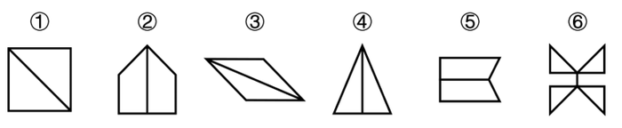

# 图形推理-对称性（轴对称与中心对称分组分类）

考点：[[20-考点/判断推理/图形推理/图形推理-对称性（轴对称与中心对称分组分类）|图形推理 / 图形推理-对称性（轴对称与中心对称分组分类）]]

**问法模型**：六个图形分为两类使每类各有共同特征 → 分组分类题，元素组成不同优先考虑属性规律（对称性）

## 推理链
1. 第1步：题干六个图形元素组成不同，且出现正方形、等腰三角形、平行四边形等多个'规则/等腰'图形，优先考虑对称性属性
2. 第2步：逐一判定对称类型——①正方形加对角线、③平行四边形加对角线、⑥双三角蝶形组合均旋转180°后与原图重合（中心对称）；②房形加竖中线、④等腰三角形加竖中线、⑤上下对称梯形加横中线仅能沿一条直线折叠重合（轴对称）
3. 第3步：按'是否（既轴对称又）中心对称'二分：①③⑥一组，②④⑤一组
4. 第4步：对照选项，①③⑥、②④⑤的分组对应D项

**最快解法**：⚡ 对称性口诀法：先验中心对称——把每个图形旋转180°，能重合的①③⑥一组，不能重合（仅轴对称）的②④⑤一组，直接锁定D

## 易错点
- ⚠ 混淆轴对称（翻折重合）与中心对称（旋转180°重合），把⑤的上下对称误判为中心对称
- ⚠ 误认为'平行四边形是轴对称图形'，对③的对称类型判断出错（一般平行四边形无对称轴，仅中心对称）
- ⚠ 只盯着'图形里有横线/竖线'等表面线条特征分类，漏掉对称性这一本质属性规律

## 母题抽象
> 🧩 当分组分类题六图元素组成不同且含等腰、平行等规则图形时，优先用对称性二分：旋转180°重合的（中心对称）一组，仅翻折重合的（仅轴对称）一组

**同类特征**：分组分类问法、元素组成不同、出现等腰/正方形/平行四边形等规则图形、图形内带单条分割线、轴对称与中心对称混排

## 相关题
- [[10-真题/判断推理/图形推理/10297262 数量规律-面的形状种类（封闭面种类数分组）|10297262]]（浙江 2025，相关度2）
- [[10-真题/判断推理/图形推理/12536392 数量规律-黑色区域面积（宫格面积折算）|12536392]]（四川 2024，相关度2）
- [[10-真题/判断推理/图形推理/12882156 图形推理-对称性（仅轴对称 vs 既轴对称又中心对称）|12882156]]（黑龙江 2025，相关度2）
- [[10-真题/判断推理/图形推理/15833781 属性规律-对称性（轴对称与中心对称组合分组）|15833781]]（内蒙古 2026，相关度2）
- [[10-真题/判断推理/图形推理/17097256 数量规律-交点数（交点数相同再比交点分布位置）|17097256]]（山西 2024，相关度2）

---

### 题干

把下面的六个图形分为两类，使每一类都有各自的共同特征或规律，分类正确的一项是：

### 选项
- A. ①②③，④⑤⑥
- B. ①③⑤，②④⑥
- C. ①②⑥，③④⑤
- D. ①③⑥，②④⑤　✅

### 官方解析
本题为分组分类题目。元素组成不同，优先考虑属性规律。观察发现，题干出现多个“等腰”图形，考虑对称性。图①③⑥均为既轴对称又中心对称图形，图②④⑤均为轴对称图形。即图①③⑥为一组，图②④⑤为一组。
故正确答案为D。

### 给定材料
（无）

> [!warning] 疑点（官方解析可能有误，待人工复核）
> 官方称'图①③⑥均为既轴对称又中心对称'，但图③按图为一般平行四边形（邻边不等）时仅有中心对称、无对称轴，该表述对③不够严谨；不过不影响分组结论——以'是否中心对称'分类仍得①③⑥/②④⑤，答案D成立
