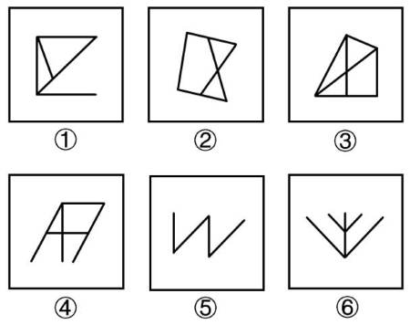

# 数量规律-平行线组数

考点：[[20-考点/判断推理/图形推理/数量规律-平行线组数|图形推理 / 数量规律-平行线组数]]

**问法模型**：六个图形分为两类使每类各有共同特征 → 分组分类题，元素组成不同且无属性规律时，转向数量规律（数平行线组数）

## 推理链
1. 第1步：提取图形特征：六图元素组成各不相同，均由直线构成，无对称、封闭、曲直等明显属性规律
2. 第2步：属性规律不通则转向数量规律，观察发现每幅图都存在明显的同向线段，优先考虑平行线数量
3. 第3步：数①②③的平行线组数：图①上下横线平行、图②左右两侧边平行、图③中间竖线与右侧竖边平行，各均只有1组平行线
4. 第4步：数④⑤⑥的平行线组数：图④横线间平行且斜线间平行、图⑤'W'形两笔下行线平行且两笔上行线平行、图⑥内外两个'V'对应边分别平行，各均有2组平行线
5. 第5步：按'平行线组数'分为两类：①②③（1组）为一类，④⑤⑥（2组）为一类
6. 第6步：对照选项，A项为①②③，④⑤⑥，与规律完全吻合，故选A

**最快解法**：⚡ 数平行线组数法：逐图找同向且不相交的线段，①②③均只含1组平行线，④⑤⑥均含2组平行线，直接锁定A项

## 易错点
- ⚠ 混淆'平行线条数'与'平行线组数'，把同一组内的多条平行线重复计组，误判④⑤⑥
- ⚠ 只找水平/垂直方向的平行线，漏掉斜向平行线（如⑤的斜笔、⑥的斜V边），导致分组错误
- ⚠ 元素组成不同时仍纠结属性规律（对称、封闭、曲直），考场浪费时间

## 母题抽象
> 🧩 当分组分类题元素组成不同、无属性规律，且图形均由直线构成并含同向线段时，数平行线组数：组数相同（如均1组）的归一类，组数相同（如均2组）的归另一类

**同类特征**：分组分类（六图分两类）、元素组成不同、均由直线构成、存在明显平行线、平行线组数1组vs2组、无属性规律可用

## 相关题
- [[10-真题/判断推理/图形推理/2579750 数量规律-平行线组数|2579750]]（浙江 2020，相关度3）
- [[10-真题/判断推理/图形推理/10297148 数量规律-线的细化（端点连线穿过线条数；备选：平行线组数）|10297148]]（天津 2025，相关度2）
- [[10-真题/判断推理/图形推理/1752676 数量规律-交点数（分组分类）|1752676]]（北京 2016，相关度2）
- [[10-真题/判断推理/图形推理/2444750 图形推理-属性规律（轴对称-黑白区域分别看对称性）|2444750]]（四川 2019，相关度2）
- [[10-真题/判断推理/图形推理/4658468 属性规律-对称性（轴对称与否分组）|4658468]]（四川 2021，相关度2）

---

### 题干

把下面六个图形分为两类，使每一类图形都有各自的共同特征或规律，分类正确的一项是（    ）。

### 选项
- A. ①②③，④⑤⑥　✅
- B. ①②⑤，③④⑥
- C. ①②④，③⑤⑥
- D. ①③④，②⑤⑥

### 官方解析
本题为分组分类题目。元素组成不同，且无明显属性规律，考虑数量规律。观察发现，题干图形均由直线构成，且存在明显的平行线，优先考虑平行线数量。图①②③中，均有一组平行线，图④⑤⑥中，均有两组平行线。即图①②③为一组，图④⑤⑥为一组。
故正确答案为A。

### 给定材料
（无）
