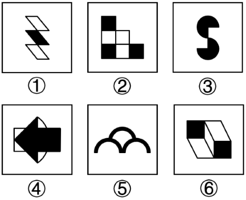

# 对称性-中心对称与轴对称的分组分类

考点：[[20-考点/判断推理/图形推理/对称性-中心对称与轴对称的分组分类|图形推理 / 对称性-中心对称与轴对称的分组分类]]

**问法模型**：‘六个图形分为两类，每类有各自共同特征’→ 优先属性规律，逐图判定对称类型（轴对称/中心对称/兼具/均不），按对称类型二分

## 推理链
1. 第1步：六图元素组成不同，且出现平行四边形条带、等腰形、圆弧、方块等规则元素，优先考虑属性规律中的对称性
2. 第2步：①由三个平行四边形条带组成Z形，平行四边形无对称轴，但绕中心旋转180°与原图重合，为中心对称图形
3. 第3步：②黑白方块呈阶梯（L形）排布，沿左上—右下对角线对折可重合，为轴对称图形，旋转180°不重合；③两个半圆错位构成S形，旋转180°重合，为中心对称图形
4. 第4步：④矩形内左指黑色箭头沿水平中线对折重合，为轴对称图形；⑤三个半圆弧沿过中间弧顶的竖直中线对折重合，为轴对称图形；⑥立方体中两个黑色面处于对角位置，旋转180°重合，为中心对称图形
5. 第5步：归纳分组——①③⑥均为中心对称图形，②④⑤均为轴对称图形
6. 第6步：对照选项，C项为'①③⑥，②④⑤'，与结论一致，故选C

**最快解法**：⚡ 对称判定法：对每图做两个动作——绕中心旋转180°看是否与自身重合（①③⑥重合→中心对称），再沿竖直/水平/对角线对折看是否重合（②④⑤重合→轴对称），两组恰好二分，秒选C

## 易错点
- ⚠ 误把①的平行四边形条带当轴对称图形（平行四边形对折不重合），①实际仅中心对称
- ⚠ ⑥为立方体直观图，易盯着'黑色方块'去找轴对称方向，实际黑面沿中心对称分布，⑥仅中心对称
- ⚠ 看错②阶梯图形的对称轴方向，或误认②绕中心旋转180°重合而错分为中心对称组

## 母题抽象
> 🧩 当分组分类题元素组成不同、且图形含平行四边形/等腰形/圆弧/方块等规则元素时，优先测对称性：旋转180°重合的归一组（中心对称），对折重合的归另一组（轴对称）

**同类特征**：元素组成不同、等腰/平行四边形元素、黑白方块与立方体组合、半圆弧、箭头等规则图形、六图分两类问法、对称性特征明显

## 相关题
- [[10-真题/判断推理/图形推理/16593051 属性规律-曲直性（线条种类数：直曲混合 vs 纯直线-纯曲线）|16593051]]（青海 2024，相关度2）
- [[10-真题/判断推理/图形推理/1746832 数量规律-曲线数（字母字符图形化计数）|1746832]]（国考 2016，相关度2）
- [[10-真题/判断推理/图形推理/2263006 数量规律-曲线条数（线条计数分类）|2263006]]（四川 2016，相关度2）
- [[10-真题/判断推理/图形推理/10204454 数量规律-部分数（黑白球连通区域数做和）|10204454]]（甘肃 2024，相关度1）
- [[10-真题/判断推理/图形推理/10204457 面数量+最大面的对称性（中心对称与轴对称分组）|10204457]]（甘肃 2024，相关度1）

---

### 题干

把下面六个图形分为两类，使每一类图形都有各自的共同特征或规律，分类正确的一项是（    ）。

### 选项
- A. ①②③，④⑤⑥
- B. ①③⑤，②④⑥
- C. ①③⑥，②④⑤　✅
- D. ①④⑥，②③⑤

### 官方解析
本题为分组分类题目。元素组成不同，优先考虑属性规律。观察发现，题干出现多个等腰元素，优先考虑对称性。图①③⑥均为中心对称图形，图②④⑤均为轴对称图形，即图①③⑥为一组，图②④⑤为一组。
故正确答案为C。

### 给定材料
（无）
