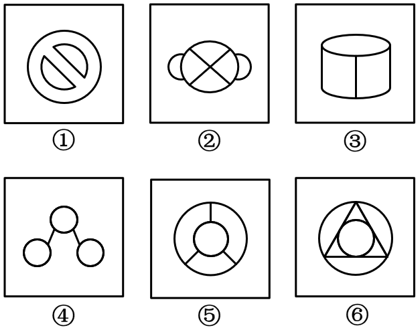

# 数量规律-线数量（曲线数-曲直交点数-直线数）分组

考点：[[20-考点/判断推理/图形推理/数量规律-线数量（曲线数-曲直交点数-直线数）分组|图形推理 / 数量规律-线数量（曲线数/曲直交点数/直线数）分组]]

**问法模型**：『六个图形分为两类，使每一类都有各自共同特征』→ 数量类分组题：先看属性无规律，再逐图数线（曲线数优先），按数量二分验证

## 推理链
1. 第1步：六图元素组成不同，对称、开闭等属性规律不明显，转向数量规律
2. 第2步：特征图识别——每幅图均含圆或弧（①禁止符外圆、②大圆加两侧小圆、③圆柱椭圆、④三个小圆、⑤内外双圆、⑥外圆内圆），且曲线与直线交叉明显，优先数曲线数或曲直交点数
3. 第3步：数曲线——图①②④均含3条曲线，图③⑤⑥均含2条曲线，呈现清晰的3/2二分
4. 第4步：交叉验证曲直交点——图①②④曲直交点均为4个，图③⑤⑥均为6个；再验证直线数——图①②④均为2条直线，图③⑤⑥均为3条直线
5. 第5步：三种数法分组完全一致，均为①②④一组、③⑤⑥一组，对照选项只有A符合

**最快解法**：⚡ 特征图口诀『有圆有直、曲直交叉明显→先数曲线数』：快速点数每图曲线，3条的①②④一组、2条的③⑤⑥一组，直接锁定A；再用曲直交点数（4/6）或直线数（2/3）二次验证

## 易错点
- ⚠ 死磕对称、封闭区域等属性/面规律，漏掉本题最直接的曲线数规律
- ⚠ 数曲直交点时把曲线与曲线的切点、交点（如图②大圆与小圆相接处、图⑤内圆与外圆间的区域）误计入曲直交点
- ⚠ 图形结构复杂（如图⑥圆内嵌三角形及交叉线）时数线遗漏或重复，直线数数错而误排官方解法三

## 母题抽象
> 🧩 当分组题六图均由直线和曲线构成、含圆且曲直交叉明显时，优先数曲线数或曲直交点数做3/2二分，直线数可作备用验证，多法同组即为稳答

**同类特征**：六个图形分两类（分组分类问法）、元素组成不同、无明显属性规律、每幅图均包含圆/曲线、曲线与直线交叉明显、曲线数、直线数、曲直交点数多解法殊途同归

## 相关题
- [[10-真题/判断推理/图形推理/11454021 数量规律-小元素个数与边数的等量关系（叠加白色同形区域验证）|11454021]]（选调 2024，相关度1）
- [[10-真题/判断推理/图形推理/2144665 数量规律-线数量（两组图运算：图一线数+图三线数=图二线数）|2144665]]（新疆 2017，相关度1）
- [[10-真题/判断推理/图形推理/2434290 数量规律-线数量（直线数与曲线数做差运算）|2434290]]（新疆 2019，相关度1）
- [[10-真题/判断推理/图形推理/2662241 数量规律-面的细化（相同面数量）|2662241]]（新疆 2020，相关度1）
- [[10-真题/判断推理/图形推理/4678642 图形推理-数量规律（黑白面积关系-面积比例）|4678642]]（选调 2020，相关度1）

---

### 题干

把下面的六个图形分为两类，使每一类图形都有各自的共同特征或规律，分类正确的一项是：

### 选项
- A. ①②④，③⑤⑥　✅
- B. ①③⑥，②④⑤
- C. ①④⑤，②③⑥
- D. ①⑤⑥，②③④

### 官方解析
解法一：元素组成不同，且无明显属性规律，考虑数量规律。观察发现，题干图形均含有圆，曲线特征明显，考虑数曲线数。图①②④的曲线数均为3，图③⑤⑥的曲线数均为2，故图①②④为一组，图③⑤⑥为一组。
故正确答案为A。
解法二：元素组成不同，且无明显属性规律，考虑数量规律。观察发现，题干图形均由直线和曲线构成，且曲线、直线交叉明显，考虑数曲直交点数。图①②④的曲直交点数均为4，图③⑤⑥的曲直交点数均为6，故图①②④为一组，图③⑤⑥为一组。
故正确答案为A。
解法三：元素组成不同，且无明显属性规律，考虑数量规律。题干图形均含有直线，考虑数直线数。图①②④的直线数均为2，图③⑤⑥的直线数均为3，故图①②④为一组，图③⑤⑥为一组。
故正确答案为A。
注：三种解法都可以选出唯一答案，因本题特征图为：每幅图均包含曲线和直线，且曲线和直线交叉明显，故可以根据特征图优先考虑曲线数或曲直交点数；除了这两种规律外，还可以考虑直线数。考场上这样的思路都是可行且合理的。

### 给定材料
（无）
