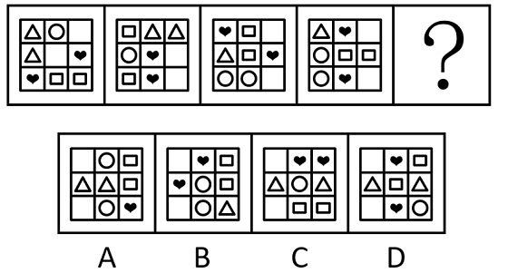
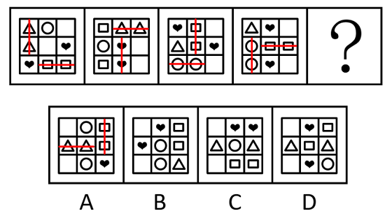

# 数量规律+位置规律（元素种类个数分布2、2、2、1＋相邻相同元素连线互相垂直）

考点：[[20-考点/判断推理/图形推理/数量规律+位置规律（元素种类个数分布2、2、2、1＋相邻相同元素连线互相垂直）|图形推理 / 数量规律+位置规律（元素种类个数分布2、2、2、1＋相邻相同元素连线互相垂直）]]

**问法模型**：问'填入问号处使之呈现一定规律性'→ 元素组成不同且无属性规律时先数元素种类与个数，数量规律无法唯一锁定时再细化到相同元素的相对位置（连线方向）规律

## 推理链
1. 第1步：题干四幅图均为3×3方格内排布的小元素（△○♥□），元素组成不同，且无对称、封闭等属性规律，转向数量规律
2. 第2步：数元素发现，题干每幅图均包含4种小元素，个数分布均为2、2、2、1，但四个选项同样满足该分布，数量规律无法确定唯一答案
3. 第3步：继续细化位置规律：题干每幅图中都有两对相同的小元素位置相邻（同行或同列紧邻），如图1中△△竖直相邻、□□横向相邻
4. 第4步：将这两对相邻相同元素分别连线，题干四幅图的两条连线均一横一竖、互相垂直
5. 第5步：验证选项——A项△△横向相邻、□□竖直相邻，两连线互相垂直，符合
6. 第6步：B项两对相邻元素○○与□□均为竖直连线、互相平行；C项♥♥与□□均为横向连线、互相平行；D项不存在两对相邻的相同元素，均排除
7. 第7步：只有A项符合'两对相邻相同元素连线互相垂直'的规律，故正确答案为A

**最快解法**：⚡ 连线法：先数元素个数发现每图均为2、2、2、1且选项无差别，立即换用'相邻相同元素两两连线看方向'口诀——题干两连线互相垂直，快速排除B（两线同竖平行）、C（两线同横平行）、D（无相邻对），锁定A

## 易错点
- ⚠ 只数到元素个数分布2、2、2、1就停止分析，发现四个选项均满足而陷入无法排除的僵局，漏掉深层位置规律
- ⚠ 连线时误把不相邻（对角、隔一格）的相同元素连线，如B项♥♥为对角分布不可连，或只找了一对相同元素就下结论
- ⚠ 忽略连线的方向性（垂直vs平行），误选B、C这类两连线同向平行的干扰项

## 母题抽象
> 🧩 当一组图由多种小元素排布于方格中、数量规律（种类与个数）无法唯一锁定答案时，继续观察相同元素的相对位置，用'相邻相同元素连线'法验证连线方向（垂直/平行）即可秒杀

**同类特征**：3×3方格内多种小元素排布、每图含4种元素且个数分布为2、2、2、1、数量规律无法唯一确定答案、两对相同元素位置相邻、两条连线互相垂直（一横一竖）

## 相关题
（暂无）

---

### 题干

从所给的四个选项中，选择最合适的一个填入问号处，使之呈现一定的规律性。

### 选项
- A. A　✅
- B. B
- C. C
- D. D

### 官方解析

元素组成不同，且无明显属性规律，考虑数量规律。观察发现，题干每幅图均包含4种小元素，且每幅图中小元素的个数分布均为2、2、2、1，但无法确定正确答案；继续观察发现，题干每幅图中都有两对相同的小元素位置相邻，分别将这两对相同的小元素连线，如下图所示，每幅图中的两条连线互相垂直，？处符合此规律，只有A项符合。

故正确答案为A。

### 给定材料
（无）
