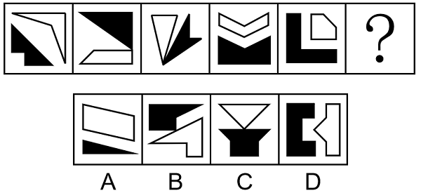

# 数量规律-线数量（边数）-黑白图形分开数并作差找奇偶交替

考点：[[20-考点/判断推理/图形推理/数量规律-线数量（边数）-黑白图形分开数并作差找奇偶交替|图形推理 / 数量规律-线数量（边数）-黑白图形分开数并作差找奇偶交替]]

**问法模型**：一组黑白组合图形问号处选最合适一项使之呈现规律性 → 元素组成不同且无属性规律时转数量规律，黑白分开数边数并作差找交替规律

## 推理链
1. 第1步：题干5幅图均由一个黑色图形和一个白色图形构成，元素组成不同，对称、曲直等属性规律不明显
2. 第2步：每个图形都是简单多边形，优先考虑数量规律中的边数，且黑色、白色图形应分开计数
3. 第3步：黑色图形边数依次为5、3、4、5、6，白色图形边数依次为4、4、3、6、5，两组数列单独看均无规律
4. 第4步：考虑两组数列作差运算：图1黑5-白4=1，图3黑4-白3=1，图5黑6-白5=1，奇数位均为黑-白=1
5. 第5步：图2白4-黑3=1，图4白6-黑5=1，偶数位均为白-黑=1，构成奇偶交替规律
6. 第6步：？处为图6（偶数位），应满足白色图形边数-黑色图形边数=1
7. 第7步：逐项对照：A项白色四边形4条边-黑色三角形3条边=1，符合；B、C、D项黑白边数差均不满足白-黑=1，故选A

**最快解法**：⚡ 黑白分开数边数+作差口诀：先验奇数位黑-白=1成立，则问号处直接找'白边数比黑边数多1'的选项，A项白4黑3秒中

## 易错点
- ⚠ 只数整体线条数或不区分黑白统一计数，漏掉'黑白分开看'这一拆分思路
- ⚠ 作差方向搞反：交替规律中奇数位是黑-白=1、偶数位是白-黑=1，若全程统一用黑-白，会在偶数位误判出-1而排除正确项
- ⚠ 数错边数：箭头形、凹多边形（如B项白色箭头形）的边易漏数或多数，导致代入选项时判断失误

## 母题抽象
> 🧩 当题干出现'黑白图形组合、元素组成不同且无属性规律'的特征时，分开数黑白图形的边数（或面数、交点数），两组数列单独无规律就作差，验证奇偶项交替差值（如黑-白=1与白-黑=1交替）

**同类特征**：黑色图形与白色图形共存、元素组成不同且无属性规律、均为简单多边形、黑白分开数边数、单独数列无规律需作差、奇偶项交替差值

## 相关题
- [[10-真题/判断推理/图形推理/10204622 图形推理-数量规律-笔画数（一笔画判定）|10204622]]（辽宁 2024，相关度1）
- [[10-真题/判断推理/图形推理/11367773 数量规律-一笔画（奇点数）+面的形状（三角形面个数）双规律|11367773]]（江苏 2025，相关度1）
- [[10-真题/判断推理/图形推理/12019817 数量规律-面的细化（面的形状：所有面均为四边形）|12019817]]（浙江 2026，相关度1）
- [[10-真题/判断推理/图形推理/13504266 数量规律-交点数（曲直交点数量+交点形态交替规律）|13504266]]（云南 2025，相关度1）
- [[10-真题/判断推理/图形推理/13504600 数量规律-多边形元素边数递减（等差数列）|13504600]]（辽宁 2025，相关度1）

---

### 题干

从所给的四个选项中，选择最合适的一项填入问号处，使之呈现一定的规律性：

### 选项
- A. A　✅
- B. B
- C. C
- D. D

### 官方解析
元素组成不同，且无明显属性规律，考虑数量规律。观察发现，图形均由黑色图形和白色图形构成，可以考虑分开看，每个图形都是简单多边形，可以优先考虑数黑色图形和白色图形的边数。题干中黑色图形的边数依次为5、3、4、5、6，白色图形的边数依次为4、4、3、6、5，单看无规律，考虑运算发现，图1、图3、图5中黑色图形边数-白色图形边数=1，图2、图4中白色图形边数-黑色图形边数=1，为交替规律，故？处图形的白色图形边数-黑色图形边数=1，只有A项符合。
故正确答案为A。

### 给定材料
（无）
