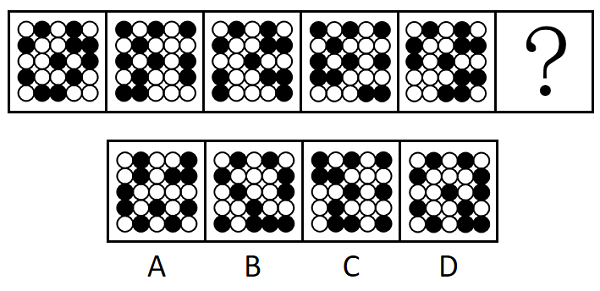
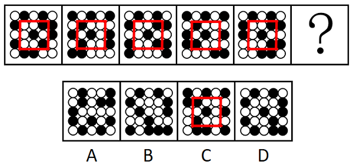

# 位置规律（平移-内外圈分层观察）

考点：[[20-考点/判断推理/图形推理/位置规律（平移-内外圈分层观察）|图形推理 / 位置规律（平移-内外圈分层观察）]]

**问法模型**：‘填入问号处使之呈现规律性’且元素组成相同、黑块数量恒定 → 采用位置规律模型，将二十五宫格拆成内外圈分开看平移轨迹

## 推理链
1. 第1步：题干五幅图均为二十五宫格，黑块数量相同、元素组成相同，故排除样式类，优先考虑位置规律（平移）
2. 第2步：将二十五宫格拆分为外圈16格与内圈九宫格两层，分层观察黑块轨迹（题干各图中间黑块数量相同是分层提示）
3. 第3步：内圈九宫格中，最中心的黑块位置始终不变（锚点），另外两个黑块每次顺（逆）时针移动4格，等价于两个黑块左右两边位置交替
4. 第4步：外圈的所有黑块每次沿顺时针方向平移1格
5. 第5步：用上述两条规律从第5幅图外推问号处（第6幅图）内、外圈各黑块应落的位置
6. 第6步：逐项对照A/B/C/D，只有C项的内圈黑块（中心不动＋两块左右交替）与外圈黑块（顺时针移1格）位置同时吻合，故选C

**最快解法**：⚡ 内外圈分层法＋锚点法：先锁定内圈最中心不动的黑块作锚点，再看内圈另两块‘左右交替’、外圈黑块‘顺时针移1格’，两步排除直接锁定C

## 易错点
- ⚠ 把内、外圈黑块混在一起整体找轨迹，移动路径交叉导致无法归纳规律
- ⚠ 忽略‘最中心黑块固定不动’这一锚点，误以为所有黑块都在移动
- ⚠ 外圈方向或格数数错（应顺时针1格），或未识别内圈‘移动4格’与‘左右两边位置交替’是同一规律的两种表述

## 母题抽象
> 🧩 当题干出现‘宫格＋黑块数量恒定＋元素组成相同’的特征时，用内外圈分层平移法：先找固定不动的锚点块，再分别数内圈、外圈黑块的移动方向与格数，外推下一幅图并验证选项

**同类特征**：二十五宫格、黑块数量相同、元素组成相同、内外圈结构、黑块平移、顺时针移动

## 相关题
- [[10-真题/判断推理/图形推理/12881947 位置规律-平移（十六宫格内外圈分开看，顺-逆时针逐格移动）|12881947]]（广东 2025，相关度2）
- [[10-真题/判断推理/图形推理/16593031 位置规律-平移（内外圈分组移动）|16593031]]（青海 2024，相关度2）
- [[10-真题/判断推理/图形推理/2616491 图形推理-位置规律（平移-旋转移动步数）|2616491]]（深圳市考 2020，相关度2）
- [[10-真题/判断推理/图形推理/2776045 位置规律-动态位置（多元素分轨道循环移动：内圈-外圈+不同步长）|2776045]]（浙江 2021，相关度2）
- [[10-真题/判断推理/图形推理/2172768 位置规律（旋转-翻转）|2172768]]（海南 2021，相关度1）

---

### 题干

从所给的四个选项中，选择最合适的一项填入问号处，使之呈现一定的规律性：

### 选项
- A. A
- B. B
- C. C　✅
- D. D

### 官方解析

元素组成相同，优先考虑位置规律。题干图形均出现了二十五宫格，且中间黑块数量相同，优先考虑内外圈分开看平移。观察发现，内圈九宫格最中心黑块位置不变，其余两个黑块每次顺（逆）时针移动4格（也可以看成两个黑块左右两边位置交替），最外圈黑块每次顺时针平移1格，只有C项符合。

故正确答案为C。

### 给定材料
（无）
