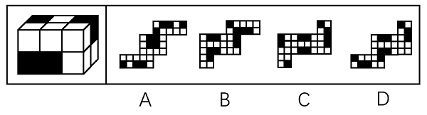

# 空间重构-外表面展开图（面一一对应-无中生有面排除）

考点：[[20-考点/判断推理/图形推理/空间重构-外表面展开图（面一一对应-无中生有面排除）|图形推理 / 空间重构-外表面展开图（面一一对应/无中生有面排除）]]

**问法模型**：问'哪一个不可能是其外表面展开图'（选非题）→ 先给立体外表面各面标号记图案，再用'面一一对应法'逐项核对，找出出现'无中生有面'的选项

## 推理链
1. 第1步：题干立体为8个白色正方体+4个黑色正方体粘接的3×2×2长方体（共12块），外表面共6个面，每个面由若干黑白小方格拼成特定图案
2. 第2步：依官方解析给六个外表面标号：e正面、f顶面、k右侧面、i左侧面、g背面、h底面，并记录各面的黑白格图案与相邻关系
3. 第3步：确立判定规则——合法展开图折叠后，每个面必须与立体外表面某一面图案完全对应，不能出现立体上不存在的面
4. 第4步：A项：展开图6个面与标号外表面一一对应，可折成原长方体，排除
5. 第5步：B项：6个面与外表面一一对应，排除；C项：6个面与外表面一一对应，排除
6. 第6步：D项：左下角的面和右侧的面在6个标号外表面中找不到任何对应图案，属'无中生有的面'，不可能折出题干长方体
7. 第7步：本题为选非题（问'不可能'），故正确答案为D

**最快解法**：⚡ 无中生有排除法（标号对照）：先给立体图6个外表面标号并记下各面黑白图案，再快速扫视四个展开图——D项左下角的面和右侧面的黑白图案在6个标号面中均无对应，直接锁定D，无需逐面折叠验证

## 易错点
- ⚠ 审题忽略'不可能是'为选非题，排除A/B/C后误选成'可能'的项
- ⚠ 只核对黑白格总数量、不比对每个面的完整图案形状，把陌生面误当作背面或底面的图案
- ⚠ 忽略面的方向性：展开图中面经旋转后图案须与标号面一致，易把D中不存在的面误判为可翻转对应的合法面

## 母题抽象
> 🧩 当题干给出黑白小正方体粘接组合体的立体图并问'哪个不是其外表面展开图'时，用标号法先记录六个外表面的黑白图案，再逐项核对展开图各面是否存在对应面——出现'无中生有'的面即为答案。

**同类特征**：8白4黑正方体粘接成长方体、问'哪个不可能是外表面展开图'（选非）、各外表面为黑白小方格图案、展开图面须与立体面一一对应、存在'无中生有面'的选项即为答案、空间重构类展开图题型

## 相关题
（暂无）

---

### 题干

左图为8个白色正方体和4个黑色正方体粘接而成的长方体，问以下哪一个不可能是其外表面展开图？

### 选项
- A. A
- B. B
- C. C
- D. D　✅

### 官方解析

将长方体的外表面依次标上序号，如下图所示，面e为正面、面f为顶面、面k为右侧面、面i为左侧面，面g为背面，面h为底面，逐一分析选项。

A项：展开图的6个面（如上图所示）与长方体的外表面一一对应，选项与题干一致，排除；

B项：展开图的6个面（如上图所示）与长方体的外表面一一对应，选项与题干一致，排除；

C项：展开图的6个面（如上图所示）与长方体的外表面一一对应，选项与题干一致，排除；

D项：展开图中左下角的面和右侧的面为无中生有的面，选项与题干不一致，当选。

本题为选非题，故正确答案为D。

### 给定材料
（无）
