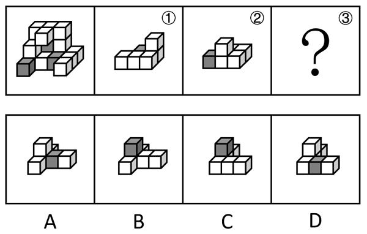
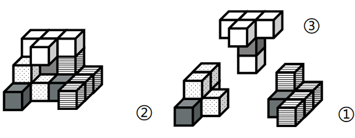

# 立体拼合（多块拼合-凹凸互补+灰色块颜色对应）

考点：[[20-考点/判断推理/图形推理/立体拼合（多块拼合-凹凸互补+灰色块颜色对应）|图形推理 / 立体拼合（多块拼合-凹凸互补+灰色块颜色对应）]]

**问法模型**：整体多面体=①+②+③，已知①②求问号处的③ → 用'凹凸互补+颜色守恒'拼合模型：先看灰块数量与位置，再让剩余空腔与选项经三维旋转后咬合

## 推理链
1. 第1步：从题干提取前提——整体多面体由15个白色和3个灰色正方体（共18块）组成，可拆成①、②、③三块，其中②的左前端含1个灰色正方体，①为全白阶梯状块体
2. 第2步：颜色守恒——整体共3个灰色块，②已含1个，故①与③须合计提供另外2个灰块，③中灰块的数量和摆放位置由此受限
3. 第3步：形状守恒（凹凸互补）——将①、②在三维空间中旋转后放入整体，剩余空腔的凹凸轮廓即为③的形状，块的凸起必须恰好填入整体的凹陷
4. 第4步：定位灰块——整体中灰色正方体位于底层左前角及中层中部区域，多被白色正方体包围，故③的灰块应处于块体中部而非顶层突出端点
5. 第5步：逐项排除——B、C项的灰色块位于凸起的顶端位置，与整体中被包围的灰色正方体位置不对应；D项底排灰块虽在下层，但其凹凸轮廓与剩余空腔不互补
6. 第6步：验证A项——A项的凹凸轮廓与①②放入后剩下的空腔完全咬合，其灰色块恰嵌入整体中层灰色位置，三者拼合即还原题干多面体，故选A

**最快解法**：⚡ 凹凸互补法+颜色定位：先在整体图中'挖去'①和②，把剩余空腔（注意块体可三维旋转）与四个选项比对轮廓，再用灰块'居中被包围'的位置特征排除B、C、D，锁定A

## 易错点
- ⚠ 只比对形状不做颜色守恒：忽略灰块数量与位置的对应关系，误选灰块在顶端的B或C
- ⚠ 忽视三维旋转：把选项按纸面呈现方向直接硬套，未旋转就判定'不吻合'而错排正确项
- ⚠ 凹凸方向看反：将空腔的凸凹与块体的凸凹弄反，产生镜像错误
- ⚠ 忽略被遮挡方块：整体中被遮挡的灰色正方体未纳入考量，导致灰块位置判断失误

## 母题抽象
> 🧩 当题干出现'整体多面体可由①②③拼合、求问号处一块'的特征时，用凹凸互补法：先据灰色块的数量与位置排除明显不符项，再将剩余空腔经三维旋转与选项咬合验证

**同类特征**：15个白色+3个灰色正方体、三个多面体拼合成整体、问号处填入哪项、已知①②两块的形状、灰色方块颜色定位、立体拼合-凹凸互补

## 相关题
- [[10-真题/判断推理/图形推理/13504321 立体拼合-多面体组合（选非题）|13504321]]（云南 2025，相关度1）
- [[10-真题/判断推理/图形推理/5510151 立体拼合（小方块数量守恒+凹凸互补）|5510151]]（广西 2023，相关度1）

---

### 题干

左图为15个白色正方体和3个灰色正方体组合而成的多面体，其可以由①、②和③三个多面体组合而成，问哪项能填入问号处？

### 选项
- A. A　✅
- B. B
- C. C
- D. D

### 官方解析

本题考查立体拼合，如下图所示，立体图形可由①、②以及A项拼合而成。

故正确答案为A。

### 给定材料
（无）
