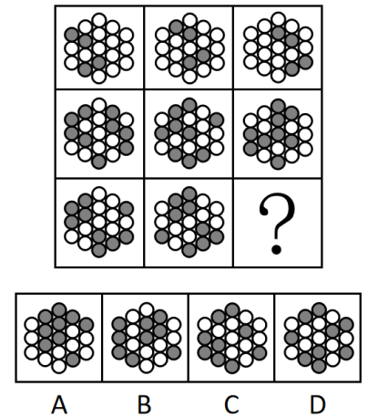
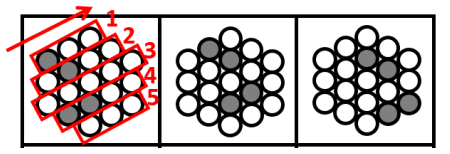
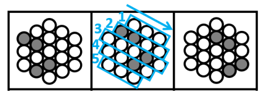
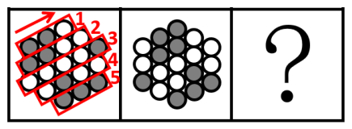
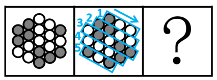
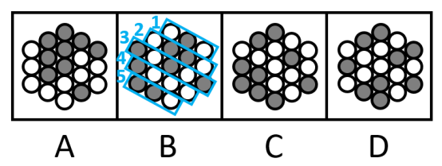
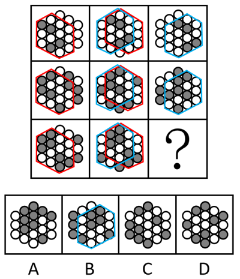

# 位置规律-平移（黑球整体移动+到头循环）

考点：[[20-考点/判断推理/图形推理/位置规律-平移（黑球整体移动+到头循环）|图形推理 / 位置规律-平移（黑球整体移动+到头循环）]]

**问法模型**：九宫格填问号求规律 → 元素组成相同优先看位置类，横行相邻比较找黑球整体平移路径

## 推理链
1. 第1步：九宫格每行图形的框架（蜂窝状圆圈阵）与黑球数量完全相同，仅黑白分布变化，判定为位置类规律
2. 第2步：九宫格优先看横行，第一行图1→图2：所有黑球沿右上方方向整体移动一格
3. 第3步：第一行图2→图3：所有黑球沿右下方方向整体移动一格（到头循环走），规律成立
4. 第4步：用第二行验证：图1黑球右上移一格得图2、图2黑球右下移一格（循环）得图3，规律一致
5. 第5步：第三行应用规律：图1黑球右上移一格得图2（与题面图2吻合），再将图2黑球沿右下方移动一格（到头循环走）
6. 第6步：逐项对照：B项黑球分布与平移结果完全一致；A、C、D均存在黑球位置不吻合
7. 第7步：辅助验证（解析二）：每行相邻两图均有一局部区域黑白球摆放相同，？处应与第三行图2存在局部区域相同，仅B满足

**最快解法**：⚡ 整体平移法：每行'图1→图2黑球整体右上移一格，图2→图3黑球整体右下移一格（到头循环）'，直接将第三行图2的黑球沿右下方移动一格，与选项比对秒选B

## 易错点
- ⚠ 误以为只需追踪单个黑球，忽略'所有黑球同步整体平移'，导致个别位置对不上而误判
- ⚠ 忽略'到头循环走'规则，处在边缘的黑球移动一格后应循环回到另一侧，漏掉循环会排除正确答案B
- ⚠ 被解析二'部分区域黑白球相同'的局部相似性干扰，可能误选与图2局部相似但整体平移不符的选项

## 母题抽象
> 🧩 当九宫格各行元素组成完全相同、仅黑白球（或色块）分布变化时，优先横向找'整体平移+到头循环'规律，验证一行后套用到所求行再比对选项

**同类特征**：九宫格、每行元素组成相同、黑白球分布变化、蜂窝状圆圈阵列、位置规律-平移、到头循环走

## 相关题
- [[10-真题/判断推理/图形推理/10204610 样式规律-加减同异（去同存异），九宫格列规律|10204610]]（辽宁 2024，相关度1）
- [[10-真题/判断推理/图形推理/10297349 样式规律-黑白运算|10297349]]（浙江 2025，相关度1）
- [[10-真题/判断推理/图形推理/10297407 样式规律-黑白运算（定义叠加）|10297407]]（四川 2025，相关度1）
- [[10-真题/判断推理/图形推理/10975255 数量规律-元素个数与部分数（黑白球连通堆数）|10975255]]（江苏 2024，相关度1）
- [[10-真题/判断推理/图形推理/11367791 属性类-对称性（对称轴方向与条数、轴对称+中心对称）＋数量类-面数量（九宫格横行复合规律）|11367791]]（江苏 2025，相关度1）

---

### 题干

从所给的四个选项中，选择最合适的一项填入问号处，使之呈现一定的规律性：

### 选项
- A. A
- B. B　✅
- C. C
- D. D

### 官方解析

解析一：九宫格每行元素组成相同，优先考虑位置规律。九宫格优先看横行，第一行图形中，图1所有黑球沿如下图所示方向往右上方移动一格后得图2。

图2所有黑球沿如下图所示方向往右下方移动一格后得图3。

经验证，第二行满足相同的规律（到头循环走），如下图所示：

第三行应用规律，图1所有黑球沿如下图所示方向往右上方移动一格后得图2（到头循环走）。

图2所有黑球沿如下图所示方向往右下方移动一格（到头循环走）得到B项。

故正确答案为B。

解析二：九宫格每行元素组成相同，优先考虑位置规律。九宫格优先看横行，每横行相邻比较发现，相邻的两幅图都有一部分区域黑白球的位置摆放相同，如下图所示，以此类推，？处应选择一个和第三行图2拥有一部分区域黑白球的位置摆放相同的图形，只有B项符合。

故正确答案为B。

备注：两种解析思路均可得出正确答案B，由于解析一考查的是全部黑球的平移规律，解析二相同的是部分区域，比较而言解析一的规律更为严谨，故粉笔更倾向于本题考查平移规律。

### 给定材料
（无）
