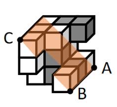
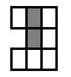

# 截面图-立体切割（三点定面确定截面）

考点：[[20-考点/判断推理/图形推理/截面图-立体切割（三点定面确定截面）|图形推理 / 截面图-立体切割（三点定面确定截面）]]

**问法模型**：题干要求确定'经A、B、C三个顶点的平面'切割多面体后的正确截面 → 用'三点定面'锁定唯一截面，沿截面路径逐格记录灰白分布并与选项比对（允许整体翻转）

## 推理链
1. 第1步：题干给出由13个白色正方体和5个灰色正方体组合而成的多面体，并在立体图上标注三个顶点A（右侧）、B（前下方）、C（左侧），四个选项均为3×3方格的灰白分布图
2. 第2步：依据平面公理'过不在一条直线上的三点，有且只有一个平面'，A、B、C三点唯一确定一个截面平面，截面被小正方体的棱分割为3×3方格
3. 第3步：沿A、B、C三点两两连线在多面体上的路径追踪截面走向，逐格记录截面所切到的正方体颜色：部分格子切到灰色正方体呈灰色，其余为白色
4. 第4步：逐项对照：A、C、D中灰块的位置/分布与实际截面的灰白分布不符，予以排除
5. 第5步：将所得截面整体'上下翻转'后，灰块分布与B选项完全一致，故正确答案为B

**最快解法**：⚡ 三点定面+描点追踪法：先连A、B、C确定唯一截面，沿截面依次经过的小正方形逐格涂色（灰/白）得到3×3分布，与选项比对时若方向不符则整体上下翻转后再对照，翻转后吻合的即为答案（本题对应B）

## 易错点
- ⚠ 忽略截面可以整体'上下翻转'与选项比对，按固定朝向硬套而误选或误排
- ⚠ 看错A、B、C三点各自所在的棱和位置，导致截面路径追踪错误、灰块位置判断失误
- ⚠ 误以为截面上所有灰色正方体位置都要着色，实际只有截面路径切到的小格才显灰色

## 母题抽象
> 🧩 当题干出现'过立体图形三个顶点的平面进行切割、求正确截面'的特征时，用'三点定面+逐格描色'法：沿三顶点连线追踪截面经过的小正方形并记录灰白分布，与选项比对时允许整体翻转后再定答案

**同类特征**：13个白色正方体与5个灰色正方体组合的多面体、经A、B、C三个顶点的平面切割、三点确定一个唯一平面、选项为3×3灰白方格截面图、截面可上下翻转后比对

## 相关题
（暂无）

---

### 题干

左图为13个白色正方体和5个灰色正方体组合而成的多面体，现用经A、B、C三个顶点的平面对该多面体进行切割，正确的截面是：

### 选项
- A. A
- B. B　✅
- C. C
- D. D

### 官方解析

本题考查截面图。根据平面公理“过不在一条直线上的三点，有且只有一个平面”得出A、B、C三个点可以确定一个唯一的截面，如下图所示：

将截面上下翻转后即可得到如下截图：

故正确答案为B。

### 给定材料
（无）
