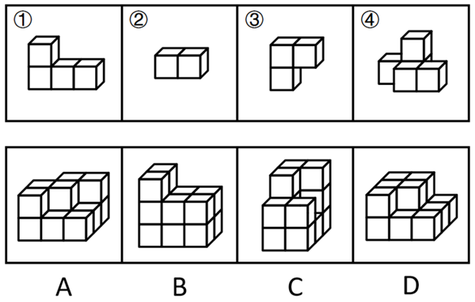
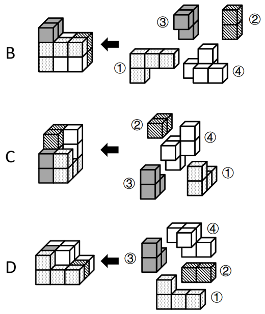

# 立体拼合-多组件拼合（凹凸互补+块数守恒）

考点：[[20-考点/判断推理/图形推理/立体拼合-多组件拼合（凹凸互补+块数守恒）|图形推理 / 立体拼合-多组件拼合（凹凸互补+块数守恒）]]

**问法模型**：问'哪一项无法由①~④各使用一次拼出'（选非题）→ 先数块数核对总量，再逐项凹凸试拼排除可拼项，锁定无法拼合（或存疑）的一项

## 推理链
1. 第1步：数块核对——组件①为4块（下层一排3块、上层左端1块的L形），②为2块（1×2双块），③为3块（L形三连块），④为4块（下层3块、上层1块的带凸起组合），四个组件合计13个小正方体，且须各使用一次
2. 第2步：明确拼合规则——组件可三维旋转、翻转，拼合时凹凸互补，块数必须与目标体恰好吻合，被视线遮挡的位置需结合轮廓与块数综合判断
3. 第3步：验证B项——按官方拼合图，①横置嵌入B的前部两排，③旋转后补足左后高台阶，②填补剩余缺缝，④扣合顶部凹陷，13块恰好拼满，B可拼出
4. 第4步：验证C项——③竖立构成C的高柱部分，④的单块凸起补柱顶，①铺满底层平台，②补齐缺角，C可拼出
5. 第5步：验证D项——①平铺作D的下层主体，④补第二层，②与③分别填补缺角与前伸排，D可拼出
6. 第6步：检验A项——A顶层中部凹陷恰需④的凸起填入，但A最下层左上角（箭头所指处）被视线遮挡，无法从图中确定该处是否有正方体
7. 第7步：分类讨论——若该角有方块，A可由①~④各用一次拼出；若该角无方块，则A无法拼出。因图面无法判定且B、C、D确定可拼，选非题倾向选A

**最快解法**：⚡ 数块+排除法：先数四个组件共13块核对目标体块数；B、C、D按官方拼合图逐一验证可拼出予以排除；A中被遮挡的下层左上角若按'无块'处理则块数/形状不匹配、无法拼满，选非题锁定A。考场遇到此类遮挡存疑的立体拼合，快速数块+排除可拼项即可，不必深究

## 易错点
- ⚠ 忽视视线遮挡的角块：直接按可见方块数拼合A，或想当然认为箭头处必有/必无方块而误判
- ⚠ 忘记组件可三维旋转、翻转，只按原图朝向硬套，把可拼项误判为无法拼出
- ⚠ 忽略'各使用一次'的约束导致块数不守恒；且本题为官方自认争议题，过度纠结浪费时间

## 母题抽象
> 🧩 当题干给出若干小方块组合体并问'哪个无法拼出目标体'时，先数块数核对总量是否守恒，再逐项凹凸互补试拼排除；凡遇视线遮挡位置，按块数守恒分类讨论，此类遮挡存疑题多为争议题，快速排除确定可拼项即可

**同类特征**：四个小多面体、等大正方体组成、各使用一次、选非题（问无法拼出）、立体拼合凹凸互补、存在视线遮挡角块

## 相关题
（暂无）

---

### 题干

下图四个小多面体均由等大的正方体组成。下面哪一项无法由①~④在使用一次的情况下拼出？

### 选项
- A. A　✅
- B. B
- C. C
- D. D

### 官方解析

本题考查立体拼合。B、C、D三项均可以由①~④在使用一次的情况下拼出，拼合方式如下图所示。

对于A项，由于视角问题，无法确定A项最下层的左上角（如箭头所示）是否有正方体。如果此处有正方体，则A项可以由①~④在使用一次的情况下拼出，拼合方式如下图所示；如果此处没有正方体，则A项无法拼出，因此，粉笔更倾向于选择A项。

本题为选非题，故正确答案为A。

注：本题为争议题，大家了解基本解题思路即可，无需作为备考重点。

### 给定材料
（无）

> [!warning] 疑点（官方解析可能有误，待人工复核）
> 官方解析自认争议题：A项能否拼出取决于被遮挡的下层左上角有无方块，图面无法判定；若该处有方块，则A、B、C、D四项均可拼出，题目将不存在答案。故答案A依赖'该角无方块'的倾向性假设，命题视角存在歧义漏洞，但按官方给定答案仍为A

<!-- CODEX-ANSWER-REVIEW:BEGIN -->
### 本次独立复核

**复核状态：** `resolved`（答案与解析已核定）

**计分答案：** A（可计分）

**复核解析：**

【编辑补明图示】固定题源图被遮挡的底层左上角没有方块。按四个小多面体各使用一次进行拼合，A不能由①—④恰好拼出；若擅自补入该缺失方块，则A也可能拼出并导致无解。明确遮挡处为空后答案A唯一。

**修订材料：**

【编辑补充图示条件】题图被遮挡的底层左上角位置没有正方体。其余图形和选项均按固定题图。

**相关信息：**

立体拼合—先确认被遮挡体素，再以方块总量及凹凸互补逐项拼合。

**题源依据：** [固定版本原题](https://github.com/Mentat-Uran/kaogongzhentizhengliu/blob/84ab93d4b64b61d897bece8a1c0a5bab06b4feb2/10-%E7%9C%9F%E9%A2%98/%E5%88%A4%E6%96%AD%E6%8E%A8%E7%90%86/%E5%9B%BE%E5%BD%A2%E6%8E%A8%E7%90%86/5908635%20%E7%AB%8B%E4%BD%93%E6%8B%BC%E5%90%88-%E5%A4%9A%E7%BB%84%E4%BB%B6%E6%8B%BC%E5%90%88%EF%BC%88%E5%87%B9%E5%87%B8%E4%BA%92%E8%A1%A5%2B%E5%9D%97%E6%95%B0%E5%AE%88%E6%81%92%EF%BC%89.md)；固定内容 commit `84ab93d4b64b61d897bece8a1c0a5bab06b4feb2`，Markdown blob `f6d71e1a6003e2f9f4cce3676b47600de5627925`。
<!-- CODEX-ANSWER-REVIEW:END -->
