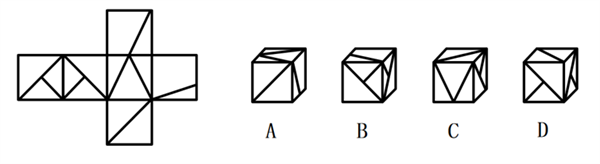
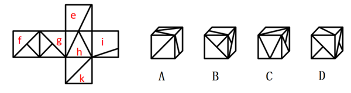
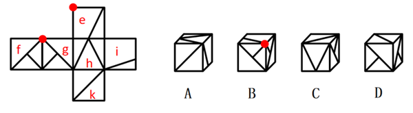
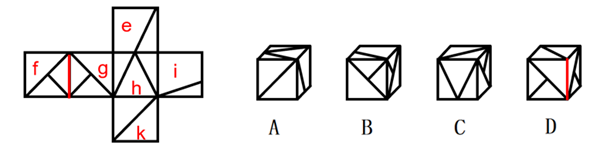

# 空间重构-六面体折叠（公共边法＋公共点法）

考点：[[20-考点/判断推理/图形推理/空间重构-六面体折叠（公共边法＋公共点法）|图形推理 / 空间重构-六面体折叠（公共边法＋公共点法）]]

**问法模型**：'左边给定纸盒外表面展开图，右边哪项能由它折叠而成'→ 空间重构题：先排相对面同现，再用相邻面公共边/公共点上的图案特征逐项验证

## 推理链
1. 第1步：题干为六面体外表面展开图，各面内含大三角形、小直角三角形、斜线等图案，先对展开图各面编号为e、f、g、h、k以便定位
2. 第2步：标出相对面：面h与面f为相对面，依据'相对面不能同时出现'，立体图中二者只能出现其一，可先行排除面组合错误
3. 第3步：A项出现面h、面k：展开图中h、k两面的公共边是面h内'大三角形的边'，选项中该公共边却对应面h内'小直角三角形的直角边'，公共边特征不符，排除
4. 第4步：B项由面f、面g、面e构成：展开图中三面公共点'不与面e的斜线相交'，选项中公共点'与斜线相交'，公共点特征不符，排除
5. 第5步：D项由面f、面g、面k构成：展开图中面f与面g的公共边两侧分别挨着两面的'小三角形'，选项中公共边却挨着'大三角形'，特征不符，排除
6. 第6步：C项由面h、面k、面g构成（不可能是面f，因h与f为相对面），其公共边、公共点图案特征均与展开图一致，当选C

**最快解法**：⚡ 相对面排除＋公共边/公共点定位法：先确认h与f相对（立体图只能含其一），再逐项核对公共边挨着'大三角形还是小三角形'、公共点是否穿过'斜线'，仅C项全部吻合

## 易错点
- ⚠ 忽略公共边两侧图案的'大小'之别：A项把小直角三角形的直角边误看成大三角形的边
- ⚠ 忽视公共点与斜线'相交/不相交'的细节差异，误选B
- ⚠ 未先用相对面规则锁定C项面组合为h、k、g，误纠结C项是否可能含面f

## 母题抽象
> 🧩 当题干给出带图案（三角形、斜线等）的六面体展开图要求折叠时，先标相对面排除同现选项，再用相邻面'公共边挨着什么图案、公共点是否与线相交'的特征法逐项验证

**同类特征**：纸盒外表面展开图折叠、各面含三角形/斜线图案、相对面不能同时出现、相邻面公共边图案对应、公共点与斜线相交关系、问哪项能折叠而成

## 相关题
- [[10-真题/判断推理/图形推理/12561915 空间重构-六面体折叠（相对面排除+公共点法）|12561915]]（浙江 2024，相关度2）
- [[10-真题/判断推理/图形推理/1746880 空间重构-六面体折叠（相对面排除+画边法）|1746880]]（国考 2016，相关度2）
- [[10-真题/判断推理/图形推理/2172154 空间重构-六面体折纸盒（相对面排除＋公共点法）|2172154]]（广州市考 2018，相关度2）
- [[10-真题/判断推理/图形推理/2367990 空间重构-六面体折叠（相对面排除＋相邻面特征边验证）|2367990]]（江苏 2019，相关度2）
- [[10-真题/判断推理/图形推理/4928010 空间重构-折纸盒（相对面排除+公共边-公共点法）|4928010]]（选调 2022，相关度2）

---

### 题干

左边给定的是纸盒的外表面展开图，右边哪项能够由它折叠而成？

### 选项
- A. A
- B. B
- C. C　✅
- D. D

### 官方解析

对题干展开图进行编号，如下图所示，逐一分析选项：

A项：选项出现面h、面k，题干展开图中这两个面的公共边对应面h内大三角形的边，选项中这两个面的公共边对应面h内小直角三角形的直角边，选项与题干展开图不一致，排除；

B项：选项由面f、面g、面e构成，题干展开图中这三个面的公共点与面e中的斜线不相交，而选项中这三个面的公共点与面e中的斜线相交，选项与题干展开图不一致，排除；

C项：选项由面h、面k和面g（不可能是面f，因面h与面f为相对面，相对面不能同时出现）构成，选项与题干展开图一致，当选；

D项：选项由面f、面g和面k构成，题干展开图中面f和面g的公共边分别挨着两个面中的小三角形，而选项中面f与面g的公共边分别挨着两个面中的大三角形，选项与题干展开图不一致，排除。

故正确答案为C。

### 给定材料
（无）
