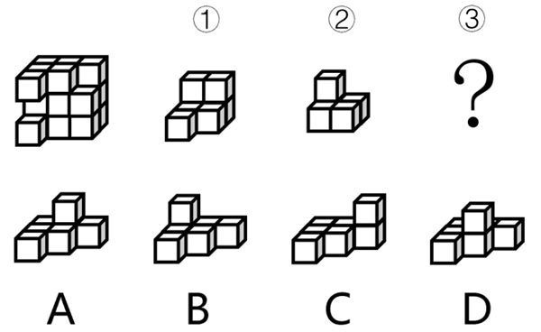
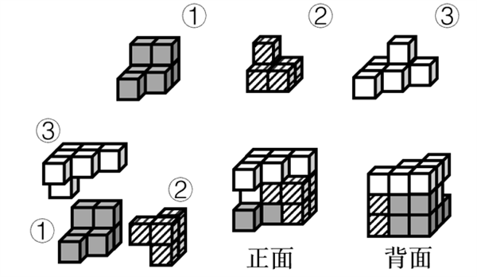

# 立体拼合-小方块组合拼合（凹凸互补）

考点：[[20-考点/判断推理/图形推理/立体拼合-小方块组合拼合（凹凸互补）|图形推理 / 立体拼合-小方块组合拼合（凹凸互补）]]

**问法模型**：立体图形由①、②和③拼合组成、选一项填入问号 → 凹凸互补嵌入法：先嵌入特征最独特的已知组件，剩余空缺与选项逐项比对

## 推理链
1. 第1步：目标立体是由小方块堆叠成的凹凸体，左前方中部和底部各有一小方块向前凸出、呈阶梯状；①、②形状固定，③为待选组件
2. 第2步：方法——立体拼合用「数量守恒+凹凸互补」：①、②与③的小方块数之和应等于目标体，且各组件的凸起必须恰好嵌入目标体及彼此的凹位
3. 第3步：先嵌特征最独特的组件：①为双层阶梯块（下层两块、上层两块错位），②为顶部单块、底部多块的塔状块，将二者的凸起对准目标体的凹槽试放入
4. 第4步：①、②放入后，目标体剩余空缺的形状为「底层一排约4块、其上一列向上叠出塔状凸起」
5. 第5步：逐项对照：A项底层排布与塔状凸起的位置、朝向与剩余空缺完全吻合；B、C、D是塔的位置或底层走向不同的旋转/镜像干扰项，无法与空缺无缝嵌合
6. 第6步：与选项对照，仅A能与①、②拼成题干立体图形，与官方解析一致，故选A

**最快解法**：⚡ 凹凸互补法+排除法：先把特征最独特的②（上1下多塔状）和①（双层阶梯）嵌入目标体，剩余空缺直接与四个选项比对凸起位置和朝向，仅A吻合，秒选A

## 易错点
- ⚠ B/C/D多为正确项的空间旋转或镜像变形，只看平面轮廓不比对凹凸朝向就会选错
- ⚠ 忽略被遮挡的小方块，导致目标体或组件的方块数数错
- ⚠ 只做方块数量校验、不做形状嵌入（二级辨析缺位），数量相近的选项无法区分

## 母题抽象
> 🧩 当题干出现「立体图形由①②（③）拼合/组成，选一项填入问号」时，用凹凸互补嵌入法：先嵌形状最独特的组件，剩余空缺与选项逐项比对凸起位置与朝向，验证能否无缝拼合

**同类特征**：立体拼合、由①②③组成、问号处填入、小方块堆叠体、凹凸互补、旋转/镜像干扰项

## 相关题
- [[10-真题/判断推理/图形推理/5510232 立体拼合（小方块组合成立方体-凹凸互补）|5510232]]（广东 2023，相关度3）
- [[10-真题/判断推理/图形推理/12881949 立体拼合-多块拼合正方体（凹凸互补+旋转）|12881949]]（广东 2025，相关度2）
- [[10-真题/判断推理/图形推理/18649987 立体拼合（多面体拆分组合+旋转匹配）|18649987]]（选调 2025，相关度2）
- [[10-真题/判断推理/图形推理/2448540 立体拼合（多视图还原+组件拼合互补）|2448540]]（国考 2020，相关度2）
- [[10-真题/判断推理/图形推理/2719441 立体拼合（多面体切割重组，凹凸互补）|2719441]]（国考 2021，相关度2）

---

### 题干

左边的立体图形是由①、②和③组成的，下列哪项可以填入问号处？

### 选项
- A. A　✅
- B. B
- C. C
- D. D

### 官方解析

本题考查立体拼合。如下图所示，题干立体图形可以由①、②以及A项拼合而成。

故正确答案为A。

### 给定材料
（无）
